# 系統分析簡報資料：學校自動排課系統

> 本文件整理「系統分析與設計」簡報需要的全部資訊：專案背景、可行性分析、SDLC 各階段、需求分析、DFD、UML（使用案例圖、類別圖、循序圖、活動圖、狀態圖、元件圖、部署圖）、ERD 與資料字典、測試與成果。
>
> - 內容依據：`README.md`、`docs/SYSTEM_DESIGN.md`、`AGENTS.md`、`backend/`、`scheduling_engine/`、`frontend/src/` 原始碼與 git 歷史（整理日期 2026-11-13）。
> - 圖表都用 **Mermaid** 撰寫，可以貼到 GitHub、Notion、Obsidian、VS Code（Markdown Preview Mermaid 外掛）或 [mermaid.live](https://mermaid.live) 匯出成 PNG/SVG 再放進投影片。
> - Mermaid 沒有原生的「使用案例圖」與「DFD」語法，本文用 flowchart 模擬（演員 / 外部實體用方框、處理用圓角、資料儲存用圓柱），正式繪製可以改用 draw.io、StarUML、Visual Paradigm 照著畫。

---

## 目錄

0. [簡報大綱建議（約 20 頁）](#0-簡報大綱建議約-20-頁)
1. [專案概述](#1-專案概述)
2. [可行性分析](#2-可行性分析)
3. [SDLC 系統開發生命週期](#3-sdlc-系統開發生命週期)
4. [需求分析](#4-需求分析)
5. [DFD 資料流程圖](#5-dfd-資料流程圖)
6. [UML 圖](#6-uml-圖)
7. [ERD 與資料字典](#7-erd-與資料字典)
8. [系統架構設計](#8-系統架構設計)
9. [排課演算法設計](#9-排課演算法設計)
10. [介面設計](#10-介面設計)
11. [API 設計](#11-api-設計)
12. [安全設計](#12-安全設計)
13. [測試計畫與結果](#13-測試計畫與結果)
14. [部署與維護](#14-部署與維護)
15. [專案成果統計](#15-專案成果統計)
16. [已知限制與未來規劃](#16-已知限制與未來規劃)
17. [結論與 Q&A 預備](#17-結論與-qa-預備)

---

## 0. 簡報大綱建議（約 20 頁）

| 頁 | 標題 | 內容來源（本文章節） | 建議放的圖 |
|---|---|---|---|
| 1 | 封面 | 系統名稱、組員、日期 | 首頁截圖 `docs/images/landing.png` |
| 2 | 問題背景與動機 | 1.1、1.2 | — |
| 3 | 系統目標與範圍 | 1.3、1.4 | — |
| 4 | 使用者與利害關係人 | 1.5 | — |
| 5 | 可行性分析 | 2 | 四格表 |
| 6 | SDLC 模型選擇 | 3.1、3.2 | 迭代增量示意圖 |
| 7 | 開發時程 | 3.3 | 甘特圖 |
| 8 | 功能需求 | 4.2 | — |
| 9 | 非功能需求 & 業務規則 | 4.3、4.4 | — |
| 10 | DFD Context Diagram | 5.1 | 圖 5-1 |
| 11 | DFD Level 1 | 5.2 | 圖 5-2 |
| 12 | DFD Level 2（自動排課） | 5.3 | 圖 5-3 |
| 13 | Use Case Diagram | 6.1 | 圖 6-1 |
| 14 | Class Diagram | 6.2 | 圖 6-2 / 6-3 |
| 15 | Sequence Diagram | 6.3 | 圖 6-4（自動排課） |
| 16 | Activity / State Diagram | 6.4、6.5 | 圖 6-7、6-9 |
| 17 | ERD | 7 | 圖 7-1 |
| 18 | 系統架構 & 部署 | 8、6.6、6.7 | 分層架構圖、部署圖 |
| 19 | 系統展示（Demo） | 10 | 截圖 / 現場操作（`docs/DEMO_SCRIPT.md`） |
| 20 | 測試結果 & 成果統計 | 13、15 | 測試數量表 |
| 21 | 限制、未來規劃、結論 | 16、17 | — |

---

## 1. 專案概述

### 1.1 系統名稱

**學校自動排課系統（School Timetable System）**——以國小為主，也支援國中、高中的學校排課 full-stack web application。

### 1.2 問題背景

學校每學期都要由教學組長排出全校課表，傳統做法是用 Excel 或紙本人工排，常見問題：

| 問題 | 說明 |
|---|---|
| 限制條件多且互相牽動 | 老師不能衝堂、班級不能衝堂、特殊教室不能重複使用、老師有不可排時段、每週節數上下限、連堂（例如自然 2+1）、併班上課…… |
| 人工排課耗時 | 改一堂課會連帶影響其他班級與老師，常常要反覆調整好幾天 |
| 錯誤難以發現 | 衝堂、節數不足往往到開學才被發現 |
| 排不出來時不知道原因 | 只知道「卡住了」，不知道是哪個老師、哪個條件造成 |
| 版本混亂 | 課表改來改去，不知道哪一版才是正式公告的版本 |

### 1.3 系統目標

1. **自動排課**：輸入老師、班級、科目需求等設定，自動產生一份**滿足全部硬性規則**的課表。
2. **可解釋的失敗**：排不出來時，說明「為什麼不能排」與「可能怎麼解決」，而不是只回「排課失敗」。
3. **偏好最佳化**：在合法的前提下，盡量讓國語數學排早上、體育避開剛吃飽等。
4. **手動微調**：拖曳調整課表，每次調整前先預覽會新增/解決哪些衝突。
5. **版本管理與發布**：每次排課留下紀錄，發布後全校老師才看得到，已發布的課表不能直接修改。
6. **角色權限**：系統管理員、教學組長、一般老師各自只能做自己權限內的事，並依學校隔離資料。

### 1.4 系統範圍

| 範圍內（In Scope） | 範圍外（Out of Scope，AGENTS.md 第 18 節） |
|---|---|
| 學校、班級、科目、教室、時段等基本資料管理 | 行動 App |
| 6 步驟排課精靈與排課前檢查 | 學生選課 |
| 自動排課（前向檢查搜尋）+ Soft Constraint 最佳化 | 微服務、Kubernetes、Redis、Message Queue |
| 衝突檢查與失敗原因說明 | 多校 SaaS 計費 |
| 手動調整（移動、對調、換教師、換教室、移出/放回） | AI Agent、向量資料庫 |
| 排課紀錄（版本）、發布、取消發布、複製 | 代課管理、請假系統 |
| JWT 登入、三種角色 RBAC、依學校隔離 | — |
| 自動化測試、Docker Compose、GitHub Actions CI | — |

### 1.5 使用者與利害關係人

| 角色 | 系統代號 | 職責 / 需求 |
|---|---|---|
| 系統管理員 | `ADMIN` | 建立學校（自動產生年級、時段、國小預設科目）、管理教學組長與一般老師帳號；**不能讀寫任何排課資料** |
| 教學組長 | `COORDINATOR` | 學校排課的主要使用者：維護學校資料、跑排課精靈、手動調整、發布課表、管理本校老師帳號 |
| 一般老師 | `TEACHER` | 唯讀，只能看到自己學校**已發布**的課表 |
| 學生 / 家長（間接） | — | 課表的最終受益者（本系統未提供帳號） |
| 開發者 / 維護者 | — | 需要可測試、可維護、架構清楚的程式碼 |

---

## 2. 可行性分析

| 面向 | 評估 | 結論 |
|---|---|---|
| **技術可行性** | 採用成熟開源技術：React + TypeScript + Vite、FastAPI + SQLAlchemy + Alembic、PostgreSQL、Docker。排課問題建模為約束滿足問題（CSP），以前向檢查 + 重新開始（Luby 數列）求解，90 秒上限內可排出 6 個年級的課表 | 可行 |
| **經濟可行性** | 全部使用免費開源軟體；開發環境為個人電腦；CI 使用 GitHub Actions 免費額度；部署只需一台可跑 Docker 的主機 | 成本極低，可行 |
| **操作可行性** | 以「精靈」引導教學組長逐步設定，每步自動儲存、可中斷續做；中文介面、錯誤訊息全部中文化並附建議做法；老師只需登入看課表 | 可行 |
| **時程可行性** | 採迭代增量開發，2026-09-10 開始，每個 Task 都是可驗證的小步驟；核心排課引擎在前兩天就完成並獨立測試 | 可行 |
| **法規 / 隱私** | 不蒐集身分證字號（同名老師以帳號 Email 區分）；初始密碼由系統亂數產生並寄到本人 Email；密碼 bcrypt 雜湊 | 已考量 |

**為什麼不直接用 OR-Tools 等現成求解器？**（決策 5）這是學習與作品集專案，核心價值在展示「如何為真實問題建立 CSP 模型、設計約束、實作可解釋的演算法」；若是正式商用產品，會優先考慮 CP-SAT 這類成熟求解器。

---

## 3. SDLC 系統開發生命週期

### 3.1 採用的開發模型：迭代增量模型（Iterative & Incremental），以 Task 為單位

本專案**不是**瀑布式一次做完，而是：

- 先訂出整體優先順序（AGENTS.md 第 26 節：骨架 → 後端基礎 → 資料庫 → 遷移 → 認證 → CRUD → 排課領域模型 → Hard Constraints → Greedy → Backtracking → Soft Constraints → 衝突說明 → 課表 UI → 手動調整 → 版本發布 → 測試 → Docker → 文件）。
- 每個 **Task** 都是一個小型 SDLC 循環：**Read → Analyze → Plan → Implement → Test → Run → Fix → Review → Report**（AGENTS.md 第 19 節）。
- 每完成一個 Task 就有可執行、可測試的增量；使用者（需求方）確認後才進入下一個 Task。
- 重大需求變更（例如取消任教資格、改用排課紀錄 v3）經使用者確認後，以新的一輪迭代重構。

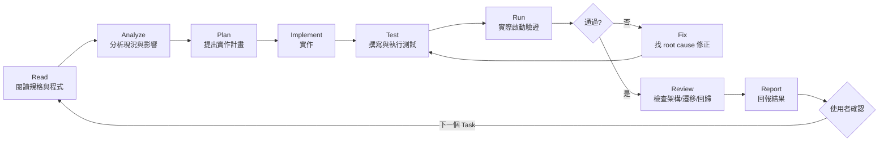

> 簡報可以這樣說：「這是一個 **Agile 精神的迭代增量模型**：每個 Task 都走完一次小型 SDLC（分析→設計→實作→測試→回報），每次產出都能運作、都有測試保護，需求變更時以新的迭代處理。」

### 3.2 各 SDLC 階段在本專案的具體內容

| SDLC 階段 | 本專案做了什麼 | 產出物 |
|---|---|---|
| **1. 規劃（Planning）** | 定義專案定位（CSP 建模與求解）、優先順序（正確性 > 可理解性 > 可測試性 > …）、MVP 範圍與排除項目、技術選型 | `AGENTS.md`（專案規章）、本文第 1、2 節 |
| **2. 需求分析（Analysis）** | 整理排課領域：教師、班級、科目、教室、時段、每週節數；定義 Hard Constraints H1–H15 與 Soft Constraints；角色權限；後續依使用者回饋修訂語意（取消任教資格、指定教室取代教室類型、新增導師、共同排課） | `AGENTS.md` 第 5–8 節、`docs/FRONTEND_REQUIREMENTS.md`、`SYSTEM_DESIGN.md` 0.5 節 |
| **3. 系統設計（Design）** | 分層架構（API / Service / Engine / ORM）、排課引擎與框架完全隔離、資料庫 ER 設計、API 規格（REST `/api/v1`）、錯誤處理慣例、前端分階段策略、設計系統 token | `docs/SYSTEM_DESIGN.md`（架構、ER、演算法、48+ 項決策紀錄） |
| **4. 實作（Implementation）** | 後端 FastAPI 18 個 router、40 個 service；排課引擎 18 條 constraint、5 種演算法；25 個 Alembic 遷移；前端 10 個頁面、19 個 API 模組、18 個 hooks | `backend/`、`scheduling_engine/`、`frontend/` |
| **5. 測試（Testing）** | 三層測試：引擎純邏輯單元測試、API 整合測試（真實 PostgreSQL）、前端純函式測試；修 bug 先寫回歸測試 | `tests/`、`frontend/src/**/*.test.ts`，共 1,727 個測試 |
| **6. 部署（Deployment）** | Docker Compose 一鍵啟動（PostgreSQL + 後端 + 前端 Nginx）；GitHub Actions CI 每次 push/PR 自動跑測試、遷移驗證、前端 lint/test/build | `docker-compose.yml`、`backend/Dockerfile`、`frontend/Dockerfile`、`.github/workflows/ci.yml` |
| **7. 維護（Maintenance）** | 依使用者回饋多輪改版（排課精靈、學校類型、排課紀錄 v3、導師與共同排課、設計系統、前向檢查演算法、導師規則…）；示範資料重置腳本；文件與截圖持續更新 | git 歷史 141 個 commit、`scripts/`、`docs/reports/` |

### 3.3 開發時程（依 git 紀錄）

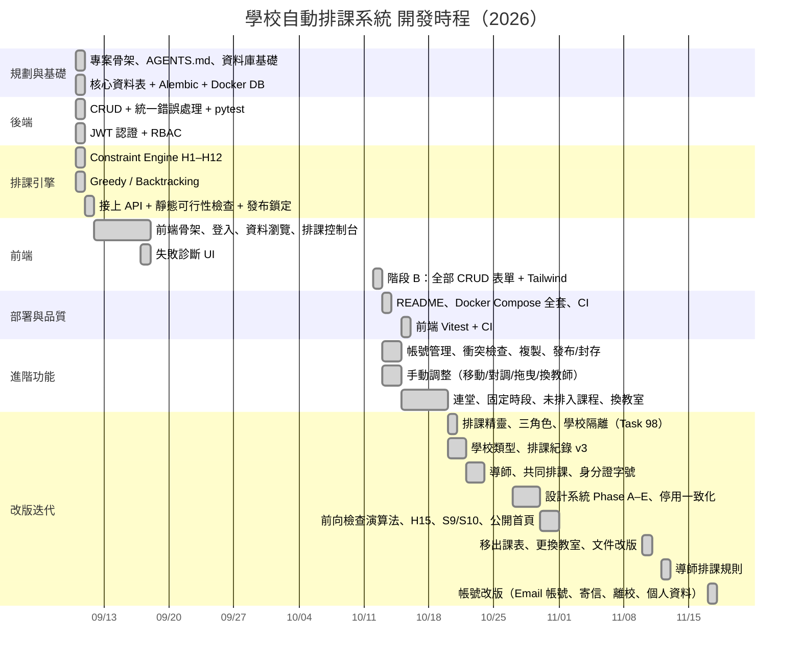

### 3.4 迭代里程碑摘要

| 迭代 | 日期 | 重點 |
|---|---|---|
| 1 基礎建設 | 09/10 | 骨架、資料庫、CRUD、測試框架、JWT/RBAC |
| 2 排課引擎 | 09/10–09/11 | H1–H12、Greedy、Backtracking、靜態可行性檢查、發布鎖定 |
| 3 前端階段 A | 09/12–09/17 | 登入、資料瀏覽、需求總覽、排課控制台、失敗診斷（唯讀為主） |
| 4 前端階段 B | 10/12 | 全部資料表的新增/編輯/刪除、Tailwind 設計系統 |
| 5 部署與品質 | 10/13–10/15 | README、Docker Compose、GitHub Actions CI、Vitest |
| 6 課表操作 | 10/13–10/19 | 衝突檢查、版本複製/發布/封存、拖曳調整、換教師、連堂、未排入課程 |
| 7 精靈改版（Task 98） | 10/20–10/23 | 6 步驟精靈、三角色、依學校隔離、排課紀錄 v3、導師、共同排課 |
| 8 介面一致化（Task 99–103） | 10/27–10/29 | 設計系統、確認框、停用一致化、閒置登出 |
| 9 演算法升級（Task 104） | 10/30–10/31 | 前向檢查 + Luby 重新開始、H15、S9/S10、公開首頁 |
| 10 持續維護 | 11/10–11/12 | 移出課表、更換教室、導師排課規則 |

---

## 4. 需求分析

### 4.1 需求蒐集方式

- 與需求方（使用者，扮演教學組長角色）逐 Task 討論，重大語意改變記錄在 `SYSTEM_DESIGN.md` 第 7 節「決策紀錄」。
- 依實際國小排課慣例設定預設值：國小 10 個預設科目與各年級節數、國語數學由導師授課、自然/藝術 2+1 連堂、早自習/午休/放學不可排。

### 4.2 功能需求（Functional Requirements）

| 編號 | 功能 | 說明 | 角色 |
|---|---|---|---|
| FR-01 | 登入 / 登出 | 帳號密碼登入取得 JWT；閒置 30 分鐘自動登出，操作中自動換發 token | 全部 |
| FR-02 | 學校管理 | 建立學校（國小/國中/高中），自動產生年級、時段、國小預設科目與節數 | ADMIN |
| FR-03 | 帳號管理 | 以 Email 建立帳號（系統產生密碼並寄信）、停用/啟用、重設密碼、離校、分配學校、搜尋與篩選；帳號不能刪除；教學組長與一般老師都有教師資料 | ADMIN、COORDINATOR |
| FR-04 | 學校資料管理 | 班級（含批次新增）、科目、年級科目需求、教室（一次可容納班數）、時段標籤與可排課；停用/啟用並提示影響範圍 | COORDINATOR |
| FR-05 | 排課精靈 | 6 步驟：學期 → 教師設定 → 年級可排節次 → 科目需求 → 共同排課 → 確認並排課；每步自動儲存、可續做 | COORDINATOR |
| FR-06 | 排課前檢查（Preflight） | 不跑搜尋就能找出必定排不出來的問題（9 類靜態可行性檢查） | COORDINATOR |
| FR-07 | 自動排課 | 前向檢查搜尋產生合法課表，再依 Soft Constraints 最佳化；90 秒上限 | COORDINATOR |
| FR-08 | 失敗診斷 | 排不出來時列出每個原因（類型、班級、科目、老師、時段）與建議做法，可連到對應頁面修改 | COORDINATOR |
| FR-09 | 課表檢視 | 依班級 / 教師 / 教室三種視角查看 | COORDINATOR、TEACHER |
| FR-10 | 衝突檢查 | 檢查整份課表的 Hard Constraint 違規與警告，並可在課表上定位 | COORDINATOR |
| FR-11 | 手動調整 | 移動、對調、連堂整組移動、換教師、換教室、移出課表、放回未排入課程；先預覽再儲存 | COORDINATOR |
| FR-12 | 排課紀錄管理 | 列表、備註、檢視設定、複製設定重排、複製課表、刪除 | COORDINATOR |
| FR-13 | 發布 / 取消發布 | 每學期最多一筆已發布；發布新的自動取消舊的；已發布不可刪除 | COORDINATOR |
| FR-14 | 首頁儀表板 | 依角色顯示學期狀態、最新紀錄檢查結果、資料缺漏提醒 | COORDINATOR、TEACHER |

### 4.3 非功能需求（Non-Functional Requirements）

| 類別 | 需求 | 實現方式 |
|---|---|---|
| 正確性 | 不得把部分排好的課表當成功結果 | All-or-nothing：排課失敗什麼都不寫入；排完再用全部 Hard Constraint 整份驗證一次 |
| 效能 | 自動排課有時間上限，不可無限搜尋 | 前向檢查 90 秒上限；Backtracking 有 `max_backtrack_steps` 與 timeout |
| 可重現性 | 相同輸入 + 相同 seed → 相同結果 | 演算法以 seed 決定嘗試順序，seed 回傳在結果中 |
| 安全性 | 密碼不得明文、授權由後端強制 | bcrypt 雜湊、JWT、每個 API 依角色與學校檢查（前端隱藏按鈕只是 UX） |
| 資料隔離 | 不同學校資料互不可見 | 所有查詢依登入者學校過濾，跨校一律當作不存在（404/422） |
| 可用性 | 中文介面、錯誤說明清楚 | 全部錯誤訊息中文化、全形標點、InfoPopover 說明、確認框依風險分級 |
| 可維護性 | 分層清楚、引擎可獨立測試 | 排課引擎不 import FastAPI / SQLAlchemy |
| 可測試性 | 新功能都要有測試、修 bug 先加回歸測試 | 三層測試、CI 自動執行 |
| 可部署性 | 一鍵啟動 | Docker Compose `--profile full` |
| 資料一致性 | Schema 變更可追蹤 | 一律走 Alembic migration，CI 驗證 `upgrade head` |
| 無障礙 | 文字對比足夠 | 設計 token 對比度單元測試（WCAG 對比） |

### 4.4 業務規則：排課限制條件

**Hard Constraints（必須滿足，否則課表不合法）**

| # | 規則 | 說明 |
|---|---|---|
| H1 | 教師衝堂 | 同一老師同一時段不能有兩堂課（共同排課的合併節除外） |
| H2 | 班級衝堂 | 同一班同一時段不能有兩堂課 |
| H3 | 教室衝堂 | 同一教室同一時段最多 `max_classes` 班 |
| H4 | 教師不可排時段 | 不能排在老師勾選的不可排時段 |
| H5 | 參與排課 | 只有參與這筆排課紀錄的老師能授課 |
| H6 | 指定教師 | 需求指定的老師必須授課 |
| H7 | 每週節數 | 每班每科恰好排滿要求節數 |
| H8 | 教師每週上限 | 不超過老師的最高每週節數 |
| H9 | 指定教室 | 指定教室的課必須在該教室上 |
| H10 | 教室容量 | 不實作（改由 H3 的 `max_classes` 表達） |
| H11 | 非教學時段 | 不能排在早自習、午休等非教學時段 |
| H12 | 停用狀態 | 停用的老師/班級/科目/教室不能排入 |
| H13 | 年級可排節次 | 班級只能排在年級開放的節次 |
| H14 | 共同排課不可拆 | 合併節的各班必須同一時段 |
| H15 | 同科單一教師 | 同一班同一科目由同一位老師授課 |
| — | 連堂、固定時段 | 連堂同一天相鄰、同師同教室；固定時段的課只能排在指定時段 |
| — | 最低每週節數 | 只警告（WARNING），不阻擋 |
| — | 導師規則 | 無指定教師時導師不排其他班的課；無法成立時最少化跨班節數 |

**Soft Constraints（偏好，合法前提下盡量滿足）**

| # | 偏好 |
|---|---|
| S8 | 國語文、數學排在每天第 1–2 節 |
| S9 | 體育避開每天第 1、4、5 個教學節（第 5 節是午休後第一節） |
| S10 | 國小「全日」的最後一節排活動性課程 |

---

## 5. DFD 資料流程圖

> 符號說明（Gane–Sarson / Yourdon 皆可）：
> - **方框**：外部實體（External Entity）
> - **圓角 / 圓形**：處理（Process）
> - **圓柱**：資料儲存（Data Store，D1、D2…）
> - **箭頭**：資料流（Data Flow），箭頭上的文字是資料名稱

### 5.1 Context Diagram（Level 0 / 環境圖）

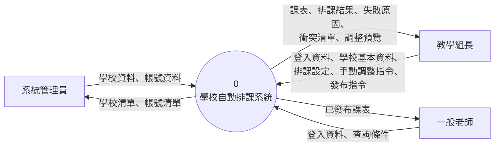

### 5.2 Level 1 DFD

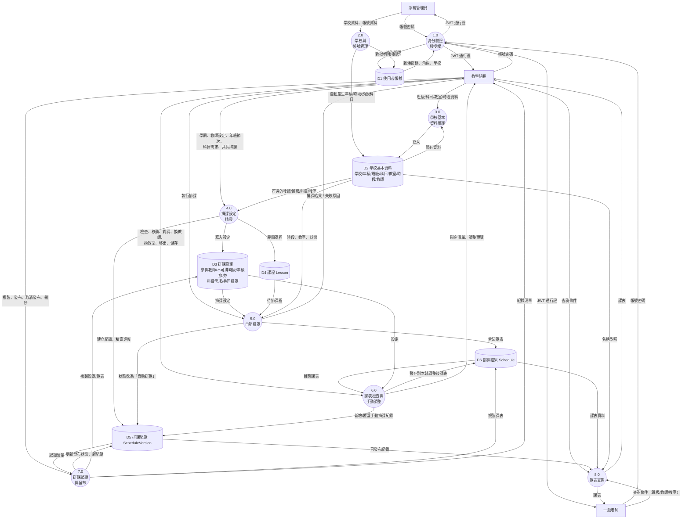

### 5.3 Level 2 DFD：5.0 自動排課

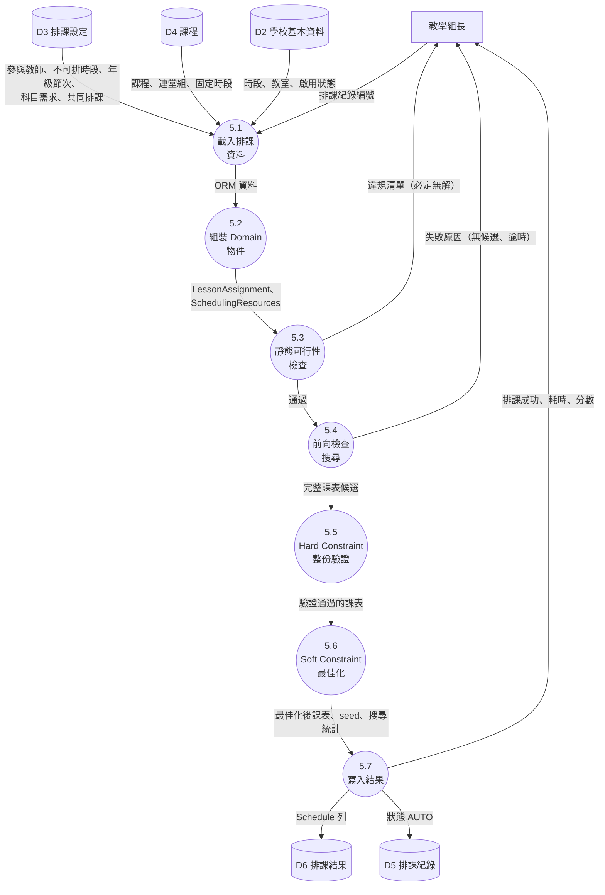

> 5.2–5.6 都在 `scheduling_engine/` 內執行（純 Python，不碰資料庫）；5.1 與 5.7 在 Service 層（`backend/app/services/scheduler.py`）。這張圖正好說明「引擎與資料庫分離」的架構原則。

### 5.4 Level 2 DFD：6.0 課表檢查與手動調整

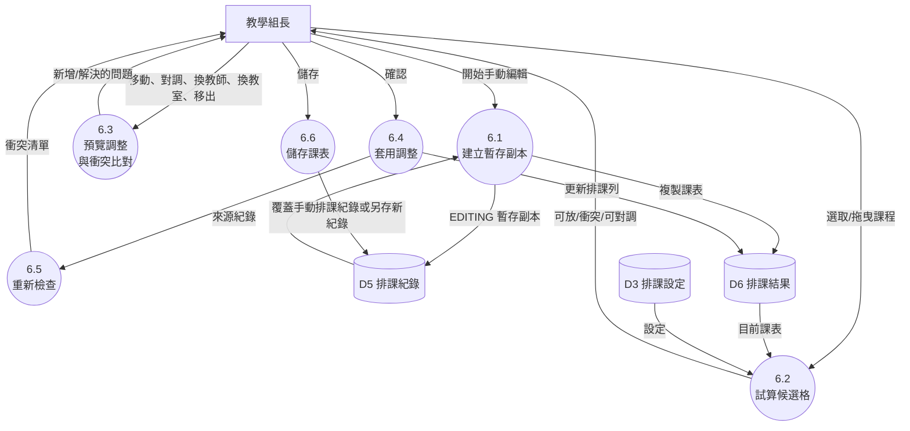

### 5.5 資料儲存說明（DFD Data Store ↔ 資料表）

| DFD 資料儲存 | 對應資料表 |
|---|---|
| D1 使用者帳號 | `users` |
| D2 學校基本資料 | `schools`、`academic_years`、`semesters`、`grades`、`classes`、`subjects`、`rooms`、`time_slots`、`teachers`、`grade_subject_requirements` |
| D3 排課設定 | `semester_teachers`、`semester_teacher_unavailabilities`、`semester_grade_time_slots`、`class_subject_requirements`、`combined_lessons`、`combined_lesson_members` |
| D4 課程 | `lessons` |
| D5 排課紀錄 | `schedule_versions` |
| D6 排課結果 | `schedules` |

---

## 6. UML 圖

### 6.1 使用案例圖（Use Case Diagram）

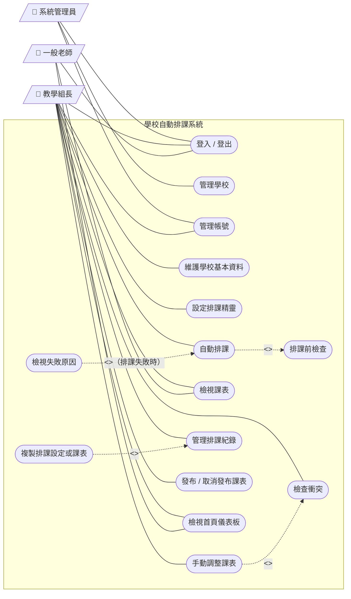

#### 主要使用案例規格

**UC7 自動排課**

| 項目 | 內容 |
|---|---|
| 主要角色 | 教學組長 |
| 前置條件 | 已登入；排課紀錄狀態為「尚未排課」；精靈前 5 步已完成 |
| 觸發 | 在精靈第 6 步按「開始排課」 |
| 主要流程 | 1. 系統同步科目需求並展開課程（generate-lessons）<br/>2. 系統執行排課前檢查（include UC6）<br/>3. 系統組裝排課資料交給排課引擎<br/>4. 引擎以前向檢查搜尋合法課表<br/>5. 引擎整份驗證 Hard Constraints<br/>6. 引擎依 S8/S9/S10 最佳化<br/>7. 系統寫入課表、紀錄狀態改為「自動排課」<br/>8. 顯示排課成功與課表連結 |
| 替代流程 | 2a. 排課前檢查發現問題 → 列出問題與建議做法，不進入搜尋<br/>4a. 搜尋失敗或逾時 90 秒 → 顯示失敗診斷（extend UC8），不寫入任何資料 |
| 後置條件 | 成功：紀錄有完整合法課表；失敗：資料庫不變 |
| 業務規則 | H1–H15、連堂、固定時段、導師規則；不得把部分課表當成功 |

**UC11 手動調整課表**

| 項目 | 內容 |
|---|---|
| 主要角色 | 教學組長 |
| 前置條件 | 紀錄已有課表 |
| 主要流程 | 1. 按「手動編輯」，系統建立 EDITING 暫存副本<br/>2. 選取或拖曳一堂課，系統標示每格可放/衝突/可對調<br/>3. 放到目標格，系統預覽會新增/解決的問題<br/>4. 確認後套用，系統自動重新檢查（include UC10）<br/>5. 按「儲存課表」 |
| 替代流程 | 3a. 換教師 / 換教室 / 移出課表 / 放回未排入課程<br/>5a. 離開頁面不儲存 → 丟棄暫存副本 |
| 後置條件 | 手動排課紀錄直接覆蓋；自動/複製/已發布紀錄另存成新的「手動排課」紀錄 |

**UC13 發布課表**

| 項目 | 內容 |
|---|---|
| 主要角色 | 教學組長 |
| 前置條件 | 紀錄已有課表 |
| 主要流程 | 1. 在課表頁或紀錄頁按「發布」<br/>2. 系統取消同學期原本已發布的紀錄<br/>3. 標記此紀錄為已發布<br/>4. 一般老師即可看到 |
| 業務規則 | 每學期最多一筆已發布；已發布紀錄不能刪除、不能直接修改（要改會另存新紀錄） |

### 6.2 類別圖（Class Diagram）——資料模型（ORM）

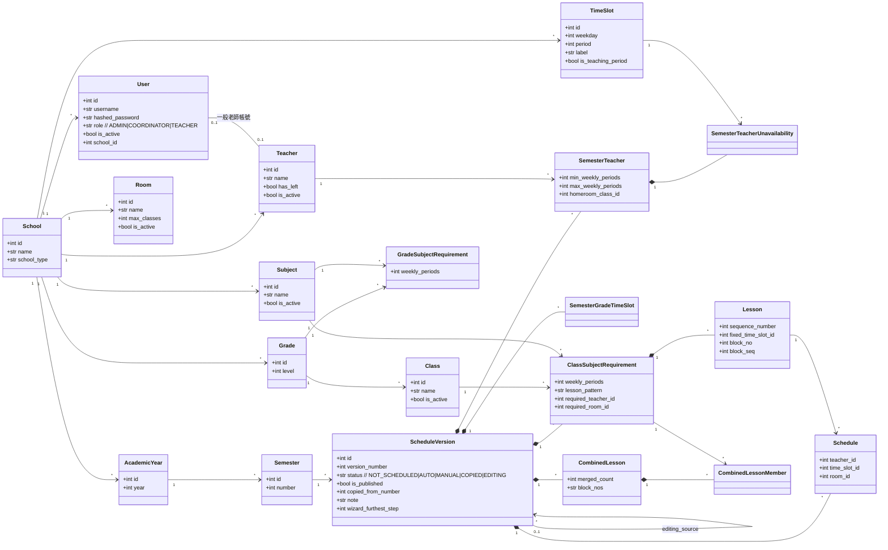

> 屬性為簡化版，精確欄位以 `backend/app/models/` 為準。`*--`（組合）表示刪除排課紀錄時，其設定與課表一起刪除（`services/version_contents.py`）。

### 6.3 類別圖——排課引擎（Domain Model）

```mermaid
classDiagram
    direction TB

    class LessonAssignment {
        <<dataclass frozen>>
        +int lesson_id
        +int class_subject_requirement_id
        +int class_id
        +int subject_id
        +int|None teacher_id
        +int|None time_slot_id
        +int|None room_id
    }
    class SchedulingResources {
        +list time_slot_ids
        +list teacher_ids
        +list teacher_unavailability
        +list required_teacher_rules
        +list required_room_rules
        +list time_slots
        +list active_statuses
        +list requirement_periods
        +list teacher_workload_limits
        +list lesson_blocks
        +list combined_lessons
        +list homeroom_teachers
    }
    class ConstraintViolation {
        +str type
        +Severity severity
        +int lesson_id
        +int teacher_id
        +int class_id
        +int subject_id
        +int time_slot_id
        +int room_id
        +str message
        +str suggested_action
        +str identity_key
    }
    class Severity {
        <<enumeration>>
        ERROR
        WARNING
    }
    class BaseConstraint {
        <<abstract>>
        +explain_violations(assignments) list~ConstraintViolation~
        +validate(assignments) bool
    }
    class TeacherConflictConstraint
    class ClassConflictConstraint
    class RoomConflictConstraint
    class TeacherAvailabilityConstraint
    class TeacherParticipationConstraint
    class RequiredTeacherConstraint
    class WeeklyPeriodsConstraint
    class TeacherWorkloadConstraint
    class RequiredRoomConstraint
    class NonTeachingPeriodConstraint
    class ActiveStatusConstraint
    class ClassTimeSlotConstraint
    class CombinedLessonConstraint
    class RequirementSingleTeacherConstraint
    class LessonBlockConstraint
    class TeacherMinWorkloadConstraint

    class StaticFeasibility {
        +check_static_feasibility(lessons, resources) StaticFeasibilityResult
    }
    class ForwardCheckingScheduler {
        +schedule_forward_checking(lessons, resources, seed, timeout) ForwardCheckingResult
        -luby(index) int
    }
    class GreedyScheduler
    class BacktrackingScheduler
    class PreferredPeriodsOptimizer {
        +optimize_preferred_periods(...) 
    }
    class HomeroomRule {
        +reduce_cross_homeroom(...)
    }
    class ForwardCheckingResult {
        +bool success
        +list assignments
        +list violations
        +int seed
        +float duration
    }

    BaseConstraint <|-- TeacherConflictConstraint : H1
    BaseConstraint <|-- ClassConflictConstraint : H2
    BaseConstraint <|-- RoomConflictConstraint : H3
    BaseConstraint <|-- TeacherAvailabilityConstraint : H4
    BaseConstraint <|-- TeacherParticipationConstraint : H5
    BaseConstraint <|-- RequiredTeacherConstraint : H6
    BaseConstraint <|-- WeeklyPeriodsConstraint : H7
    BaseConstraint <|-- TeacherWorkloadConstraint : H8
    BaseConstraint <|-- RequiredRoomConstraint : H9
    BaseConstraint <|-- NonTeachingPeriodConstraint : H11
    BaseConstraint <|-- ActiveStatusConstraint : H12
    BaseConstraint <|-- ClassTimeSlotConstraint : H13
    BaseConstraint <|-- CombinedLessonConstraint : H14
    BaseConstraint <|-- RequirementSingleTeacherConstraint : H15
    BaseConstraint <|-- LessonBlockConstraint : 連堂
    BaseConstraint <|-- TeacherMinWorkloadConstraint : 最低節數警告

    BaseConstraint ..> LessonAssignment : 檢查
    BaseConstraint ..> ConstraintViolation : 產生
    ConstraintViolation --> Severity
    ForwardCheckingScheduler --> SchedulingResources
    ForwardCheckingScheduler --> BaseConstraint : 使用
    ForwardCheckingScheduler --> HomeroomRule
    ForwardCheckingScheduler ..> ForwardCheckingResult
    GreedyScheduler --> BaseConstraint
    BacktrackingScheduler --> BaseConstraint
    PreferredPeriodsOptimizer --> BaseConstraint
    StaticFeasibility ..> ConstraintViolation
```

> 實際類別名稱請以 `scheduling_engine/constraints/*.py` 為準（每條規則一個檔案，如 `teacher_conflict.py`、`requirement_teacher.py`）；演算法在 `scheduling_engine/algorithms/`（`forward_checking.py`、`greedy.py`、`backtracking.py`、`preferred_periods.py`、`homeroom.py`）。這張圖的重點是**策略模式（Strategy）**：所有規則實作同一個 `BaseConstraint` 介面，演算法只依賴介面。

### 6.4 循序圖（Sequence Diagram）

#### 6.4.1 登入與授權

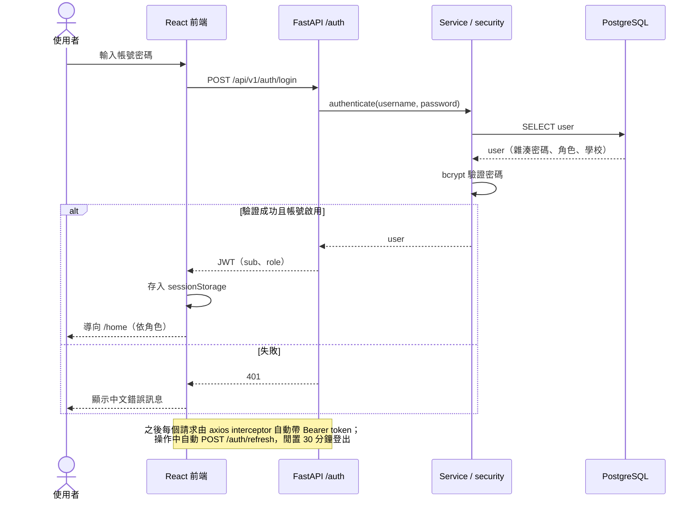

#### 6.4.2 自動排課（核心流程）

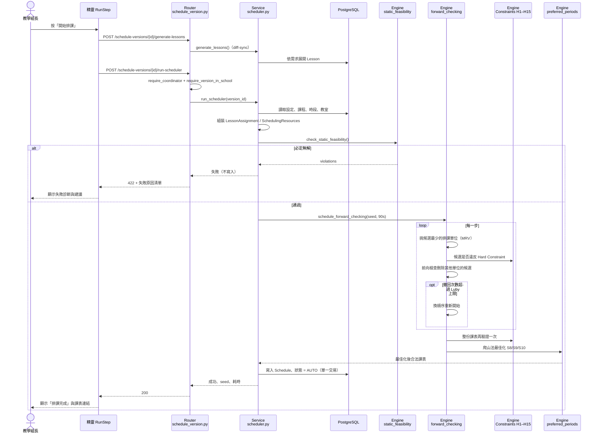

#### 6.4.3 手動移動課程（先預覽再套用）

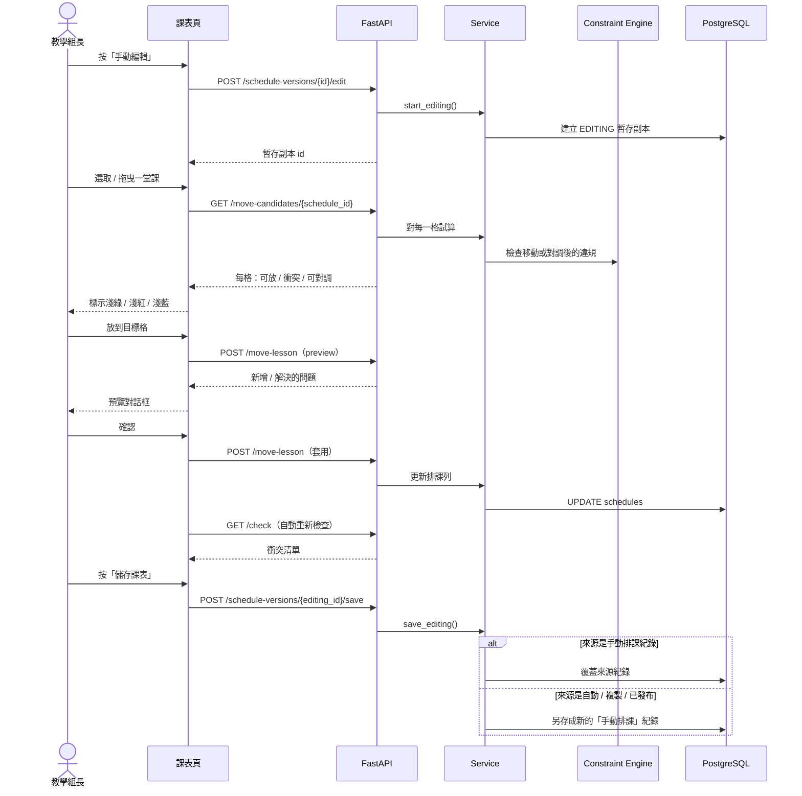

#### 6.4.4 發布課表

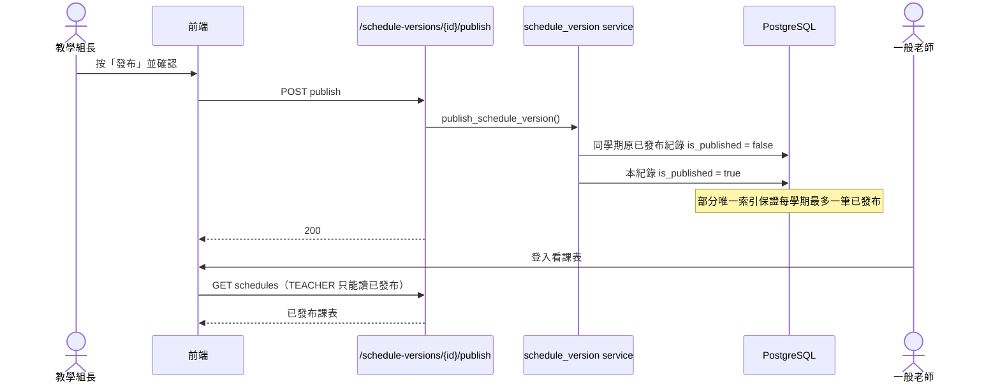

### 6.5 活動圖（Activity Diagram）

#### 6.5.1 排課精靈（教學組長）

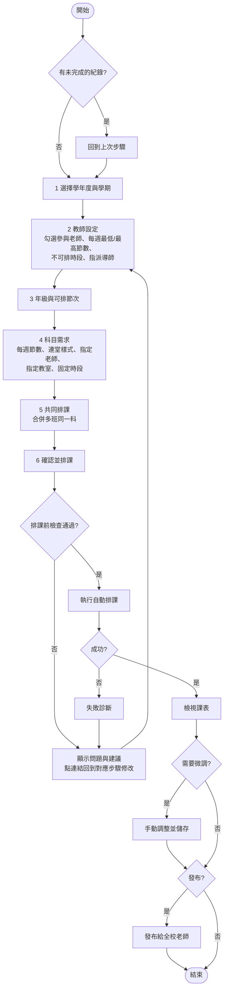

#### 6.5.2 自動排課演算法（前向檢查 + 重新開始）

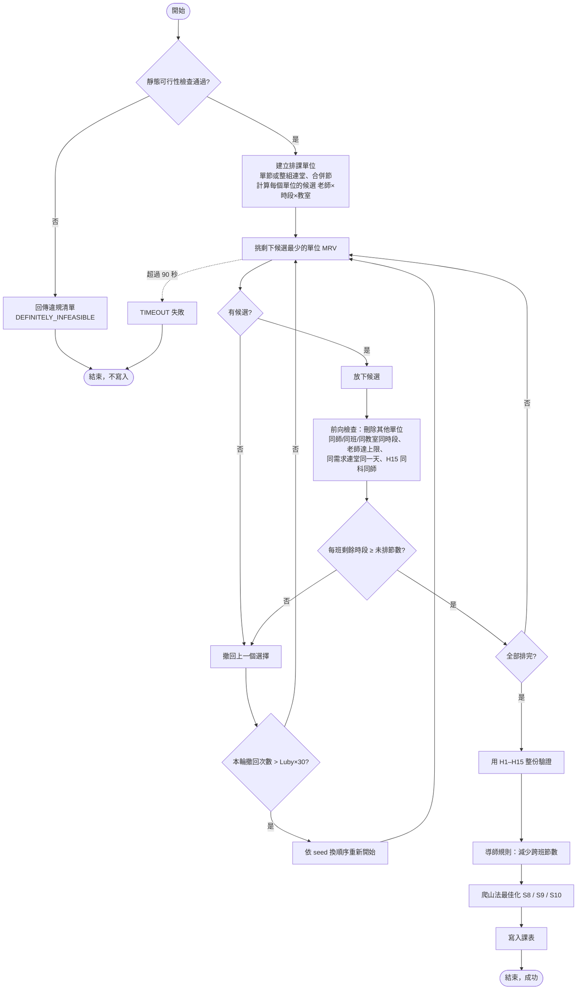

### 6.6 狀態圖（State Machine Diagram）——排課紀錄 ScheduleVersion

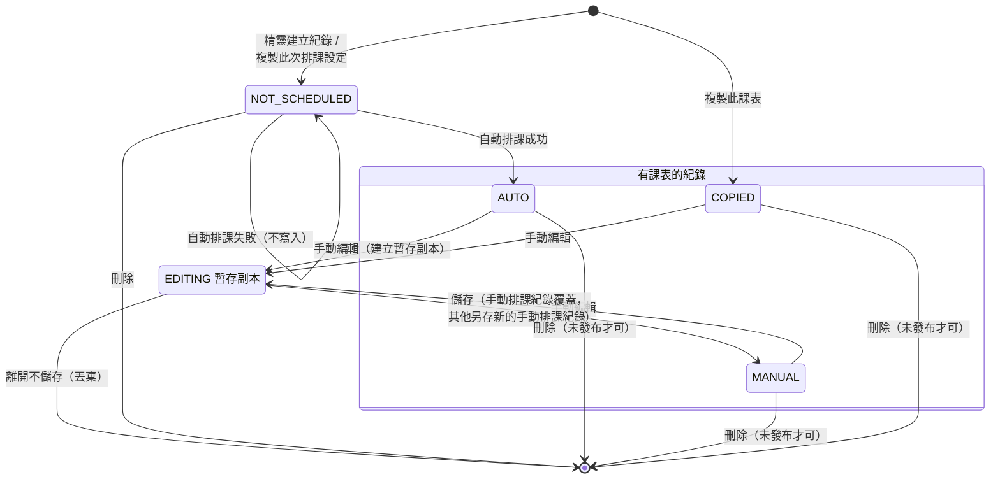

**發布是與狀態正交的旗標**（`is_published`）：

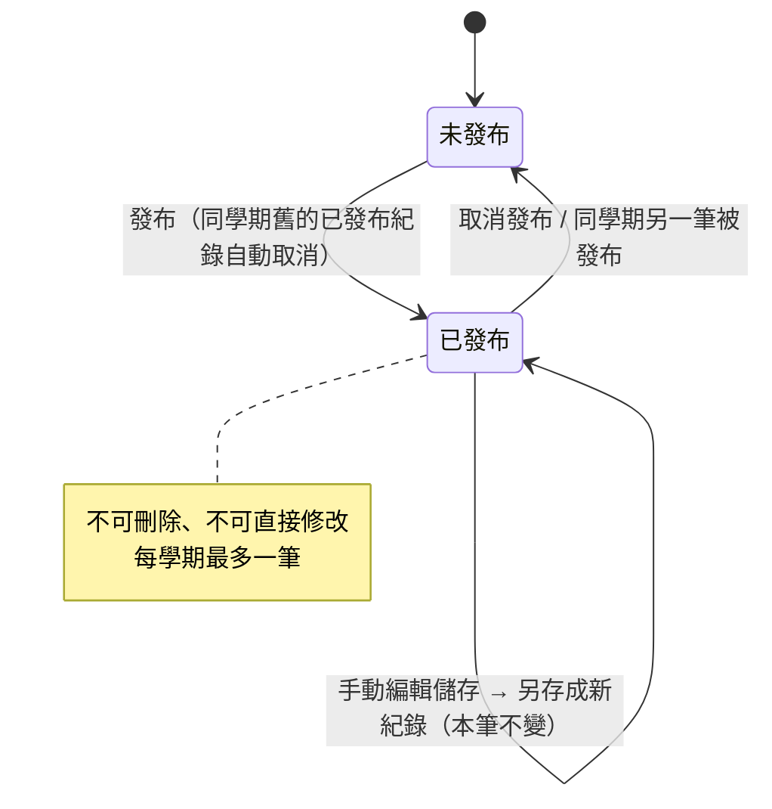

### 6.7 元件圖（Component Diagram）

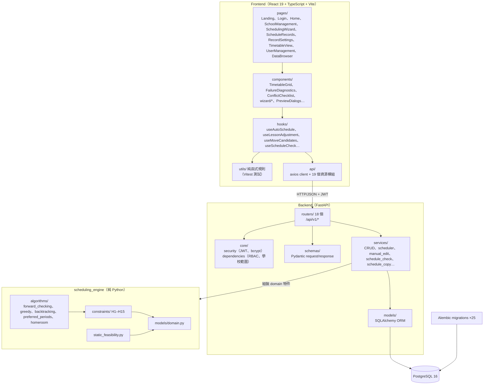

### 6.8 部署圖（Deployment Diagram）

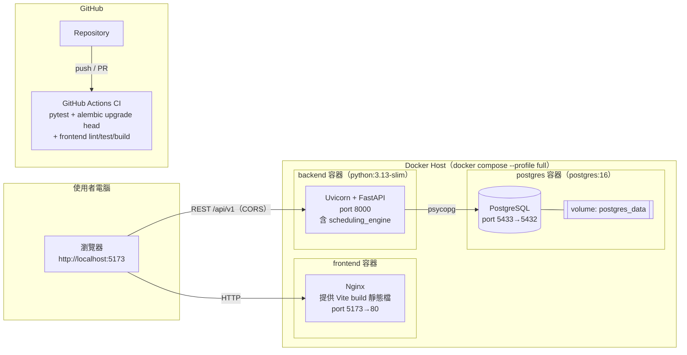

---

## 7. ERD 與資料字典

### 7.1 ERD

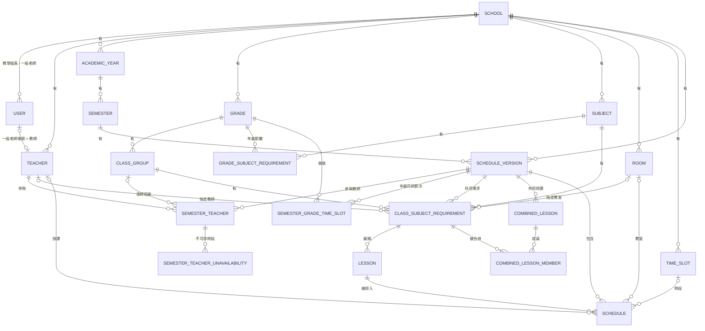

> `CLASS` 是 Mermaid 保留字，圖中以 `CLASS_GROUP` 表示班級（程式中為 `Class`）。完整含屬性的 ERD 見 `docs/SYSTEM_DESIGN.md` 第 4 節。

### 7.2 資料字典（主要資料表）

| 資料表 | 說明 | 主要欄位 | 重要限制 |
|---|---|---|---|
| `schools` | 學校 | id, name, school_type | school_type ∈ 國小/國中/高中 |
| `users` | 帳號 | id, username, hashed_password, role, is_active, school_id | role ∈ ADMIN/COORDINATOR/TEACHER；username 唯一 |
| `teachers` | 教師 | id, school_id, name, user_id, has_left, is_active | 每個帳號只有一筆 has_left = false（部分唯一索引） |
| `academic_years` / `semesters` | 學年度 / 學期 | year；number | — |
| `grades` | 年級 | id, school_id, level | 國小 1–6、國中 7–9、高中 10–12 |
| `classes` | 班級 | id, grade_id, name, is_active | — |
| `subjects` | 科目 | id, school_id, name, is_active | — |
| `rooms` | 教室 | id, school_id, name, max_classes, is_active | max_classes 1–10 |
| `time_slots` | 時段 | id, school_id, weekday, period, label, is_teaching_period | 建立學校時自動產生 |
| `grade_subject_requirements` | 學校層級年級科目節數 | grade_id, subject_id, weekly_periods | 精靈自動帶入 |
| `schedule_versions` | 排課紀錄 | version_number, status, is_published, copied_from_number, editing_source_id, note | status CHECK；每學期最多一筆 is_published |
| `semester_teachers` | 紀錄的參與教師 | schedule_version_id, teacher_id, min/max_weekly_periods, homeroom_class_id | 一位老師最多導一班 |
| `semester_teacher_unavailabilities` | 不可排時段 | semester_teacher_id, time_slot_id | 存在即不可排（稀疏表示） |
| `semester_grade_time_slots` | 年級可排節次 | schedule_version_id, grade_id, time_slot_id | H13 |
| `class_subject_requirements` | 班級科目需求 | class_id, subject_id, weekly_periods, lesson_pattern, required_teacher_id, required_room_id | weekly_periods 1–6；連堂最多 5 組 |
| `lessons` | 課程實例 | class_subject_requirement_id, sequence_number, fixed_time_slot_id, block_no, block_seq | 3 節課 = 3 筆 |
| `combined_lessons` / `_members` | 共同排課 | merged_count, block_nos, room_id | H14 |
| `schedules` | 排課結果 | schedule_version_id, lesson_id, teacher_id, time_slot_id, room_id | 同紀錄同課程唯一 |

**正規化與設計重點**
- `Requirement → Lesson → Schedule` 三層分離：需求說「要幾節」、Lesson 是展開的待排清單、Schedule 是「在某版本排在哪裡」，所以同一批課可以在多個版本有不同排法。
- 不可排時段採**稀疏表示**：只記錄例外，沒有紀錄就代表可排。
- 排課設定掛在每筆紀錄上（v3），修改一筆永遠不影響另一筆。

---

## 8. 系統架構設計

```mermaid
flowchart TB
    UI["React / TypeScript（UI、表單驗證只為 UX）"]
    API["API Layer：FastAPI routers（驗證 request、RBAC、回 response）"]
    SVC["Service Layer：業務邏輯、交易、學校隔離、ORM ↔ Domain 轉換、例外分類"]
    ENG["Scheduling Engine：純 Python dataclass、Constraint、演算法（不碰 DB / FastAPI）"]
    ORM["Repository / SQLAlchemy ORM"]
    DB[("PostgreSQL")]

    UI -->|REST /api/v1 + JWT| API --> SVC
    SVC -->|Domain 物件| ENG
    ENG -->|Scheduling Result| SVC
    SVC --> ORM --> DB
```

| 層 | 職責 | 不可以做 |
|---|---|---|
| API | HTTP、Pydantic 驗證、權限依賴注入 | 寫排課演算法、try/except 業務例外 |
| Service | 業務邏輯、交易、IntegrityError 轉自訂例外 | 拋 HTTPException（與 FastAPI 無關） |
| Engine | 排課與驗證 | import SQLAlchemy / FastAPI、碰資料庫 |
| ORM / DB | 持久化、CHECK / FK / 唯一索引 | — |

**錯誤處理流程**：Service 層遇到 `IntegrityError` → `rollback` → 拋 `DependentRecordsExistError` / `InvalidReferenceError` / `DuplicateValueError` → `main.py` 全域 exception handler 轉成 409 / 422 / 409 → 前端 `constants/errorMessages.ts` 翻成中文。

**設計模式**
- **分層架構（Layered Architecture）**
- **策略模式**：每條 Hard Constraint 實作 `BaseConstraint`
- **依賴注入**：FastAPI `Depends(get_db)`、`Depends(require_coordinator)`
- **DTO**：Pydantic schema 與 ORM model 分離
- **Copy-on-write**：手動編輯建立 EDITING 暫存副本，儲存才生效

---

## 9. 排課演算法設計

### 9.1 問題建模：約束滿足問題（CSP）

| CSP 元素 | 本系統 |
|---|---|
| 變數（Variables） | 每個排課單位（單節課、整組連堂、合併節） |
| 定義域（Domains） | 候選 (老師, 時段, 教室) 組合；固定時段/指定老師/指定教室會縮小定義域 |
| 約束（Constraints） | H1–H15、連堂、固定時段、導師規則 |
| 目標（Objective） | 在合法解中最大化 S8/S9/S10 分數 |

### 9.2 演算法演進

| 版本 | 演算法 | 特點 | 狀態 |
|---|---|---|---|
| 1 | Greedy + MRV | 依候選最少排序，選第一個合法候選，不回頭 | 保留作對照 |
| 2 | Backtracking | 卡住時撤回前一個選擇；有 `max_backtrack_steps` 與 timeout | 保留作對照 |
| 3 | **Forward Checking + Luby Restart** | 每步重新挑候選最少的單位；放下後刪除其他單位不能用的候選；空位計數；撤回太多次依 Luby 數列重新開始；seed 決定順序 | **目前使用** |
| 後處理 | Hill Climbing | 移動或對調排課單位，只接受分數提高且仍合法的步驟 | S8/S9/S10 |

**為什麼換成前向檢查？** 實例：六班、每班時段全滿的學期，Backtracking 放寬到 20 萬次回溯仍排不出來——錯誤往往是很早的選擇，只撤回最近幾步永遠修不到；前向檢查提早發現死路，加上重新開始跳出壞的開頭。

### 9.3 可解釋性（Explainable Scheduling）

- 所有違規共用 `ConstraintViolation` 格式：type、severity、lesson/teacher/class/subject/time_slot/room id、message、suggested_action。
- 失敗分三類：`DEFINITELY_INFEASIBLE`（保證無解）、`SEARCH_LIMIT_EXCEEDED`、`TIMEOUT`（不代表無解）。
- **9 類靜態可行性檢查**（不搜尋就能證明無解）：教師工作量超標、可用時段不足、停用狀態、零候選教師、固定時段不可能、連堂不可能、教室超量、年級開放節次不足、共同排課固定時段矛盾。
- 前端失敗診斷把 id 翻成名稱、組成中文句子，並提供「前往修改」連結。

**範例訊息**：「王老師被指定的課共 6 節，超過每週上限 5 節。建議：提高王老師的每週上限，或把部分課改由其他老師授課。」

---

## 10. 介面設計

### 10.1 頁面清單與權限

| 頁面 | 路由 | ADMIN | COORDINATOR | TEACHER |
|---|---|:-:|:-:|:-:|
| 公開首頁 | `/` | ✔ | ✔ | ✔ |
| 登入 | `/login` | ✔ | ✔ | ✔ |
| 後台首頁（儀表板） | `/home` | — | ✔ | ✔（簡化版） |
| 學校資料 | `/data` | — | ✔ | — |
| 開始排課（精靈） | `/wizard` | — | ✔ | — |
| 排課紀錄 | `/records` | — | ✔ | — |
| 檢視排課設定 | `/records/:id/settings` | — | ✔ | — |
| 課表 | `/timetable` | — | ✔（可編輯） | ✔（唯讀、已發布） |
| 帳號管理 | `/users` | ✔ | ✔（本校老師） | — |
| 學校管理 | `/schools` | ✔ | — | — |

### 10.2 可用的截圖（`docs/images/`）

| 檔案 | 畫面 |
|---|---|
| `landing.png` | 公開首頁 |
| `login.png` / `login-mobile.png` | 登入頁（桌面 / 手機） |
| `wizard-teachers.png` | 精靈：教師設定 |
| `wizard-requirements.png` | 精靈：科目需求 |
| `failure-diagnostics.png` | 失敗診斷 |
| `records.png` | 排課紀錄 |
| `timetable-view.png` | 課表檢視 |
| `room-view.png` | 依教室檢視 |
| `conflict-check.png` | 衝突檢查清單 |
| `timetable-edit.png` | 手動編輯（候選格標示） |
| `block-drag.png` | 連堂整組拖曳 |
| `reassign-teacher.png` | 換教師預覽 |
| `unscheduled-lessons.png` | 未排入課程 |
| `publish-switch.png` | 發布切換 |
| `accounts.png` | 帳號管理 |

### 10.3 UI/UX 設計原則

- 設計系統：色彩 token（`styles/ui.ts`）、按鈕層級（Primary/Secondary/Success/Danger/Ghost）、StatusBadge、InfoPopover、自有 SVG 圖示。
- 對比度以單元測試保證可讀性。
- 確認框依風險分級、按鈕寫出具體動作；刪除不了時提示刪除步驟。
- 課表候選格：淺綠可放、淺紅衝突、淺藍可對調（⇄）。

---

## 11. API 設計

- 風格：REST，前綴 `/api/v1/`，FastAPI 自動產生 OpenAPI 文件（`http://localhost:8000/docs`）。
- 資源：`auth`、`users`、`schools`、`academic-years`、`semesters`、`grades`、`classes`、`subjects`、`rooms`、`time-slots`、`teachers`、`grade-subject-requirements`、`class-subject-requirements`、`lessons`、`combined-lessons`、`schedules`、`schedule-versions`。

**排課核心端點（`/api/v1/schedule-versions/{id}/...`）**

| 方法 | 路徑 | 用途 |
|---|---|---|
| POST | `/generate-lessons` | 依需求展開課程（diff-sync） |
| GET | `/preflight` | 排課前檢查 |
| POST | `/run-scheduler` | 自動排課 |
| GET | `/check` | 檢查整份課表違規 |
| POST | `/edit` / `/save` | 建立暫存副本 / 儲存手動編輯 |
| GET | `/move-candidates/{schedule_id}` | 試算每格可放/衝突/可對調 |
| POST | `/move-lesson`、`/swap-lessons` | 移動、對調 |
| POST | `/reassign-teacher`、`/change-room` | 換教師、換教室 |
| POST | `/unschedule-lesson`、`/place-lesson` | 移出課表、放回 |
| GET | `/unscheduled-lessons`、`/place-candidates/{lesson_id}` | 未排入課程與候選 |
| POST | `/publish`、`/unpublish` | 發布、取消發布 |
| POST | `/copy`、`/copy-settings` | 複製課表、複製設定 |
| PUT/GET | `/teachers`、`/grades/{grade_id}/time-slots` | 精靈設定 |

**HTTP 狀態碼慣例**：201 建立、204 刪除、401 未登入、403 權限不足、404 不存在（含跨校）、409 衝突（重複、被參照、已排課、已發布）、422 驗證失敗 / 無效參照 / 排課失敗原因。

---

## 12. 安全設計

### 12.1 認證

- 密碼以 **bcrypt** 雜湊（passlib），長度規則前後端一致。
- 登入發 **JWT**（python-jose），payload 含 `sub`、`role`；前端存在 `sessionStorage`。
- 操作中自動換發（`/auth/refresh`），閒置 30 分鐘自動登出。
- 第一個 ADMIN 可匿名註冊，之後註冊需 ADMIN token。

### 12.2 授權（RBAC）矩陣

| 操作 | ADMIN | COORDINATOR | TEACHER |
|---|:-:|:-:|:-:|
| 建立學校 | ✔ | — | — |
| 建立教學組長帳號 | ✔ | — | — |
| 建立一般老師帳號 | ✔ | ✔（本校） | — |
| 維護學校資料 | — | ✔ | — |
| 排課設定 / 自動排課 / 手動調整 | — | ✔ | — |
| 發布 / 取消發布 | — | ✔ | — |
| 看草稿課表 | — | ✔ | — |
| 看已發布課表 | — | ✔ | ✔（本校） |

- 實作：`backend/app/core/dependencies.py` 的 `require_admin`、`require_coordinator`、`require_school_member`、`require_version_in_school` 等依賴。
- **後端強制**：前端隱藏按鈕只是 UX，後端每個端點都檢查角色與學校（跨校資料一律 404/422，不洩漏存在與否）。
- 個人資料：每個角色都有 `/api/v1/me`；離校後無所屬學校的一般老師讀取學校資料一律 403「目前無所屬學校，請聯絡系統管理員」。

---

## 13. 測試計畫與結果

### 13.1 測試策略（三層）

| 層級 | 工具 | 範圍 | 數量* |
|---|---|---|---|
| 單元測試：排課引擎 | pytest | Constraint H1–H15、連堂、固定時段、前向檢查、Greedy/Backtracking、靜態檢查、Soft Constraints、導師規則；**不需資料庫** | 224 |
| 整合測試：API | pytest + FastAPI TestClient + 真實 PostgreSQL 測試庫 | CRUD、排課 API、手動調整、紀錄與發布、權限與學校隔離、衝突檢查 | 943 |
| 前端單元測試 | Vitest | 純函式規則：失敗診斷句子、衝突比對、拖放規則、候選格、設計 token 對比… | 560 |
| **合計** | | | **1,727** |

\* 數量為 2026-11-13 以 `pytest --collect-only` 與 `npx vitest run` 重新統計；共 75 個後端測試檔、55 個前端測試檔。

### 13.2 API 整合測試分布

| 類別 | 數量 |
|---|---|
| 排課設定與需求 | 200 |
| 手動調整 | 201 |
| 排課紀錄 | 152 |
| 學校資料 | 147 |
| 帳號與權限 | 124 |
| 檢查衝突 | 65 |
| 自動排課 | 54 |

### 13.3 AGENTS.md 要求的排課測試案例覆蓋

| 必測項目 | 對應 |
|---|---|
| 教師 / 班級 / 教室衝突 | H1/H2/H3 constraint 測試 |
| 不可排時段、參與資格 | H4/H5 |
| 每週節數、教室要求、工作量 | H7/H9/H8 |
| 無解情境 | 靜態可行性、`DEFINITELY_INFEASIBLE` |
| Greedy 失敗但 Backtracking 成功 | `test_backtracking_succeeds_where_greedy_fails` |
| 相同 seed 結果相同 | 前向檢查 seed 決定性測試 |

### 13.4 測試結果

- 2026-11-13 完整執行：後端 1,167 個全數通過（引擎 224 個約 17 秒、API 943 個約 22 分鐘）；前端 557 個通過、3 個失敗（`utils/homeCards.test.ts` 仍預期首頁卡片顯示「最近一筆」狀態，但 11/10 已簡化為只顯示筆數，測試尚未更新）。
- CI：每次 push 到 `main` 與每個 PR 自動執行後端測試、`alembic upgrade head`、前端 lint / test / build。
- 回歸測試原則：修 bug → 先加會失敗的測試 → 修正 → 測試通過（除錯案例見 `SYSTEM_DESIGN.md` 第 8 節，共 8 個）。

---

## 14. 部署與維護

| 項目 | 內容 |
|---|---|
| 一鍵啟動 | `docker compose --profile full up --build -d` → `http://localhost:5173` |
| 只啟動資料庫（本機開發） | `docker compose up -d`，後端 venv + uvicorn、前端 `npm run dev` |
| 資料庫遷移 | `alembic upgrade head`（25 個 migration） |
| 示範資料 | `python scripts/seed_test_data.py [--run]`：建立示範國小、10 位老師、6 個班級 |
| CI | `.github/workflows/ci.yml`：PostgreSQL 16 service、Python 3.13、pytest、遷移驗證、前端 build |
| 版本控制 | Git + GitHub；功能分支開發（如 `feature/refactor`），commit 由開發者決定 |

---

## 15. 專案成果統計

| 指標 | 數值 |
|---|---|
| 開發期間 | 2026-09-10 ～ 2026-11-12 |
| Git commits | 141 |
| 後端程式（`backend/app`） | 約 13,600 行 Python（18 routers、40 services、17 models） |
| 排課引擎（`scheduling_engine`） | 約 5,200 行 Python（18 constraints、5 algorithms） |
| 前端（`frontend/src`） | 約 29,800 行 TypeScript/TSX（10 頁面、19 API 模組、18 hooks） |
| 測試程式（`tests`） | 約 21,200 行 |
| 自動化測試 | 1,727 個（後端 1,167、前端 560） |
| Alembic migrations | 25 |
| Hard / Soft Constraints | 14 條 Hard（H10 不實作）+ 連堂/固定時段/導師規則；3 條 Soft |
| 架構決策紀錄 | 48+ 項（`SYSTEM_DESIGN.md` 第 7 節） |

### 技術棧

| 層 | 技術 |
|---|---|
| 前端 | React 19、TypeScript 6、Vite 8、React Router 7、axios、Tailwind CSS 4、Vitest、oxlint |
| 後端 | Python 3.13、FastAPI、Pydantic 2、SQLAlchemy 2、Alembic、psycopg 3、python-jose（JWT）、passlib/bcrypt |
| 資料庫 | PostgreSQL 16 |
| 測試 | pytest、pytest-cov、Vitest |
| 基礎設施 | Docker、Docker Compose、Nginx、GitHub Actions |

---

## 16. 已知限制與未來規劃

| 類別 | 限制 | 未來方向 |
|---|---|---|
| 排課規則 | H10 教室容量不實作（不知道班級人數） | 加入班級人數與容量 |
| 排課規則 | Soft Constraint 以科目名稱判定 | 科目加「類別」欄位 |
| 排課規則 | 只有 S8/S9/S10，分數未顯示 | 實作 S1–S7（教師每日平衡、減少空堂…）並顯示分數 |
| 排課規則 | 最低每週節數只警告 | 納入最佳化 |
| 手動調整 | 衝突不阻擋、儲存後無復原 | Undo/Redo、版本差異比較 |
| 手動調整 | 換教師一次一門課 | 批次換人 |
| 權限 | 一般老師看全校課表，無「只看自己」預設 | 個人課表預設篩選 |
| 權限 | 「有未排入課程不能發布」只在前端擋 | 後端同步檢查 |
| 工程 | 前端錯誤翻譯依賴英文字串比對 | 後端回傳錯誤代碼 |
| 工程 | 前端只有純函式測試 | 加入元件 / E2E 測試（Playwright） |
| 工程 | 前端 bundle > 500 kB | 程式碼分割 |
| 演算法 | 自製求解器 | 正式產品可評估 OR-Tools CP-SAT |

---

## 17. 結論與 Q&A 預備

### 17.1 結論（簡報最後一頁）

1. 把學校排課建模為**約束滿足問題**，以前向檢查 + 重新開始求解，保證輸出的課表 100% 符合 Hard Constraints。
2. **可解釋**：排不出來時說明原因與建議，而不是一句「失敗」。
3. **架構清楚**：排課引擎完全獨立於 Web 框架與資料庫，可單獨測試。
4. **流程完整**：資料管理 → 精靈設定 → 自動排課 → 手動微調 → 版本管理 → 發布。
5. **品質保證**：1,727 個自動化測試、CI、Docker 一鍵部署。

### 17.2 30 秒電梯簡報

> 這是一個給學校教學組長用的排課系統。核心是一套完全獨立於 API 框架和資料庫的排課引擎：把參與的老師、不可排時段、每週節數上下限、各年級可排節次、科目需求、連堂和共同排課建成 15 條 Hard Constraint，用前向檢查搜尋出一份一定合法的課表，再依「國語數學排早上、體育避開剛吃飽」等偏好最佳化；排不出來時會說出是哪個老師、哪個條件造成的。排完可以拖曳微調，每次調整先預覽衝突，最後發布給全校老師。

### 17.3 可能被問的問題

| 問題              | 回答要點                                                                    |
| --------------- | ----------------------------------------------------------------------- |
| 為什麼用迭代增量而不是瀑布？  | 排課規則複雜、需求會隨使用回饋改變（例如取消任教資格、新增導師與共同排課）；每個 Task 都有可運作、有測試的產出，降低風險         |
| 怎麼保證課表一定合法？     | 搜尋時每個候選都用 Constraint 檢查；排完再用全部 Hard Constraint 整份驗證一次，不通過就視為引擎錯誤、什麼都不寫入 |
| 排不出來怎麼辦？        | 先跑 9 類靜態檢查，不搜尋就能證明無解的情況直接說明原因；搜尋失敗會區分「確定無解」與「逾時」                        |
| 為什麼不用 OR-Tools？ | 學習與作品集目的，要展示 CSP 建模與演算法設計；正式產品會考慮                                       |
| 為什麼每次排出來的課表不同？  | 每次用新的 seed；同 seed 同輸入一定得到同結果，可重現除錯                                      |
| 已發布課表怎麼修改？      | 不能直接改；手動編輯會建立暫存副本，儲存時另存成新紀錄，再重新發布                                       |
| 資料怎麼在學校之間隔離？    | 每個查詢依登入者學校過濾，跨校一律當作不存在                                                  |
| 前端驗證夠嗎？         | 前端只為 UX；後端是最終權威，拖曳、手動調整、發布都由後端再驗證                                       |
| 排課要多久？          | 上限 90 秒；示範國小（6 班）通常數秒內完成（可現場 Demo）                                      |
| 最大的技術挑戰？        | Backtracking 在班級時段全滿時排不出來 → 改用前向檢查 + Luby 重新開始；以及讓失敗原因能歸咎到具體的課          |

### 17.4 參考文件

- `README.md`：安裝、啟動、功能說明
- `docs/SYSTEM_DESIGN.md`：架構、演算法、決策紀錄、除錯案例
- `docs/DEMO_SCRIPT.md`：5–8 分鐘現場示範腳本
- `docs/FRONTEND_REQUIREMENTS.md`：前端需求與分階段策略
- `AGENTS.md`：開發規範與工作流程
