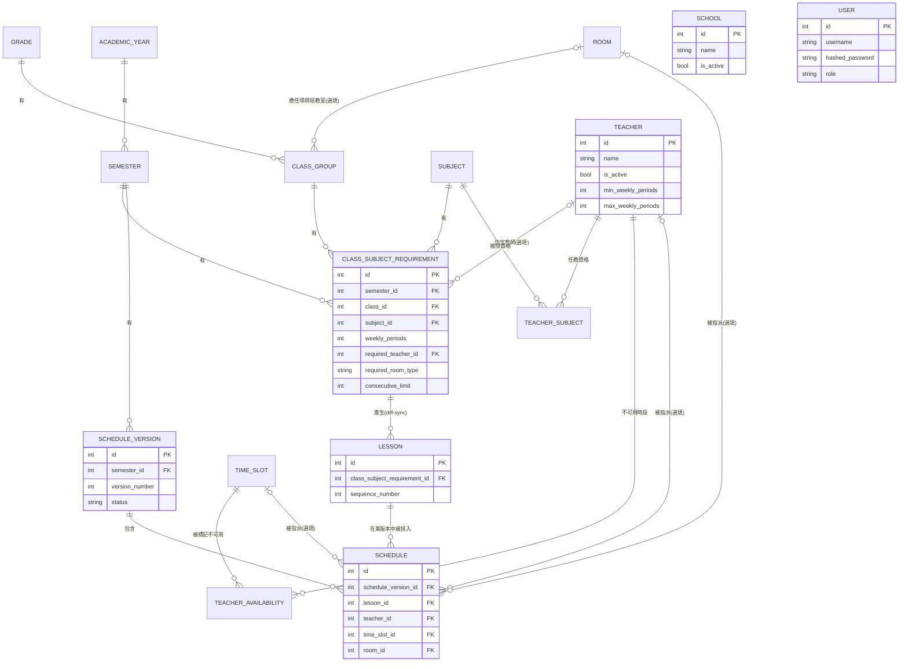

# 系統設計文件:國小智慧排課系統

> 本文件給面試/作品集講述用,說明「為什麼這樣設計」。API 規格已經由 FastAPI 自動產生的 `/docs` 涵蓋,這裡不重複。內容來自實際程式碼、docstring,以及開發過程中每個 Task 的實作紀錄;不確定的地方會註明「這是我的推論,不是逐字紀錄」。

---

## 1. 專案定位

這是一個**約束滿足問題(Constraint Satisfaction Problem, CSP)的建模與求解專案**:輸入是老師的任教資格、可用時段、工作量上限、班級的每週授課節數需求、教室類型限制;輸出是一份滿足所有 Hard Constraint 的課表,或者——當滿足不了的時候——一份講得出具體原因的失敗報告。CRUD、Auth、REST API 是把這個求解引擎包裝成可操作系統所需要的基礎設施,核心是 `scheduling_engine/` 這個完全獨立的約束引擎與排課演算法。

---

## 2. 整體架構


**為什麼 Scheduling Engine 要獨立於框架**:`scheduling_engine/` 底下沒有任何一行 import SQLAlchemy、FastAPI,或是直接碰資料庫,只吃/吐純 Python dataclass(`LessonAssignment`、`SchedulingResources`、`ConstraintViolation`…)。這個邊界帶來幾個具體、可驗證的好處:

- **測試速度**:`tests/scheduling_engine/` 底下總共 73 個測試(Constraint、Greedy、Backtracking、靜態可行性檢查、Fixed Time Slot),實測 `pytest tests/scheduling_engine/ -q` 只要 **0.12 秒**,因為完全不需要 `Base.metadata.create_all()`/`drop_all()` 這種資料庫層級的操作。相對地,`tests/` 底下 192 個 API 層測試,因為每個測試都要對真實 PostgreSQL 建表/清表,總耗時要 80 秒以上。
- **獨立可測試性**:Task 17 到 Task 23 開發整個約束引擎、Greedy、Backtracking、靜態可行性檢查的過程中,一次都沒有啟動過 FastAPI 或連過資料庫——所有邏輯都是用手寫的 dataclass 資料直接驗證。直到 Task 21 才第一次需要「接上真實資料庫」,而那個轉接層(`backend/app/services/scheduler.py`)清楚地被隔離在 Service 層,`scheduling_engine/` 本身完全沒被碰過。
- **關注點分離**:排課邏輯的正確性(這組候選會不會衝突、這樣排合不合法)跟「這筆資料在資料庫裡長怎樣」是兩個完全不同層次的問題,混在一起會讓兩邊都難測試、難改。

---

## 3. 前端架構

第一版本文件(Task 26)寫成時,系統完全沒有前端,只能透過 Swagger UI 操作——這種呈現方式沒辦法讓非技術背景的人(或只有幾分鐘評估時間的面試官)在短時間內感受到 Scheduling Engine 背後的設計價值。`docs/FRONTEND_REQUIREMENTS.md` 明確把前端存在的目的定義為「**降低理解門檻,不是做一套完整的教務系統**」,並訂出一條貫穿所有頁面取捨的判斷標準:「這個畫面能不能讓看的人在 10 秒內感受到『這是一個會思考的排課系統,不是一個表單工具』?不能的,不做。」

這個定位決定了採**分階段策略**:

- **階段 A(已完成)**:本節描述的 6 個核心頁面,唯讀為主,聚焦展示排課引擎的核心能力。
- **階段 B(待辦,見第 10 節)**:教務處日常操作所需的完整 CRUD 表單與使用者/角色管理介面,量級上預估是階段 A 的 2.5–3 倍 Task 數量、3–4 倍開發時間。

階段 A 開發時刻意保留了往階段 B 擴充的空間,而不是先把架構寫死成純唯讀再回頭重寫——`docs/FRONTEND_REQUIREMENTS.md` 第 4 章把這點列為硬性約束而非建議:API 呼叫層一開始就完整定義 `list`/`get`/`create`/`update`/`remove` 五種操作的簽章(階段 A 只是「先不呼叫」後三種,不是「介面裡沒有」)、清單頁的表格版面預留操作按鈕欄位、TypeScript 型別對齊後端 Pydantic Schema 的全部欄位而非只挑顯示會用到的子集。

### 3.1 技術選型

| 項目 | 決定 | 理由 |
|---|---|---|
| 前端框架 | React + TypeScript + Vite | 沿用專案最初規格書既定選型 |
| 路由 | React Router | 頁面數量少,業界標準,學習成本低 |
| 狀態管理 | React 內建 `useState`/`useContext` | 頁面少、資料流簡單,不需要 Redux/Zustand 這類額外套件增加複雜度 |
| HTTP 呼叫 | axios(而非原生 `fetch`) | 每個請求都要帶 JWT token、且需統一處理排課失敗時的結構化錯誤(`lesson_failures`/`post_hoc_violations`),axios 的攔截器(interceptor)可以統一處理「自動帶 token」與「錯誤格式轉換」,讓開發精力留給課表呈現、失敗診斷這些核心功能 |
| Token 儲存 | `sessionStorage` | 分頁關閉即清除,比 `localStorage` 稍微安全,demo 情境已足夠 |

完整的選型理由、階段 A 的三項擴充性硬性約束、以及失敗診斷畫面的 id/類型轉換機制規格,見 `docs/FRONTEND_REQUIREMENTS.md` 第 4 章。

### 3.2 六個核心頁面

| 頁面 | 路由 | 定位 |
|---|---|---|
| 登入 | `/login` | JWT 認證,取得 token,存入 `sessionStorage` |
| 基礎資料瀏覽 | `/data` | 老師/班級/科目/教室/時段五類資料的分頁籤唯讀瀏覽(單頁 + 分頁籤切換,不做成獨立路由),老師列可展開查看任教資格與不可用時段 |
| 排課需求總覽 | `/requirements` | 顯示目前學期設定的 `ClassSubjectRequirement`,id 轉名稱呈現 |
| 排課控制台 | `/scheduler` | **核心亮點頁面**:選版本 → 展開課程清單 → 觸發自動排課 → 顯示結果;排課失敗時內嵌顯示失敗診斷(見 3.3) |
| 課表檢視 | `/timetable` | **核心亮點頁面**:依班級/教師/教室三種視角查看排課結果,縱軸節次、橫軸星期一到五 |
| 失敗診斷 | 無獨立路由,內嵌於排課控制台 | **核心亮點頁面**:見 3.3 |

（`/` 首頁目前是登入成功後的暫時性佔位頁,尚未實作 `docs/FRONTEND_REQUIREMENTS.md` 流程 A 設想的統計 Dashboard,不計入上述 6 個核心頁面。）

「失敗診斷」刻意沒有獨立路由,而是排課失敗時直接嵌入排課控制台畫面——這是實作階段做的決定:失敗診斷永遠緊接在「按下開始排課」這個動作之後,拆成獨立頁面等於多一次導覽、多傳一份跨頁面的 state,對這個一次性、上下文緊密的畫面沒有實質好處。

### 3.3 失敗診斷:整個前端最能對應後端設計理念的一頁

`docs/FRONTEND_REQUIREMENTS.md` 明確把失敗診斷列為「整個前端最有價值的一頁」,理由是它直接把第 6 節 Explainable Scheduling 的設計——`ConstraintViolation` 的共同格式、三種搜尋層級失敗類型、Task 23 的靜態可行性預檢——攤開給非技術背景的人看,呈現「為什麼排不出來、具體是哪個老師哪個限制、建議去哪個畫面修」。

實作上分兩層轉換,都在前端完成,不修改後端或 `scheduling_engine/`(刻意維持後者 framework-independent 的邊界,見第 2 節):

1. **代碼 → 中文說明**:一份 `Record<string, string>` 對照表,涵蓋 5 種頂層 `failure_type`(`DEFINITELY_INFEASIBLE`/`SEARCH_LIMIT_EXCEEDED`/`TIMEOUT`/`REQUIREMENT_PERIODS_MISMATCH`/`STATIC_CHECK_FAILED`)與 16 種 `ConstraintViolation.type`(H1–H9、H11、H12 共 11 條 Hard Constraint,加上 `NO_CANDIDATE_TEACHER`/`H6_REQUIRED_TEACHER_NOT_QUALIFIED` 兩種合成類型,加上 3 種靜態檢查類型)。查不到對照的類型會 fallback 顯示原始英文訊息,不會吞掉或顯示空白。
2. **id → 名稱**:畫面載入時一併查詢教師/班級/科目/教室/時段清單(與基礎資料瀏覽頁共用同一組 API 呼叫,不重複查詢),把 `teacher_id`/`class_id` 這類裸露的資料庫 id 轉換成「楊老師」「五年一班」這樣的實際名稱。

畫面上每則違規固定兩行:違規說明(中文樣板組字,結尾用驚嘆號)、以及「請至 XX 頁面修正」(依違規類型對應到最適合的既有頁面,可點擊連結導向;少數在目前 API 流程中實際不可能觸發、也沒有對應可修正頁面的類型,顯示固定說明文字而非勉強塞一個不準確的連結)。同一個需求底下因完全相同原因失敗的多堂課,會合併成一則訊息(「XX 班的 XX 科目(共 N 堂課):……,這些課無法排定!」)呈現,不逐堂課重複顯示編號無意義的 `lesson_id`。

目前前端沒有建立自動化測試框架(`frontend/package.json` 沒有 `test` 腳本),每個階段 A 頁面的驗證方式是啟動真實的前後端服務、用真實資料手動觸發情境確認;失敗診斷這類邏輯較複雜的模組另外搭配對已編譯原始碼的直接呼叫重放真實 API 回應驗證。這項限制列入第 10 節。

---

## 4. Domain Model



> 圖中的 `CLASS_GROUP` 對應程式碼裡的 `Class`(班級)——`CLASS` 是 Mermaid erDiagram 語法的保留字,拿來當實體名稱會導致解析失敗,因此圖上改用 `CLASS_GROUP`。屬性型別/是否必填等細節以第 4.1 節文字與 `backend/app/models/` 原始碼為準;`role` 目前只接受 `ADMIN`/`TEACHER`,`status` 只接受 `DRAFT`/`PUBLISHED`,`required_teacher_id`/`required_room_type`/`consecutive_limit` 與 `SCHEDULE` 的 `teacher_id`/`time_slot_id`/`room_id` 均為選填欄位。

> 圖中 `SCHOOL` 跟 `USER` 沒有任何關聯線,是如實反映現況。細節見第 10 節「已知限制」。

### 4.1 四個非直覺但刻意的設計決策

**(1) `TeacherAvailability`:用「存在即不可用」取代 `is_available: bool` 欄位**
`TeacherAvailability` 表只記錄「這位老師在這個時段不可用」的例外情況,沒有欄位存「可用」——一個老師沒有出現在這張表裡,就代表所有時段都可用。這是刻意的精簡設計:現實中「不可用時段」通常是少數例外(某老師週三下午要開會),把「可用」當預設值、只記錄例外,資料量遠比「每個老師 × 每個時段都存一筆 True/False」小得多,查詢邏輯也更貼近業務語意(「這個時段有沒有被排除」而不是「查出所有 True 的列」)。`RequiredTeacherRule`、`RoomTypeRequirement` 也採用同一種「稀疏表示,沒有規則=無限制」的模式。

**(2) `Lesson` / `Schedule` / `ScheduleVersion` 三層分離**
這三張表分別回答三個不同的問題:`ClassSubjectRequirement` 說「這個班這學期這科目需要幾節課」;`Lesson` 是把「幾節課」具體展開成的一份**版本無關**的待排清單(3 節課 = 3 筆 `Lesson`,不管排到哪個版本);`Schedule` 才是「某個 `Lesson` 在某個特定 `ScheduleVersion` 裡實際落在哪個時段/老師/教室」。這樣分層之後,重新排一次課(建立新的 `ScheduleVersion`)不需要重新產生 `Lesson`,同一批 `Lesson` 可以在多個版本裡有不同的排法——這正是「Draft / Published 版本管理」得以成立的資料結構基礎。

**(3) 中介表語意化巢狀在資源底下,沒有獨立的 CRUD endpoint**
`TeacherSubject`(任教資格)、`TeacherAvailability`(不可用時段)走的是 `POST/GET/DELETE /api/v1/teachers/{id}/subjects`、`/api/v1/teachers/{id}/unavailable-slots`,沒有 `/api/v1/teacher-subjects`、`/api/v1/teacher-availabilities` 這種獨立資源。理由是這兩張表脫離「某位老師」的脈絡沒有獨立存在的意義——沒有人會想單獨查「所有教師資格紀錄」而不關心是哪位老師,把它們設計成子資源讓 API 的形狀直接對應到業務語意,也讓 404(教師不存在)自然發生在對的層級。

**(4) `ActiveStatusInfo` 用一個共用 dataclass 取代四個各自獨立的 Active 狀態類別**
H12(停用狀態)理論上要分別檢查教師/班級/科目/教室四種實體是否停用,直覺的做法是寫 `TeacherActiveStatus`、`ClassActiveStatus`…四個結構幾乎一樣的 dataclass。但這四者的「形狀」完全相同(一個 id + 一個布林值),差別只在 id 取自哪個實體的 id 空間,所以最終設計成一個帶 `entity_type: Literal["teacher","class","subject","room"]` 判別欄位的共用 dataclass。這避免了四份幾乎重複、卻仍然需要一樣的 Constraint 處理邏輯的程式碼。

---

## 5. 排課演算法

### 5.1 MRV → Greedy → Backtracking 的分工

三者彼此銜接,構成一條漸進的責任鏈:

1. **MRV(Minimum Remaining Values)排序**:兩個演算法共用同一套排序邏輯(`algorithms/resources.py::candidate_teacher_ids`)——先處理候選老師最少的 `Lesson`。有 `required_teacher_id` 的 `Lesson` 天生只有 1 個候選,永遠排最前面。這個排序只計算一次,搜尋過程中永遠不重新排序(重新排序的是「搜尋順序」的假設會被打破,不利於 Backtracking 的正確性推理)。
2. **Greedy Scheduler**:依照 MRV 順序,對每個 `Lesson` 選第一個通過即時 Hard Constraint 檢查的候選,選完就不再回頭。優點是快、實作簡單;缺點是一旦某個選擇卡死後面的 `Lesson`,整次排課就直接宣告失敗,即使換一個更早的選擇就能成功。
3. **Backtracking Scheduler**:候選產生邏輯與 Greedy 完全共用(同一個 `resources.py`),差別只在「某個 `Lesson` 沒有候選可用時該怎麼辦」——Greedy 直接放棄,Backtracking 會**撤回前一個 `Lesson` 的選擇**,換下一個候選再試一次。這是用游標(`cursor[i]`)記錄每個位置下一個要試的候選索引,回溯時游標不歸零(只有「第一次前進到這個位置」才歸零),確保搜尋不會重複做過的嘗試。

測試中有一個具體案例直接證明兩者的差異:`test_backtracking_succeeds_where_greedy_fails`——同一組輸入,Greedy 因為貪心搶走了唯一一間特殊教室而失敗,Backtracking 靠撤回重試成功排出結果。

### 5.2 H1–H12 實作狀態

| # | 名稱 | 狀態 | 說明 |
|---|------|------|------|
| H1 | Teacher Conflict | ✅ 已做 | 即時檢查,兩演算法皆有 |
| H2 | Class Conflict | ✅ 已做 | 即時檢查 |
| H3 | Room Conflict | ✅ 已做 | 即時檢查 |
| H4 | Teacher Availability | ✅ 已做 | 即時檢查 |
| H5 | Teacher Qualification | ✅ 已做 | 即時檢查;曾有一個與 H6 交互的邊界案例(指定教師剛好不具資格)沒被正確判定為零候選,已在 Task 22 修正 |
| H6 | Required Teacher | ✅ 已做 | 同時影響候選產生(MRV 篩到只剩 1 個)與即時驗證(雙重保險) |
| H7 | Weekly Subject Requirement | ✅ 已做,**僅整批驗證** | 數學上無法逐候選檢查,詳見 5.3 |
| H8 | Teacher Maximum Workload | ✅ 已做,**Greedy 整批 / Backtracking 即時** | 兩演算法刻意採不同策略,詳見 5.3 |
| H9 | Room Type | ✅ 已做 | 即時檢查;查無資料時的處理原則見第 7 節 |
| H10 | Room Capacity | ⏸️ **延後** | `Room.capacity` 欄位已預留(nullable),但未實作對應 Constraint,見第 10 節 |
| H11 | Non-teaching Period | ✅ 已做 | 即時檢查;在目前的 API 流程中實際上不會被觸發(只有 `greedy.py` 的逐候選解釋路徑會產生,但 `run_scheduler()` 只呼叫 Backtracking),前端失敗診斷因此對它顯示「此為排課引擎內部判斷」而非導向某個修正頁面,見 3.3 |
| H12 | Active Status | ✅ 已做 | 即時檢查,涵蓋教師/班級/科目/教室 |

12 條 Hard Constraint 中 11 條已實作(H1–H9、H11、H12),H10 是唯一延後項目。

### 5.3 H7 與 H8:為什麼一個永遠整批驗證、一個可以即時過濾

H7(「這個需求恰好要有 N 節課」)是一個**等式**限制:排課過程中任何時間點,已排入的節數必定 ≤ 目標值,這跟「真的會短缺」在數學上無法區分,只有排入最後一節課的當下才知道對不對。所以 H7 在兩個演算法裡都只能是排完之後的整批檢查,不存在「提早篩掉候選」的可能。

H8(「這位老師每週不能超過上限」)是一個**上限**限制:一旦某個候選會讓老師超過上限,這個事實不會因為後面又排了別的東西而改變,可以安全地在候選產生階段就篩掉。但兩個演算法對這件事的態度不一樣——**Greedy 選擇不做即時 H8 過濾**,因為 Greedy 沒有回頭機制,提早篩掉候選只會讓失敗發生在更早的 `Lesson`,不會改變「這次排課到底成不成功」的結果,所以不值得為此增加複雜度;**Backtracking 選擇即時過濾**,因為 Backtracking 可以靠撤回重試來利用這個提早發現的資訊,避免整個搜尋走進一個從一開始就注定失敗的分支,能有效減少不必要的回溯次數。

---

## 6. Explainable Scheduling

系統的一個核心原則(來自 `AGENTS.md` 第 8 節)是:排課失敗不能只回一句「排不出來」,必須講出「為什麼」跟「可能怎麼解決」。第 3.3 節說明了這個原則如何在前端被視覺化。

### 6.1 `ConstraintViolation`:所有失敗訊息的共同格式

每一種違規都用同一個 dataclass 表達:`type`、`severity`、`lesson_id`、`teacher_id`、`class_id`、`subject_id`、`time_slot_id`、`message`、`suggested_action`,加上後來因應實際需求陸續補上的 `room_id`(Task 17.5)與 `class_subject_requirement_id`(Task 19)。這個欄位集合是隨著實際寫測試、發現「這種違規講不清楚是哪個班的哪個需求」才逐步補齊的,不是一開始就設計完整。這也是為什麼優先順序把「正確性」跟「可理解性」放在「功能完整」前面:先讓已實作的部分講得清楚,比一開始就設計一個大而全的結構更重要。

### 6.2 三種搜尋層級的失敗類型

Backtracking 的結果區分三種本質不同的失敗:

- **`DEFINITELY_INFEASIBLE`**:搜尋空間被完整耗盡(或某個 `Lesson` 一開始就零候選)。這是確定的結論——保證無解,跟後面兩種「還沒找到」不同。
- **`SEARCH_LIMIT_EXCEEDED`**:在 `max_backtrack_steps` 次回溯內沒找到解,但不代表無解,只代表搜尋預算不夠。
- **`TIMEOUT`**:同樣不代表無解,只是時間到了。

這個區分很重要:對使用者來說,「保證排不出來,問題出在資料本身」跟「可能排得出來,但機器沒找到,試著放寬搜尋預算」是完全不同的建議。

### 6.3 靜態可行性檢查(Task 23,Task 38 擴充為四類):不用搜尋就能證明無解

有四類問題根本不需要跑一次搜尋就能靠加總/比對確定會失敗:

1. **教師工作量超標**:被 `required_teacher_id` 指定的所有 `Lesson` 節數加總,超過該教師 `max_weekly_periods`。
2. **教師可用時段不足**:被指定的節數超過該教師實際可用的時段數(全校時段數 − 該教師不可用時段數)。
3. **停用狀態衝突**:需求涉及的教師/班級/科目本身就是停用狀態。
4. **零合格教師**(Task 38 補上):某個 `Lesson` 完全沒有任何候選老師——沒有 `required_teacher_id` 規則、也沒有任何老師具備該科目的 H5 資格;或 `required_teacher_id` 指定的老師剛好不具資格。這類判斷原本只存在 Backtracking 自己的 pre-flight 步驟裡,直到 Task 38 一個真實案例(見第 8 節案例一)才發現它沒有被納入這裡,導致跟其他三類檢查「互斥」。

這四類檢查在 `run-scheduler` 呼叫 `schedule_backtracking()` 之前執行,一旦命中就直接回報,完全不進入搜尋。這樣做除了節省搜尋時間,也避免這類失敗被 Backtracking 自己發現時,落入「搜尋整個耗盡、但無法歸咎到單一 `Lesson`」的模糊地帶(這正是 Task 22 修的那個 bug 的根源:一個必然失敗的案例,因為候選產生邏輯沒有正確識別它是「零候選」,結果搜尋跑到底才回報「無解」卻給不出任何理由——跟 Task 38 的案例是同一種「零候選沒被正確辨識」的根本問題,只是發生在流程的不同位置)。

### 6.4 具體案例:教師工作量超標的完整錯誤訊息

假設老師 6 被兩個需求(id=1、id=2)都指定為 `required_teacher_id`,兩者加起來需要 6 節課,但這位老師的 `max_weekly_periods` 只有 5。呼叫 `POST /api/v1/schedule-versions/{id}/run-scheduler` 會得到:

```json
HTTP 422

{
  "failure_type": "STATIC_CHECK_FAILED",
  "lesson_failures": [],
  "post_hoc_violations": [
    {
      "type": "STATIC_TEACHER_WORKLOAD_EXCEEDED",
      "severity": "ERROR",
      "lesson_id": null,
      "teacher_id": 6,
      "class_id": null,
      "subject_id": null,
      "time_slot_id": null,
      "room_id": null,
      "class_subject_requirement_id": null,
      "message": "Teacher 6 is required (via required_teacher_id) for 6 lessons this run -- across requirement(s) [1, 2] -- but their max_weekly_periods is only 5.",
      "suggested_action": "Raise teacher 6's max_weekly_periods, reduce weekly_periods on the affected requirement(s), or reassign the required-teacher rule on some of them."
    }
  ],
  "backtrack_count": 0
}
```

`backtrack_count: 0` 是結構性保證:`schedule_backtracking()` 這一行程式碼在原始碼裡位於這個提早回傳之後,根本不會被執行到。

---

## 7. 關鍵架構決策紀錄

| # | 問題 | 選項 | 決定 | 理由 |
|---|------|------|------|------|
| 1 | `generate-lessons`(diff-sync)遇到「現有 Lesson 數量已超過 weekly_periods」該怎麼辦?排課失敗時,已經嘗試過的部分結果該不該寫入? | (a) 自動刪除多餘資料 / 寫入部分結果 (b) 整批中止,完全不寫入,回報清單 | (b) | `Lesson`/`Schedule` 底下可能已經有後續資料(已排課結果、人工調整),自動刪除或寫入部分結果等於默默丟棄或誤導使用者。`AGENTS.md` 明文禁止「把部分排好的課表當作成功結果」,採 all-or-nothing 讓呼叫端得到一個可預期、可驗證的結果,不留「半成功」的模糊狀態。 |
| 2 | `Teacher.qualified_subjects` / `unavailable_slots` 這類多對多關聯,要不要開放透過 relationship 直接 `.append()` 寫入? | (a) 可寫入的 relationship (b) `viewonly=True`,強制透過 `TeacherSubject`/`TeacherAvailability` 物件本身建立 | (b) | 這兩張中介表本身帶有業務語意(資格、不可用時段紀錄),不是純粹的多對多橋接表。強制透過物件寫入,確保「讀」跟「寫」走同一條、可測試的路徑,也避免關聯的隱式 INSERT 繞過未來可能加上的欄位驗證。 |
| 3 | 已發布(PUBLISHED)版本要不要能被修改? | (a) 允許管理員強制覆蓋 (b) 完全鎖定,包括不能改回 DRAFT,唯一出路是複製一份新 Draft | (b) | 規格明確要求「Published 不可直接修改」。若開放「改回 DRAFT」這個例外,等於留了一個繞過鎖定的後門——選擇行為最單純、最容易對使用者解釋的版本(「發布了就是發布了,要改就開新草稿」),複製機制列為下一步待辦。 |
| 4 | H9(教室類型)檢查時,如果查無對應的 `RoomInfo`/`TimeSlotInfo` 資料,該視為違規還是放行? | (a) 保守起見視為違規 (b) 視為「資料不足、無法判斷」,不算違規 | (b),並讓 H9 與已有的 H11 保持一致 | Hard Constraint 的職責是「證明違規」,不是「證明合法」。查無資料代表輸入資料本身不完整,那是上游資料品質的問題,不應該由 Constraint 用猜測的方式懲罰一個它其實無法判斷的案例。這是 Task 18.5 從一個實際不一致(H9 跟 H11 處理方式不同)修正而來的原則。 |
| 5 | 為什麼不直接用 OR-Tools(或其他現成的 CP-SAT/排課求解器)? | (a) 直接呼叫成熟求解器套件 (b) 自己實作 Constraint Engine + Greedy + Backtracking | (b) | 這是一個學習與作品集專案,核心價值在於展示「如何為一個真實問題建立 CSP 模型、設計約束、實作可解釋的求解演算法」的能力。直接呼叫 OR-Tools 會把最有學習/展示價值的部分外包掉;如果這是一個真正要上線給學校用的正式產品，我會優先考慮用 OR-Tools 這類成熟的 CP-SAT 求解器,因為它們經過大量優化、處理過更多邊界案例 |
| 6 | H7(精確節數)、H8(工作量上限)這類「加總型」限制,能不能像 H1–H6 一樣逐候選即時過濾? | (a) 全部整批驗證 (b) 依「上限型」與「精確型」分別處理 | (b):H7 永遠整批(數學上不可能提早判定);H8 在 Backtracking 即時檢查,Greedy 仍整批 | 詳見第 5.3 節的完整推導。 |
| 7 | `scheduling_engine/` 在 repo 根目錄,是 `backend/` 的手足目錄(不是子套件),`backend/app/services/scheduler.py` 要怎麼 import 它? | (a) 把 `scheduling_engine/` 搬進 `backend/app/` 底下 (b) 在轉接層檔案加一段 `sys.path` bootstrap | (b) | 搬動目錄會讓 `scheduling_engine/` 看起來像是 backend 的子模組,模糊了它「框架獨立、原則上可以獨立安裝/發布」的定位。專案裡已經有兩個方向相反、但問題本質相同的先例(`backend/alembic/env.py`、`tests/conftest.py`),延續同一套解法比改動目錄結構的架構代價更小。 |
| 8 | 對一個已經有 `Schedule` 記錄的版本重新呼叫 `run-scheduler`,該怎麼處理? | (a) 自動覆蓋既有結果 (b) 拒絕(409),要求先手動刪除既有記錄 | (b) | 與決策 1 同樣的「不自動覆蓋/丟棄資料」精神——已存在的 `Schedule` 可能是已發布的正式課表,或人工微調過的結果,自動覆蓋的風險遠高於多一步手動確認的成本。 |
| 9 | Task 38 發現「靜態檢查」與「Backtracking pre-flight」兩層獨立機制會因為 `run_scheduler()` 的 early-return 而互斥,該移除 early-return 讓兩層都跑,還是把 pre-flight 的判斷併入靜態層? | (a) 移除 early-return,靜態檢查失敗後仍呼叫 `schedule_backtracking()` 取得 pre-flight 結果 (b) 把「零候選教師」升級成 `check_static_feasibility()` 的第四種檢查 | (b) | (a) 對已經用加總就能確定失敗的案例,仍會多付出建構搜尋狀態的成本,且 `schedule_backtracking()` 的既有回傳形狀(`failure_type`/`backtrack_count`)沒有為「順便回報靜態問題」設計過,混用會模糊掉兩種機制原本的責任分界。(b) 讓 `check_static_feasibility()` 保持「不需要搜尋就能確定失敗」的單一職責,`schedule_backtracking()` 本身完全不用動,對直接呼叫它的既有呼叫端/測試沒有任何影響。完整案例見第 8 節。 |

---

## 8. 除錯歷程

決策紀錄(第 7 節)講的是「當初怎麼選」,這一節講的是「選完之後,實際用真實資料跑起來時發現了什麼」——每個案例都是先有一個具體、可重現的錯誤現象,再一路往回追到根因。格式統一是**問題 → 發現過程 → 根因 → 修法**。

### 案例一:靜態檢查機制互斥導致漏報(Task 38)

**問題**:排課控制台實際操作時,一次排課同時觸發「教師工作量超標」與「完全沒有合格教師」兩種完全不同的失敗原因,畫面卻只顯示工作量超標那一則,另一種問題完全沒出現。

**發現過程**:先繞過前端,直接呼叫 `POST /api/v1/schedule-versions/{id}/run-scheduler`,用真實資料重現同一個情境(一組需求把某教師的 `required_teacher_id` 指定到超過其 `max_weekly_periods`,另一組需求的科目完全沒有任何教師具備資格)。確認後端回應本身 `lesson_failures` 就是空陣列——不是前端漏渲染,是後端真的沒有把第二種問題算出來。

**根因**:`run_scheduler()` 一旦 `check_static_feasibility()`(當時只做工作量/可用時段/停用狀態三種檢查)找到任何問題就立刻 `return`,`schedule_backtracking()` 完全不會被呼叫到。而「這個 `Lesson` 有沒有任何候選教師」這個判斷,原本只存在 `schedule_backtracking()` 自己的 pre-flight 步驟裡。兩層各自獨立、各自正確的檢查機制,因為這個 early-return 而彼此互斥——靜態層先攔下,搜尋層(連同它自己的 pre-flight)就整個被跳過,不是「只回報第一個」,是「第二層根本沒機會執行」。

**修法**:不是移除 early-return(對一個已經能用加總確定會失敗的案例,仍跑一次搜尋只是浪費),而是把「零合格教師」升級成 `check_static_feasibility()` 的**第四種**靜態檢查,讓它跟另外三種一起被收集、一起回報。`schedule_backtracking()` 自己的 pre-flight 邏輯完全沒有被動過(直接呼叫它的既有呼叫端/測試行為不變),只是透過 `run_scheduler()` 這條路徑時,靜態層會先一步把四種問題一起抓出來。新增 4 個回歸測試,其中一個直接重現「工作量超標 + 零合格教師同時發生」的情境,斷言兩種問題會同時出現在同一份回應裡。

### 案例二:`generate-lessons` 的 `created_count` 語意誤用(Task 32.8)

> 這裡的正確編號是 Task 32.8,不是背景敘述提到的 32.7——32.7 是同一批工作裡另一個子任務(排課控制台的版本狀態管理重構),已在程式碼註解與 commit 訊息裡核對過,兩者容易混淆,這裡以原始碼裡的標號為準。

**問題**:排課控制台顯示「共 0 堂課待排」,使用者卻緊接著按下「開始自動排課」,結果成功排定了一大批課——畫面上出現兩個互相矛盾的數字。

**發現過程/根因**:`generate-lessons` 本身是 diff-sync 設計,刻意做成 idempotent——對一個已經同步過的版本再呼叫一次,「這次新增的筆數」正確地是 0,這是設計上有意的行為,不是 bug。但排課控制台把這個「本次新增筆數」(`created_count`)直接當成「目前總共有幾堂課待排」顯示,兩者在語意上是完全不同的問題(「這次做了什麼」vs.「現在情況如何」),混用在絕大多數情況下(第一次呼叫)剛好數字相同、看不出差異,只有在「已經同步過、再呼叫一次」這個路徑上才會顯現出矛盾。

**修法**:後端 `GenerateLessonsResult` 新增 `total_lesson_count` 欄位,明確回傳「這次呼叫結束後,該學期實際的 `Lesson` 總數」(等於所有需求 `weekly_periods` 加總——這個等式能成立,前提正是「沒有任何需求被過度佈建」,而這正是程式能執行到這一步就已經保證成立的條件)。前端排課控制台改讀這個明確欄位,不再從 `created_count` 反推「目前有多少」。這個案例也是本文件「Explainable」原則的一個小型翻版:不是讓呼叫端自己從一個為了別的目的設計的數字去猜語意,而是把呼叫端真正想問的問題,直接做成一個獨立、明確的欄位。

### 案例三:完整時段框架顯示的迭代(Task 35 → Task 35.5)

**問題**:課表檢視頁面最初的設計,是每個節次(period)挑一個「代表性」`TimeSlot` 來決定整**列**要顯示的名稱、以及是不是非教學時段。

**發現過程**:具體做法是取每個 period 底下「`weekday` 最小」的那筆 `TimeSlot` 代表整列——例如週一第 0 節是「早自習」,這個名稱就被用來代表所有星期的第 0 節。但 `TimeSlot` 資料模型本身是逐 `(weekday, period)` 各自一筆記錄,週三第 0 節完全可能是另一個名稱(例如「導師時間」),這種「取最小 weekday 代表整列」的做法會把週三第 0 節的真實名稱靜默地蓋掉,整列只顯示「早自習」。這違反了一個更根本的邏輯:是不是教學節次、叫什麼名字,本來就該是**每一格獨立**判斷的屬性,不是一個可以被「代表」的列層級屬性。

**根因**:問題不在資料模型(`TimeSlot` 本來就是逐格記錄),而在前端顯示邏輯把它「壓平」成列層級的屬性,用一個不具代表性的樣本去代表五天。

**修法**:拿掉列層級的標籤/教學狀態這個中間表示,`periods` 只留下單純排序過的節次數字清單;改用 `(weekday, period)` 複合 key 查表(`timeSlotByWeekdayAndPeriod`),每個儲存格各自查自己的 `TimeSlot`、各自決定要不要顯示非教學標籤、顯示什麼名字。列標題反過來簡化成單純的「第 N 節」,不再嘗試讀取任何名稱——因為同一節次在不同星期本來就可能有不同名字,列標題本來就不該有單一答案。

### 補充案例:登入錯誤訊息閃現即消失(Task 29.5)

> 這是額外找到、超出本次要求 3 個案例範圍的第 4 個真實案例,一併附上供參考;若不需要可以移除。

**問題**:輸入錯誤密碼登入時,畫面上的錯誤訊息會先短暫顯示,幾乎立刻又消失,使用者來不及看清楚寫了什麼。

**發現過程**:追蹤 `apiClient`(axios 實例)的 response interceptor,發現它對「任何」401 回應都會清掉 token、並用 `window.location.href` 強制導回登入頁。登入請求本身也是透過同一個 `apiClient` 送出的,密碼錯誤回傳的 401 因此也被同一段邏輯攔截。

**根因**:這個 interceptor 原本是為了處理「已登入但 token 過期」的情境設計——在任一個受保護頁面收到 401,代表 session 失效,理當導回登入頁。但它沒有區分「這個 401 是不是來自登入端點本身」,於是 `Login.tsx` 才剛把錯誤訊息的 state 設好,interceptor 就用整頁重新載入的方式把它清掉了。

**修法**:interceptor 判斷這次 401 回應的請求網址是否為登入端點(`/api/v1/auth/login`),是的話視為登入頁自己該處理的一般失敗結果放行,不觸發「session 過期」的清除與強制導頁。

---

## 9. 測試策略

測試分成兩個完全獨立的層級,理由直接對應第 2 節提到的架構分離:

- **`tests/scheduling_engine/`(73 個測試)**:純 Python 邏輯測試,輸入輸出都是手寫的 dataclass,不碰資料庫、不啟動 FastAPI。這一層測試的是「約束有沒有正確判斷違規」「MRV 排序對不對」「回溯的邊界語意精不精確」這些領域邏輯的正確性,可以用最小、最精確的手造資料涵蓋邊界案例(例如刻意讓 Greedy 失敗、Backtracking 成功的對照組)。
- **`tests/`(192 個測試)**:透過 `TestClient` 打真實的 FastAPI + PostgreSQL(獨立的 `timetable_test` 資料庫,每個測試前後 `create_all`/`drop_all`),測試的是「這一層有沒有正確接起來」——路由、認證/授權、Pydantic 驗證、資料庫約束、例外轉譯成正確的 HTTP 狀態碼。

兩層分開測試,是因為它們回答的問題完全不同:引擎層測試不應該因為資料庫連線設定錯誤而失敗,API 層測試也不需要重新驗證約束邏輯本身對不對(那是引擎層的責任)。前端(第 3 節)目前沒有對應的自動化測試層,以真實資料手動驗證取代,見 3.3 節末段。

**目前總計 265 個測試**,分佈:

| 類別 | 測試數 |
|---|---|
| Scheduling Engine(純邏輯) | 73 |
| ├─ Constraint 單元測試 | 37 |
| ├─ Backtracking | 10 |
| ├─ 靜態可行性檢查 | 13 |
| ├─ Greedy | 7 |
| └─ Fixed Time Slot(Task 28) | 6 |
| API / 整合測試 | 192 |
| ├─ ScheduleVersion(含 PUBLISHED 鎖定) | 22 |
| ├─ Schedule(含 PUBLISHED 鎖定) | 17 |
| ├─ TimeSlot(含 label,Task 35) | 14 |
| ├─ Class | 13 |
| ├─ Scheduler(排課 API 端到端) | 13 |
| ├─ ClassSubjectRequirement | 12 |
| ├─ Semester | 11 |
| ├─ AcademicYear / Room / Subject / Teacher | 各 10 |
| ├─ Auth / Grade / School | 各 9 |
| ├─ TeacherAvailability / TeacherSubject | 各 8 |
| └─ Lesson(含 fixed_time_slot,Task 28) | 7 |

---

## 10. 已知限制與未來規劃

以下項目都是**有意識排定優先順序後暫緩的項目**,`AGENTS.md` 本身就把它們排在目前開發階段之後(見其第 26 節的優先順序清單):

- **H10 Room Capacity 未實作**:`Room.capacity` 欄位已經預留(nullable,方便未來不需要改 schema 就能加上這條 Constraint),但 Constraint 本身在 Task 17–20 系列被明確排除在範圍外。
- **Soft Constraints(S1–S7)完全未開始**:例如教師每日負擔平衡、避免連續過多堂課等。`AGENTS.md` 明訂「先滿足所有 Hard Constraint,再比較 Soft Constraint 分數」,目前連 Hard Constraint 都才剛補齊靜態可行性檢查,Soft Constraint 排在後面。
- **版本複製機制未實作**:Published 版本的鎖定機制(Task 25)本身完整,但「從 Published 複製一份新 Draft 出來修改」這個配套動作還沒做——目前一個版本被發布後,理論上沒有任何合法路徑可以再產生它的修改版。
- **手動調整課表沒有重新驗證**:`AGENTS.md` 第 15 節要求手動調整課表時後端仍要重新驗證 Hard Constraint,但目前 `PATCH /schedules/{id}` 只檢查了型別、外鍵存在性、與 PUBLISHED 鎖定,沒有跑任何一條 H1–H12 檢查——也就是說目前可以透過手動 PATCH 把兩堂課排到同一個老師的同一個時段。這項限制截至目前(含第 3 節描述的前端範圍)依然完全成立:前端還沒有任何「手動調課」的操作介面,不影響這項限制的現況描述。
- **`fixed_time_slot_id` 後端已支援,前端還沒有對應 UI**:`Lesson.fixed_time_slot_id`(Task 28)讓單一 `Lesson` 可以固定指定時段,支援「同一需求下只固定其中部分堂課」的情境,後端 `PATCH /api/v1/lessons/{id}/fix-time-slot` 已完整可用且有測試覆蓋,但排課控制台(第 3.2 節)目前沒有任何畫面元素可以設定它,只能透過 Swagger UI 直接呼叫這個 endpoint。
- **階段 B 完整 CRUD 表單尚未開始**:`School`、`Teacher`、`Class`、`Subject`、`Room`、`TimeSlot`、`TeacherSubject`、`TeacherAvailability`、`ClassSubjectRequirement` 共 9 張表(或子資源)的新增/編輯/刪除表單,以及使用者/角色管理介面,詳見 `docs/FRONTEND_REQUIREMENTS.md` 第 7 章——預估量級是階段 A 的 2.5–3 倍 Task 數量、3–4 倍開發時間,目前刻意排在階段 A 之後。
- **行政區塊(午餐、課間活動、教師午會等)不呈現在課表檢視**:這些時段不對應任何 `ClassSubjectRequirement`,課表檢視只呈現排課引擎實際排定的課,空堂保持空白——是刻意的範圍決定,需要更大的資料模型調整才能支援,已記錄在 `docs/FRONTEND_REQUIREMENTS.md` 第 3、7 章。
- **`TimeSlot.period` 編號的跨星期一致性,依賴人工維護紀律,資料庫層級沒有強制**:`TimeSlot` 沒有 `semester_id`/`school_id`,是全校共用的單一全域結構,課表檢視的節次(列)軸完全由 `period` 這個整數決定(第 8 節除錯歷程案例三的迭代正是從這裡的一個誤用衍生出來的)。但 schema 本身沒有任何約束保證「第 3 節」在週一到週五代表的是同一個實際時段——如果建資料的人把某天的 `period` 編號填錯位移一格,課表檢視會靜默地把錯的兩堂課對齊在同一列,不會有任何錯誤訊息,純粹依賴建立資料時的人工紀律。
- **`TeacherClassAssignment` 未實作**:`AGENTS.md` 原始 domain 設計把「資格」(`TeacherSubject`)跟「這學期實際負責哪個班」(`TeacherClassAssignment`)分成兩張表,但目前系統排課時直接把「所有具備資格的老師」當候選池,沒有校方預先指派這一層篩選。
- **`User` 帳號與 `Teacher` 網域實體沒有關聯**:登入系統的 `User`(`ADMIN`/`TEACHER` 角色)跟排課領域裡的 `Teacher` 是兩張完全獨立的表,一個 `TEACHER` 角色的帳號目前無法對應到某一位特定 `Teacher`,「老師只能看到自己的課表」這類功能還做不到。
- **`STUDENT` 角色未實作**:`AGENTS.md` 列出三種角色,目前 `User.role` 的 CheckConstraint 只接受 `ADMIN`/`TEACHER`。
- **`School` 沒有實際接進資料模型**:`School` 表存在,但沒有任何其他表的外鍵指向它——系統實質上是隱含的單一學校假設,`Grade.level` 全域唯一就是這個假設的直接後果(如果要支援多校,這條唯一約束必須改成 `(school_id, level)` 複合唯一)。
- **`Teacher.min_weekly_periods` 與 `ClassSubjectRequirement.consecutive_limit` 是「已建欄位、未接引擎」的狀態**:前者沒有對應的「最低工作量」Hard Constraint(目前只有 H8 上限),後者對應到 Soft Constraint S4(避免連續過多堂課),尚未實作。

---

## 11. 電梯簡報草稿(30 秒版本)

> 這是一個國小排課系統。核心是把老師的任教資格、可用時段、工作量上限,還有班級的每週需求、教室類型,建成一套完全獨立於 API 框架跟資料庫的 Constraint Engine,自己實作了 Greedy 跟 Backtracking 兩種排課演算法。系統的重點之一是「可解釋」——每次排不出課表,都能講出具體是哪個老師、哪個限制造成的,不會只回一句排不出來,前端的排課控制台跟失敗診斷畫面把這件事直接視覺化,不用查資料庫就能看懂。目前有 265 個自動化測試,排課引擎那部分完全不需要資料庫,秒級就能跑完。

（可依實際口語習慣調整用詞與停頓,上面這版大約落在 30 秒中等語速。）
