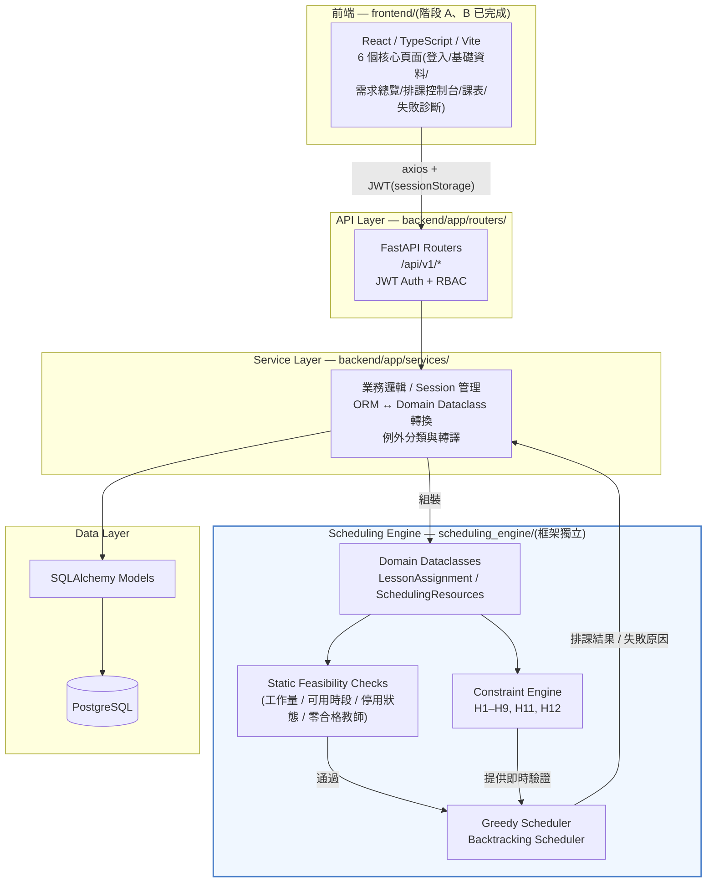
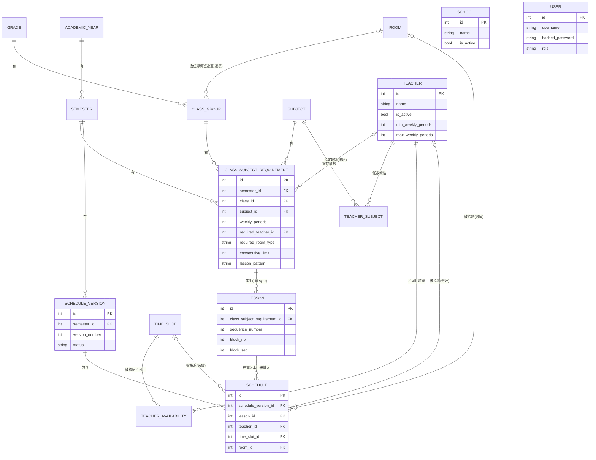

# 系統設計文件:國小智慧排課系統

> 本文件給面試/作品集講述用,說明「為什麼這樣設計」。API 規格已經由 FastAPI 自動產生的 `/docs` 涵蓋,這裡不重複。內容來自實際程式碼、docstring,以及開發過程中每個 Task 的實作紀錄;不確定的地方會註明「這是我的推論,不是逐字紀錄」。

---

## 1. 專案定位

這是一個**約束滿足問題(Constraint Satisfaction Problem, CSP)的建模與求解專案**:輸入是老師的任教資格、可用時段、工作量上限、班級的每週授課節數需求、教室類型限制;輸出是一份滿足所有 Hard Constraint 的課表,或者——當滿足不了的時候——一份講得出具體原因的失敗報告。CRUD、Auth、REST API 是把這個求解引擎包裝成可操作系統所需要的基礎設施,核心是 `scheduling_engine/` 這個完全獨立的約束引擎與排課演算法。

---

## 2. 整體架構



**為什麼 Scheduling Engine 要獨立於框架**:`scheduling_engine/` 底下沒有任何一行 import SQLAlchemy、FastAPI,或是直接碰資料庫,只吃/吐純 Python dataclass(`LessonAssignment`、`SchedulingResources`、`ConstraintViolation`…)。這個邊界帶來幾個具體、可驗證的好處:

- **測試速度**:`tests/scheduling_engine/` 底下總共 150 個測試(Constraint、Greedy、Backtracking、靜態可行性檢查、Fixed Time Slot),實測 `pytest tests/scheduling_engine/ -q` 只要 **0.12 秒**,因為完全不需要 `Base.metadata.create_all()`/`drop_all()` 這種資料庫層級的操作。相對地,`tests/` 底下 631 個 API 層測試,因為每個測試都要對真實 PostgreSQL 建表/清表,總耗時約 2 分鐘。
- **獨立可測試性**:Task 17 到 Task 23 開發整個約束引擎、Greedy、Backtracking、靜態可行性檢查的過程中,一次都沒有啟動過 FastAPI 或連過資料庫——所有邏輯都是用手寫的 dataclass 資料直接驗證。直到 Task 21 才第一次需要「接上真實資料庫」,而那個轉接層(`backend/app/services/scheduler.py`)清楚地被隔離在 Service 層,`scheduling_engine/` 本身完全沒被碰過。
- **關注點分離**:排課邏輯的正確性(這組候選會不會衝突、這樣排合不合法)跟「這筆資料在資料庫裡長怎樣」是兩個完全不同層次的問題,混在一起會讓兩邊都難測試、難改。

---

## 3. 前端架構

第一版本文件(Task 26)寫成時,系統完全沒有前端,只能透過 Swagger UI 操作——這種呈現方式沒辦法讓非技術背景的人(或只有幾分鐘評估時間的面試官)在短時間內感受到 Scheduling Engine 背後的設計價值。`docs/FRONTEND_REQUIREMENTS.md` 明確把前端存在的目的定義為「**降低理解門檻,不是做一套完整的教務系統**」,並訂出一條貫穿所有頁面取捨的判斷標準:「這個畫面能不能讓看的人在 10 秒內感受到『這是一個會思考的排課系統,不是一個表單工具』?不能的,不做。」

這個定位決定了採**分階段策略**:

- **階段 A(已完成)**:本節描述的 6 個核心頁面,唯讀為主,聚焦展示排課引擎的核心能力。
- **階段 B(已完成)**:9 張基礎資料表與排課需求的新增/編輯/刪除表單、老師的任教資格與不可用時段管理、依角色區分的畫面權限,以及統一的 Tailwind 設計系統,見 3.4–3.6。使用者/角色管理介面不在階段 B 的範圍內,之後由 Task 59 補上帳號管理頁(見 3.2),剩餘限制列在第 10 節。

階段 A 開發時刻意保留了往階段 B 擴充的空間,而不是先把架構寫死成純唯讀再回頭重寫——`docs/FRONTEND_REQUIREMENTS.md` 第 4 章把這點列為硬性約束而非建議:API 呼叫層一開始就完整定義 `list`/`get`/`create`/`update`/`remove` 五種操作的簽章(階段 A 只是「先不呼叫」後三種,不是「介面裡沒有」)、清單頁的表格版面預留操作按鈕欄位、TypeScript 型別對齊後端 Pydantic Schema 的全部欄位而非只挑顯示會用到的子集。

### 3.1 技術選型

| 項目 | 決定 | 理由 |
|---|---|---|
| 前端框架 | React + TypeScript + Vite | 沿用專案最初規格書既定選型 |
| 路由 | React Router | 頁面數量少,業界標準,學習成本低 |
| 狀態管理 | React 內建 `useState`/`useContext` | 頁面少、資料流簡單,不需要 Redux/Zustand 這類額外套件增加複雜度 |
| HTTP 呼叫 | axios(而非原生 `fetch`) | 每個請求都要帶 JWT token、且需統一處理排課失敗時的結構化錯誤(`lesson_failures`/`post_hoc_violations`),axios 的攔截器(interceptor)可以統一處理「自動帶 token」與「錯誤格式轉換」,讓開發精力留給課表呈現、失敗診斷這些核心功能 |
| Token 儲存 | `sessionStorage` | 分頁關閉即清除,比 `localStorage` 稍微安全,demo 情境已足夠 |

完整的選型理由、階段 A 的三項擴充性硬性約束、以及失敗診斷畫面的 id/類型轉換機制規格,見 `docs/FRONTEND_REQUIREMENTS.md` 第 4 章。

### 3.2 六個核心頁面

| 頁面 | 路由 | 定位 |
|---|---|---|
| 登入 | `/login` | JWT 認證,取得 token,存入 `sessionStorage` |
| 基礎資料瀏覽 | `/data` | 學校/學年度/學期/年級/老師/班級/科目/教室/時段九類資料的分頁籤(單頁 + 分頁籤切換,不做成獨立路由);階段 A 為唯讀瀏覽,階段 B 起每個分頁皆可新增/編輯/刪除,老師列可展開管理任教資格與不可用時段 |
| 排課需求總覽 | `/requirements` | 顯示目前學期設定的 `ClassSubjectRequirement`,id 轉名稱呈現;階段 B 起可新增/編輯/刪除 |
| 排課控制台 | `/scheduler` | **核心亮點頁面**:選版本 → 展開課程清單 → 觸發自動排課 → 顯示結果;排課失敗時內嵌顯示失敗診斷(見 3.3);版本管理(發布、取消發布、切換生效版本、複製成新草稿,見 3.7) |
| 課表檢視 | `/timetable` | **核心亮點頁面**:依班級/教師/教室三種視角查看排課結果,縱軸節次、橫軸星期一到五;選到已封存版本時提示「僅供查看」;`ADMIN` 可「檢查衝突」並從清單定位到課表格子(見 3.8) |
| 失敗診斷 | 無獨立路由,內嵌於排課控制台 | **核心亮點頁面**:見 3.3 |

（`/` 首頁目前是登入成功後的暫時性佔位頁,尚未實作 `docs/FRONTEND_REQUIREMENTS.md` 流程 A 設想的統計 Dashboard,不計入上述 6 個核心頁面。另有僅 `ADMIN` 可用的「帳號管理」頁(`/users`,Task 59):列出帳號、新增帳號(沿用 `POST /auth/register`)、重設密碼、刪除帳號,屬於系統管理功能,同樣不計入核心頁面。）

「失敗診斷」刻意沒有獨立路由,而是排課失敗時直接嵌入排課控制台畫面——這是實作階段做的決定:失敗診斷永遠緊接在「按下開始排課」這個動作之後,拆成獨立頁面等於多一次導覽、多傳一份跨頁面的 state,對這個一次性、上下文緊密的畫面沒有實質好處。

### 3.3 失敗診斷:整個前端最能對應後端設計理念的一頁

`docs/FRONTEND_REQUIREMENTS.md` 明確把失敗診斷列為「整個前端最有價值的一頁」,理由是它直接把第 6 節 Explainable Scheduling 的設計——`ConstraintViolation` 的共同格式、三種搜尋層級失敗類型、Task 23 的靜態可行性預檢——攤開給非技術背景的人看,呈現「為什麼排不出來、具體是哪個老師哪個限制、建議去哪個畫面修」。

實作上分兩層轉換,都在前端完成,不修改後端或 `scheduling_engine/`(刻意維持後者 framework-independent 的邊界,見第 2 節):

1. **代碼 → 中文說明**:一份 `Record<string, string>` 對照表,涵蓋 5 種頂層 `failure_type`(`DEFINITELY_INFEASIBLE`/`SEARCH_LIMIT_EXCEEDED`/`TIMEOUT`/`REQUIREMENT_PERIODS_MISMATCH`/`STATIC_CHECK_FAILED`)與 22 種 `ConstraintViolation.type`(H1–H9、H11、H12 共 11 條 Hard Constraint,加上 `NO_CANDIDATE_TEACHER`/`H6_REQUIRED_TEACHER_NOT_QUALIFIED` 兩種合成類型,加上 3 種靜態檢查類型,以及 Task 81 的 6 種固定時段預檢類型)。查不到對照的類型會 fallback 顯示原始英文訊息,不會吞掉或顯示空白。
2. **id → 名稱**:畫面載入時一併查詢教師/班級/科目/教室/時段清單(與基礎資料瀏覽頁共用同一組 API 呼叫,不重複查詢),把 `teacher_id`/`class_id` 這類裸露的資料庫 id 轉換成「楊老師」「五年一班」這樣的實際名稱。

畫面上每則違規固定兩行:違規說明(中文樣板組字,結尾用驚嘆號)、以及「請至 XX 頁面修正」(依違規類型對應到最適合的既有頁面,可點擊連結導向;少數在目前 API 流程中實際不可能觸發、也沒有對應可修正頁面的類型,顯示固定說明文字而非勉強塞一個不準確的連結)。同一個需求底下因完全相同原因失敗的多堂課,會合併成一則訊息(「XX 班的 XX 科目(共 N 堂課):……,這些課無法排定!」)呈現,不逐堂課重複顯示編號無意義的 `lesson_id`。

前端頁面與元件的互動沒有自動化測試:每個階段 A 頁面的驗證方式是啟動真實的前後端服務、用真實資料手動觸發情境確認;失敗診斷這類邏輯較複雜的模組另外搭配對已編譯原始碼的直接呼叫重放真實 API 回應驗證。Task 74 起,邏輯較複雜的**純函式**有 Vitest 單元測試(`npm test`,測試檔與原始碼相鄰,`*.test.ts`),涵蓋:衝突句子合併、分組與前後比對(`utils/violationMerge.ts`,含各違規類型的「問題身分」鍵)、「在課表中查看」的定位規則(`utils/violationLocate.ts`)、拖放規則(`utils/lessonDrop.ts`)、換教師的目前教師判定與列表(`utils/teacherReassignment.ts`)、版本狀態標籤(`utils/scheduleVersionFormat.ts`)、API 錯誤訊息翻譯(`constants/errorMessages.ts` 的 `extractApiErrorMessage()`)、密碼規則(`utils/passwordRule.ts`)、節次顯示(`utils/periodDisplay.ts`、`utils/timeSlotFormat.ts`,Task 78)、版本刪除規則(`utils/versionDelete.ts`,Task 80)、固定時段預檢的失敗診斷句子(`utils/failureDiagnostics.ts`,Task 81)、候選格標示的判定與快取鍵(`utils/moveCandidates.ts`,Task 84)、對話框的鍵盤判斷(`utils/dialogKeyboard.ts`,Task 85)。這項限制列入第 10 節。

### 3.4 階段 B:兩個共用狀態機

階段 B 的 CRUD 畫面共 10 個(`DataBrowser.tsx` 的 9 個分頁 + `RequirementsOverview.tsx`),如果每個畫面各自處理「新增中/編輯中/送出中/錯誤訊息」,同一套互動規則會被寫 10 次、而且很快就會出現細微差異。因此把互動機制抽成兩個 hook,各畫面只負責自己的欄位與版面:

| Hook | 用途 | 使用處 |
|---|---|---|
| `hooks/useCrudList.ts`(Task 42) | 一般資料表的新增/行內編輯/刪除:`isAdding`、`editingId`、`pendingKey`(同一時間只有一列在送出,送出期間該列按鈕 disabled)、逐列錯誤訊息 `rowErrors`;成功後直接更新本地清單,不重新查詢 | `DataBrowser.tsx` 9 個分頁、`RequirementsOverview.tsx` |
| `hooks/useMembershipList.ts`(Task 46) | 「某項目是否屬於這個集合」的子資源:只有加入/移除,沒有編輯,也沒有標準的 Create/Update 結構 | 老師列展開後的「任教資格」「不可用時段」兩區 |

兩者刻意分開而不是用一個 hook 加參數切換:`TeacherSubject`/`TeacherAvailability` 是 `Teacher` 的語意子資源(後端端點為 `POST`/`DELETE /teachers/{id}/subjects` 這類形式),本身沒有可編輯的欄位,硬套 `useCrudList` 會多出一堆永遠用不到的編輯狀態。Task 73 起,`useCrudList` 也統一處理逐列錯誤的清除時機:修改該列任何欄位(新增/編輯列的 `<tr>` 帶 `data-row-key`,表格的 `<tbody>` 掛一個 `handleRowChange`,利用 React 的 change 事件冒泡,不必在每個輸入框各自接線)、再次送出、取消、成功時都會清除;送出中「確認」顯示「送出中…」,失敗訊息至少在點擊 0.4 秒後才出現,讓快速失敗的重試看得出確實重新送出過。兩個 hook 的錯誤訊息都經過同一個 `extractApiErrorMessage()`(`constants/errorMessages.ts`),確保後端錯誤在每個畫面都以同樣方式翻譯、顯示。

### 3.5 設計系統:`styles/ui.ts`

`frontend/src/styles/ui.ts`(Task 48)集中定義全前端共用的 Tailwind class 字串常數(標題、內文、按鈕的一般/小型兩種尺寸與主要/次要/危險三種樣式、表單元件、表格等),各頁面 `import` 常數使用,而不是各自寫 inline style 或各自拼 class。這不是元件庫,只是把「同一種按鈕長什麼樣子」收斂到一處;配色固定為一個強調色(blue-600)加灰階,再加上成功/錯誤/載入三種語意色。

### 3.6 角色權限:JWT 帶 role,但只用於畫面呈現

- **後端**:登入時把 `role` 寫進 JWT 的 claim(`backend/app/routers/auth.py`,Task 42),見第 7 節決策 10。
- **前端**:`utils/auth.ts` 只解碼 JWT 的 payload 段取出 `role`(**不驗證簽章**,前端也無法驗證),用來決定要不要顯示新增/編輯/刪除按鈕;解不出來或不認得的 role 一律視為非 ADMIN(fail closed)。
- **路由**:`components/AdminOnlyRoute.tsx`(Task 43)讓 `TEACHER` 帳號除了 `/timetable` 之外的路由都被導回 `/timetable`,`Layout.tsx` 的導覽列也只顯示課表檢視與登出。帳號管理頁 `/users`(Task 59)同樣包在 `AdminOnlyRoute` 內、導覽列只對非 `TEACHER` 顯示,而後端 `/api/v1/users` 的所有端點一律由 `require_admin` 把關。
- **真正的權限邊界在後端**:所有寫入端點都由 `require_admin`(`backend/app/core/dependencies.py`)檢查;`TEACHER` 只能看到已發布版本也是後端查詢時過濾(第 7 節決策 11);課程與排課需求只回傳目前有已發布版本的學期,衝突檢查只限 `ADMIN`(決策 20)。前端的按鈕隱藏與路由導回只是使用體驗,就算有人竄改 token 讓按鈕出現,呼叫時仍會被後端拒絕。

---

### 3.7 版本管理介面(Task 67)

排課控制台在「目前操作版本」卡片上依版本狀態提供不同動作,版本狀態一律以同一個函式(`utils/scheduleVersionFormat.ts` 的 `formatVersionStatus()`)顯示為草稿/已發布/已封存,未知狀態顯示原始字串:

| 狀態 | 動作 |
|---|---|
| 草稿 | 發布、複製成新草稿、刪除(Task 68,連同其排課結果,課程與需求不受影響) |
| 已發布 | 取消發布(改為已封存)、複製成新草稿;不提供刪除,改顯示「已發布的版本無法刪除，請先取消發布」 |
| 已封存 | 發布(切換為生效版本)、複製成新草稿、刪除(Task 80,決策 22) |

- **確認對話框**:這三種動作都改用共用的 `components/ConfirmDialog.tsx`(原生 `<dialog>` + `showModal()`,不額外安裝套件),取代原本的 `window.confirm()`;動作進行中按鈕停用,失敗時錯誤顯示在對話框內、對話框保持開啟。發布前會說明同學期目前生效的版本將自動封存(若有),取消發布前會說明這個學期將沒有生效的課表。
- **對話框的鍵盤操作(Task 85)**:所有使用 `ConfirmDialog` 的對話框(版本管理、移動/對調預覽、換教師預覽)行為一致。開啟時焦點一定在「取消/返回」,並在下一個事件循環再確認一次(若有東西把焦點移出對話框,例如拖放結束後瀏覽器重設焦點,就拉回來);開啟期間每個按鍵都由純函式 `utils/dialogKeyboard.ts` 的 `dialogKeyAction()` 判斷,不論焦點在哪裡:Esc 等同「返回」(動作進行中則忽略),並且不會再傳到頁面自己的 Esc 處理(例如課表的「取消選取」);Enter 只啟動目前有焦點的按鈕,按住不放而自動重複的 Enter 一律忽略(Task 70 的修正),焦點在對話框外時 Enter 只會把焦點拉回「返回」;Tab 與 Shift+Tab 在對話框內循環。監聽掛在 window 的 capture 階段,頁面上任何元素都比它晚收到。關閉後焦點回到開啟前的元素;若它已不存在或無法取得焦點(例如預覽載入期間被停用的「移到這裡」),改用呼叫端提供的 `restoreFocusFallback`——課表檢視會回到剛才調整的那堂課,不行就回到課表區塊。根因:原生 `<dialog>` 的 `showModal()` 不會把 Tab 限制在對話框內,從最後一個按鈕按 Tab 會離開頁面(到瀏覽器的網址列或工具列),此時 Enter 沒有作用,在一般視窗中 Esc 也到不了頁面,看起來就像「按 Enter、Esc 沒反應,但 Tab 可以切換」;另外關閉後焦點會掉到 `<body>`。**Task 86 修正 Enter 無作用**:程式從未對「焦點在按鈕上的 Enter」呼叫 `preventDefault`,以 CDP 的 trusted 輸入在 Chrome/Edge 中一般的 Enter 也都正常;能重現使用者症狀的是**輸入法處理過的 Enter**(例如微軟注音):keydown 的 `key` 是 `"Process"`(`keyCode` 229)而 `code` 仍是 `"Enter"`,且不會產生 keypress——Chromium 正是在 Enter 的 keypress 時原生啟動按鈕,所以按鈕從未被按下,而 Esc 與 Tab 不受影響。修正:Enter 也以 `code`(`Enter`/`NumpadEnter`)辨認;焦點在對話框內的按鈕時仍不 `preventDefault`、先讓瀏覽器原生啟動,但會記下這次按下,若到 keyup 都沒有 click 到達該按鈕,就在 keyup 時補按一次(一般 Enter 已有原生 click,不會重複;自動重複的 Enter 與開啟對話框的那一次 Enter 仍被忽略)。是否 `preventDefault`、`stopPropagation` 與是否需要補按都由 `dialogKeyAction()` / `enterKeyUpShouldActivate()` 決定並有單元測試。另外補上兩處焦點回復:儲存移動或對調後課表重新載入會停用課程按鈕,載入完成後焦點回到那堂課(只在焦點仍落在 `<body>` 時);對話框若在開啟狀態下被卸載(例如刪除版本時版本卡片連同對話框一起消失),也照同樣規則回復焦點(排課控制台回到「步驟一」,換教師預覽回到換教師面板)。
- **複製**:對話框讓使用者選「同一學期(建立新草稿)」或「同學年的其他學期」,成功後自動切換到新建立的草稿。
- **刪除(Task 80)**:確認對話框寫明版本名稱與「刪除後無法復原」,已封存版本另外說明「也無法再切換回這個版本」以及排課需求可能因此解除鎖定;可不可以刪與刪除後切換到哪個版本(同學期的已發布版本,沒有則最新的,都沒有就回到選擇版本)由 `utils/versionDelete.ts` 的純函式決定。課表檢視若網址指定的版本已不存在(例如已被刪除),會顯示提示並改回選擇版本,而不是載入失敗的畫面。
- **重新載入**:發布會連帶改變同學期另一個版本的狀態,所以任何版本動作成功後都重新查詢整份版本清單,而不只更新目前這一筆。
- **步驟二、三只適用於草稿**:已發布與已封存版本的「展開課程清單」停用並說明原因;已經有排課結果的草稿(例如複製出來的)會先以 `GET /schedules?schedule_version_id=…&limit=1` 檢查,停用「開始自動排課」並說明原因,而不是讓使用者按下去才看到後端的拒絕訊息。
- **課表資料載入**:`hooks/useTimetableData.ts` 改用 Task 66 的篩選參數,只抓該版本的排課列與該學期的課程、需求;`hooks/useResource.ts` 新增 `reload()`,供之後的手動調整畫面在修改後重新載入。

### 3.8 檢查衝突與衝突清單(Task 68)

課表檢視對 `ADMIN` 多一個「檢查衝突」區塊,呼叫唯讀的 `GET /schedule-versions/{id}/check`(決策 15),任何狀態的版本都能檢查。由使用者按鈕觸發(`hooks/useScheduleCheck.ts`),不會在載入時自動執行;切換版本時舊結果立即清除,較晚回來的舊請求結果會被丟棄。

- **可重用的衝突清單**:`components/ConflictChecklist.tsx` 只接收 `violations` 與名稱對照 `lookups`,自己不打 API,之後換人預覽、移動預覽可以直接重用。課表檢視的 `lookups` 由 `useTimetableData` 已載入的資料建立(時段、老師、班級、科目、教室、該學期的需求與課程),不額外請求;排課失敗診斷 `FailureDiagnostics` 仍維持自己抓清單的做法。
- **中文句子**:沿用 `getViolationSentence()` 與 `VIOLATION_TYPE_TEMPLATES`,新增檢查專屬的兩種 type:`INCOMPLETE_SCHEDULE_ROW`(哪個班級的哪一科缺時段/老師)與 `FIXED_TIME_SLOT_MISMATCH`(固定時段不在違規欄位裡,透過 `lesson_id` 查課程的 `fixed_time_slot_id`;查不到時改用不需要固定時段名稱的句子)。後端英文的 `suggested_action` 不顯示,改用每種 type 一句的中文建議。
- **合併規則**:一個衝突常被每堂相關的課各回報一次(例如兩堂課衝堂產生兩筆 H1,句子完全相同)。`utils/violationMerge.ts` 以**最終中文句子**為鍵合併,顯示一次並標示「×N」,再依 type 分組;摘要「共 N 項問題」計算的是合併後的項目數。兩個函式都是純函式,方便日後補單元測試。
- **定位**:「在課表中查看」依違規 type 決定切到哪種檢視(Task 69 起;`utils/violationLocate.ts`),讓問題出現在最容易看出來的那張課表——例如老師衝堂只有在該老師的課表上才看得出同一格有兩堂課。該 type 需要的欄位是空的時候,退回 Task 68 的欄位規則:有班級(H7 只有需求,取需求的班級)→ 依班級;否則有老師 → 依教師;否則有教室 → 依教室。並把該違規的時段格子以琥珀色框線標示、捲動到課表。沒有時段的違規(H7、H8、缺時段的排課資料)只切換檢視、不標示格子。切換檢視、對象、版本或重新檢查時,標示即清除。

  | type | 檢視 |
  |---|---|
  | H1 老師衝堂、H4 老師不可排課時段、H5 任教資格、H6 指定教師、H8 每週授課上限 | 依教師 |
  | H2 班級衝堂、H11 非教學時段 | 依班級 |
  | H3 教室衝堂、H9 教室類型 | 依教室 |
  | H12 涉及已停用項目 | 依實際停用的那一項:老師 → 依教師;班級或科目 → 依班級;教室 → 依教室 |
  | H7、`INCOMPLETE_SCHEDULE_ROW`、`FIXED_TIME_SLOT_MISMATCH`、其他 | 欄位規則(通常為依班級) |

### 3.9 課表編輯模式(Task 69)

課表檢視對 `ADMIN` 提供「編輯模式」開關,只有 DRAFT 版本能開啟;已發布或已封存的版本顯示停用的開關與「請先複製成新草稿」的說明,切換版本時自動關閉。可以用點選或拖拉操作(拖拉於 Task 71 加入):

- **操作**:點一堂課選取它(再點一次、按「取消」或 Esc 取消選取),再點某個教學時段格子的「移到這裡」移動,或點另一堂課與它對調。編輯模式下同一格的多堂課全部列出(非編輯模式維持只顯示第一筆加 ⚠️),設有固定時段的課標示「固定」。所有可點元素都是 `button`,有描述動作的 `aria-label`;選取狀態以粗框線加「✓ 已選取」文字標示,不只靠顏色。
- **先預覽再儲存**:選定動作後,同時呼叫目前版本的 `GET .../check`(之前)與同一動作的 `dry_run`(之後),在 `ConfirmDialog` 中只顯示**這次異動造成的差異**——`utils/violationMerge.ts` 的 `diffViolations()` 以「問題身分」為鍵比對兩次檢查(Task 71 修正;原本以中文句子為鍵,但固定時段等句子含「目前排在…」,課一移動就被誤判成「解決一項、新增一項」)。身分欄位依 type 而定:時段本身就是問題的衝堂與不可排課時段(H1 老師+時段、H2 班級+時段、H3 教室+時段、H4 老師+時段)含時段;只是描述目前位置的(H11、`FIXED_TIME_SLOT_MISMATCH`、`INCOMPLETE_SCHEDULE_ROW`)以課堂為鍵;其餘不涉及時段(H5 老師+科目、H6 班級+科目+老師、H7 需求、H8 老師、H9 班級+科目+教室、H12 老師+班級+科目+教室)。前後都存在但句子變了的問題(例如仍不在固定時段、只是換了位置)歸入不受影響,並以「仍未解決:新句子」列出。分類結果:新增的問題(紅色,以 `ConflictChecklist` 列出)、會解決的問題(綠色)、不受影響的既有問題只顯示數量。完整的「之後」檢查會包含異動前就存在的所有問題,直接列出會讓使用者分不清哪些是這次造成的。會新增問題時確認鈕改為危險樣式的「仍要移動／仍要對調」;沒有任何變動(移到同一格)時只能關閉。
- **確認後**:送出 `dry_run=false`,成功後重新載入課表,以「剛調整」標記被移動的格子(Task 71 修正:與「在課表中查看」的琥珀色標示分開,只在編輯模式中顯示,關閉編輯模式、切換版本或檢視類型、開始下一次調整時清除);若頁面上已有檢查結果,直接以回應附帶的檢查結果更新(`useScheduleCheck` 的 `setResult`)。失敗時錯誤顯示在對話框內、對話框保持開啟。同一時間只有一個預覽或儲存請求,進行中整張課表停用。流程狀態集中在 `hooks/useLessonAdjustment.ts`,課表格抽成 `components/TimetableGrid.tsx`。
- **拖拉(Task 71)**:編輯模式下課堂按鈕可用原生 HTML5 拖拉(`dragstart`/`dragover`/`drop`/`dragend`,不額外安裝套件)。拖拉**只是另一種選取方式**:放開後呼叫與點選完全相同的 `requestPreview()`,一律先開預覽對話框,按「返回」不改任何資料,不會繞過預覽、也沒有新端點。拖到教學格(拖曳時每個可放的格子底部會出現「放到這裡(移動)」區域,即使格子已被課堂佔滿也有地方放)= 移動;拖到另一個時段的課堂上 = 與那堂課對調。非教學時段與來源自己的時段不可放:經過時格子顯示紅色虛線框、瀏覽器顯示禁止游標;可放的格子與課堂顯示綠色框。可放與否的規則(`utils/lessonDrop.ts`)與點選流程的「移到這裡」共用;目標時段一律取自格子的 TimeSlot,所以三種檢視都一致。拖曳只攜帶 scheduleId,放開時才從目前載入的課表資料查出完整內容。預覽或儲存進行中課堂不可拖;開始拖曳時會先清除點選選取。固定時段的課照常可拖(預覽會列出 `FIXED_TIME_SLOT_MISMATCH`)。拖拉只支援滑鼠,鍵盤操作仍走點選流程。**候選格標示**(Task 84,決策 25):選取或拖曳一堂課時,以 Task 83 的 `move-candidates` 端點一次取得每個時段的試算,以淡色底與格子右上角的小圖示(✓/✕)標出可放與衝突,對調的結果寫在課程的滑鼠提示中,判定與預覽對話框相同,僅供參考、不阻擋。Task 85 起,點選流程中空白格整格就是「移到這裡」按鈕(可 Tab、Enter/Space),有課的格子下方是一條細長虛線,滑過或聚焦時才展開;拖曳時空白格整格就是放置目標,只有拖曳經過的格子才顯示框線與「移到這裡」,這些提示不接收滑鼠事件,所以出現在游標下也不會改變放下的目標元素。
- **權限**:前端只對 ADMIN 顯示;後端的 move/swap 端點本身就要求 ADMIN 且版本必須是 DRAFT(決策 19),前端的限制只是介面呈現。

### 3.10 換教師面板(Task 70)

課表檢視對 `ADMIN` 在 DRAFT 版本提供「換教師」按鈕,展開 `components/TeacherReassignPanel.tsx`,呼叫既有的 `POST /schedule-versions/{id}/reassign-teacher`(決策 17)。使用情境是教師離職後逐門課指定新教師,可能是連鎖的(A 接綜合、C 接 A 的英文……),所以以「一門課」(一筆排課需求)為單位,可以連續操作多次。它與編輯模式互不影響。

- **列表**:先選「原教師」(列出這個版本中目前有課的教師),再列出他名下的每門課——班級、科目、每週節數、目前教師,每列可選「新教師」(只列啟用中的教師,排除原教師)並按「預覽」。「目前教師」的判定與後端一致:這個版本中該需求排課列上的教師;沒有任何排課列有教師時,用需求的指定教師(`utils/teacherReassignment.ts`)。資料全部取自課表檢視已載入的資料,不額外請求。
- **預覽與確認**:流程比照編輯模式(`hooks/useTeacherReassignment.ts`):同時取得目前版本的檢查與 `dry_run=true` 的結果,對話框顯示「班級 科目:原教師 → 新教師」、會改變教師的課堂數(`updated_schedule_row_count`),以及與編輯模式共用的前後差異(`components/ViolationDiffSummary.tsx`:新增、解決、不受影響的數量)。有新增問題時確認鈕改為危險樣式並提示,但仍可確認——後端不阻擋。對話框也依決策 17 說明影響範圍:只換教師、不動節次與教室;同時更新排課需求的指定教師與這個草稿中該課所有課堂的教師;同學期其他版本的課表不變,但因需求是同學期共用的,檢查那些版本可能出現 H6。
- **確認後**:重新載入課表;頁面上若已有檢查結果,自動重新檢查。剛換出去的課仍留在原教師的列表中並標示「剛換給…」,方便接著改選新教師處理下一步連鎖。切換版本時面板重新開始。

## 4. Domain Model



> 圖中的 `CLASS_GROUP` 對應程式碼裡的 `Class`(班級)——`CLASS` 是 Mermaid erDiagram 語法的保留字,拿來當實體名稱會導致解析失敗,因此圖上改用 `CLASS_GROUP`。屬性型別/是否必填等細節以第 4.1 節文字與 `backend/app/models/` 原始碼為準;`role` 目前只接受 `ADMIN`/`TEACHER`,`status` 接受 `DRAFT`/`PUBLISHED`/`ARCHIVED`(新版本一律以 `DRAFT` 建立;允許的狀態轉換只有 `DRAFT`/`ARCHIVED` → `PUBLISHED`(同學期原本的 `PUBLISHED` 自動改為 `ARCHIVED`)與 `PUBLISHED` → `ARCHIVED`,見第 7 節決策 18),`required_teacher_id`/`required_room_type`/`consecutive_limit` 與 `SCHEDULE` 的 `teacher_id`/`time_slot_id`/`room_id` 均為選填欄位。

> 圖中 `SCHOOL` 跟 `USER` 沒有任何關聯線,是如實反映現況。細節見第 10 節「已知限制」。

### 4.1 四個非直覺但刻意的設計決策

**(1) `TeacherAvailability`:用「存在即不可用」取代 `is_available: bool` 欄位**
`TeacherAvailability` 表只記錄「這位老師在這個時段不可用」的例外情況,沒有欄位存「可用」——一個老師沒有出現在這張表裡,就代表所有時段都可用。這是刻意的精簡設計:現實中「不可用時段」通常是少數例外(某老師週三下午要開會),把「可用」當預設值、只記錄例外,資料量遠比「每個老師 × 每個時段都存一筆 True/False」小得多,查詢邏輯也更貼近業務語意(「這個時段有沒有被排除」而不是「查出所有 True 的列」)。`RequiredTeacherRule`、`RoomTypeRequirement` 也採用同一種「稀疏表示,沒有規則=無限制」的模式。

**(2) `Lesson` / `Schedule` / `ScheduleVersion` 三層分離**
這三張表分別回答三個不同的問題:`ClassSubjectRequirement` 說「這個班這學期這科目需要幾節課」;`Lesson` 是把「幾節課」具體展開成的一份**版本無關**的待排清單(3 節課 = 3 筆 `Lesson`,不管排到哪個版本);`Schedule` 才是「某個 `Lesson` 在某個特定 `ScheduleVersion` 裡實際落在哪個時段/老師/教室」。這樣分層之後,重新排一次課(建立新的 `ScheduleVersion`)不需要重新產生 `Lesson`,同一批 `Lesson` 可以在多個版本裡有不同的排法——這正是「Draft / Published 版本管理」得以成立的資料結構基礎。

**(3) 中介表語意化巢狀在資源底下,沒有獨立的 CRUD endpoint**
`TeacherSubject`(任教資格)、`TeacherAvailability`(不可用時段)走的是 `POST/GET/DELETE /api/v1/teachers/{id}/subjects`、`/api/v1/teachers/{id}/unavailable-slots`,沒有 `/api/v1/teacher-subjects`、`/api/v1/teacher-availabilities` 這種獨立資源。理由是這兩張表脫離「某位老師」的脈絡沒有獨立存在的意義——沒有人會想單獨查「所有教師資格紀錄」而不關心是哪位老師,把它們設計成子資源讓 API 的形狀直接對應到業務語意,也讓 404(教師不存在)自然發生在對的層級。

**(4) `ActiveStatusInfo` 用一個共用 dataclass 取代四個各自獨立的 Active 狀態類別**
H12(停用狀態)理論上要分別檢查教師/班級/科目/教室四種實體是否停用,直覺的做法是寫 `TeacherActiveStatus`、`ClassActiveStatus`…四個結構幾乎一樣的 dataclass。但這四者的「形狀」完全相同(一個 id + 一個布林值),差別只在 id 取自哪個實體的 id 空間,所以最終設計成一個帶 `entity_type: Literal["teacher","class","subject","room"]` 判別欄位的共用 dataclass。這避免了四份幾乎重複、卻仍然需要一樣的 Constraint 處理邏輯的程式碼。

---

## 5. 排課演算法

### 5.1 MRV → Greedy → Backtracking 的分工

三者彼此銜接,構成一條漸進的責任鏈:

1. **MRV(Minimum Remaining Values)排序**:兩個演算法共用同一套排序邏輯(`algorithms/resources.py::candidate_teacher_ids`)——先處理候選老師最少的 `Lesson`。有 `required_teacher_id` 的 `Lesson` 天生只有 1 個候選,永遠排最前面。這個排序只計算一次,搜尋過程中永遠不重新排序(重新排序的是「搜尋順序」的假設會被打破,不利於 Backtracking 的正確性推理)。
2. **Greedy Scheduler**:依照 MRV 順序,對每個 `Lesson` 選第一個通過即時 Hard Constraint 檢查的候選,選完就不再回頭。優點是快、實作簡單;缺點是一旦某個選擇卡死後面的 `Lesson`,整次排課就直接宣告失敗,即使換一個更早的選擇就能成功。
3. **Backtracking Scheduler**:候選產生邏輯與 Greedy 完全共用(同一個 `resources.py`),差別只在「某個 `Lesson` 沒有候選可用時該怎麼辦」——Greedy 直接放棄,Backtracking 會**撤回前一個 `Lesson` 的選擇**,換下一個候選再試一次。這是用游標(`cursor[i]`)記錄每個位置下一個要試的候選索引,回溯時游標不歸零(只有「第一次前進到這個位置」才歸零),確保搜尋不會重複做過的嘗試。

測試中有一個具體案例直接證明兩者的差異:`test_backtracking_succeeds_where_greedy_fails`——同一組輸入,Greedy 因為貪心搶走了唯一一間特殊教室而失敗,Backtracking 靠撤回重試成功排出結果。

### 5.2 H1–H12 實作狀態

| # | 名稱 | 狀態 | 說明 |
|---|------|------|------|
| H1 | Teacher Conflict | ✅ 已做 | 即時檢查,兩演算法皆有 |
| H2 | Class Conflict | ✅ 已做 | 即時檢查 |
| H3 | Room Conflict | ✅ 已做 | 即時檢查 |
| H4 | Teacher Availability | ✅ 已做 | 即時檢查 |
| H5 | Teacher Qualification | ✅ 已做 | 即時檢查;曾有一個與 H6 交互的邊界案例(指定教師剛好不具資格)沒被正確判定為零候選,已在 Task 22 修正 |
| H6 | Required Teacher | ✅ 已做 | 同時影響候選產生(MRV 篩到只剩 1 個)與即時驗證(雙重保險) |
| H7 | Weekly Subject Requirement | ✅ 已做,**僅整批驗證** | 數學上無法逐候選檢查,詳見 5.3 |
| H8 | Teacher Maximum Workload | ✅ 已做,**Greedy 整批 / Backtracking 即時** | 兩演算法刻意採不同策略,詳見 5.3 |
| H9 | Room Type | ✅ 已做 | 即時檢查;查無資料時的處理原則見第 7 節 |
| H10 | Room Capacity | ⏸️ **延後** | `Room.capacity` 欄位已預留(nullable),但未實作對應 Constraint,見第 10 節 |
| H11 | Non-teaching Period | ✅ 已做 | 即時檢查;在目前的 API 流程中實際上不會被觸發(只有 `greedy.py` 的逐候選解釋路徑會產生,但 `run_scheduler()` 只呼叫 Backtracking),前端失敗診斷因此對它顯示「此為排課引擎內部判斷」而非導向某個修正頁面,見 3.3 |
| H12 | Active Status | ✅ 已做 | 即時檢查,涵蓋教師/班級/科目/教室 |
| — | 連堂組合(Lesson Block,非 H 編號) | ✅ 已做 | 需求的連堂樣式(如 2+1);同組同一天相鄰教學時段、同教師同教室,不同組不同天;以「一組一個排課單位」實作(決策 26);檢查服務以同一個 `LessonBlockConstraint` 回報 `BLOCK_NOT_CONSECUTIVE`/`BLOCK_SAME_DAY`(Task 88);手動移動、對調、換教師以整組為單位(Task 89),前端整組拖曳見決策 27(Task 90) |
| — | 最低授課節數(`TEACHER_MIN_WORKLOAD`,非 H 編號) | ✅ 只檢查、不阻擋 | 教師在該版本的節數低於 `min_weekly_periods` 時,檢查結果列出一筆 **WARNING**(唯一的非 ERROR 類型);不在任何排課演算法或預檢中,不影響 `is_valid`,不阻擋排課、發布、移動或對調(Task 88,決策 15) |
| — | 固定時段(Fixed Time Slot,非 H 編號) | ✅ 已做 | 以定義域實作:固定課的時段候選只剩固定時段(Task 28);不可能成立的固定時段在排課前預檢(6.3 第 5 類,Task 81);寫入前再確認沒有被移動(決策 23) |

12 條 Hard Constraint 中 11 條已實作(H1–H9、H11、H12),H10 是唯一延後項目;另外固定時段也是引擎保證的規則(不在 H 編號內)。

### 5.3 H7 與 H8:為什麼一個永遠整批驗證、一個可以即時過濾

H7(「這個需求恰好要有 N 節課」)是一個**等式**限制:排課過程中任何時間點,已排入的節數必定 ≤ 目標值,這跟「真的會短缺」在數學上無法區分,只有排入最後一節課的當下才知道對不對。所以 H7 在兩個演算法裡都只能是排完之後的整批檢查,不存在「提早篩掉候選」的可能。

H8(「這位老師每週不能超過上限」)是一個**上限**限制:一旦某個候選會讓老師超過上限,這個事實不會因為後面又排了別的東西而改變,可以安全地在候選產生階段就篩掉。但兩個演算法對這件事的態度不一樣——**Greedy 選擇不做即時 H8 過濾**,因為 Greedy 沒有回頭機制,提早篩掉候選只會讓失敗發生在更早的 `Lesson`,不會改變「這次排課到底成不成功」的結果,所以不值得為此增加複雜度;**Backtracking 選擇即時過濾**,因為 Backtracking 可以靠撤回重試來利用這個提早發現的資訊,避免整個搜尋走進一個從一開始就注定失敗的分支,能有效減少不必要的回溯次數。

---

## 6. Explainable Scheduling

系統的一個核心原則(來自 `AGENTS.md` 第 8 節)是:排課失敗不能只回一句「排不出來」,必須講出「為什麼」跟「可能怎麼解決」。第 3.3 節說明了這個原則如何在前端被視覺化。

### 6.1 `ConstraintViolation`:所有失敗訊息的共同格式

每一種違規都用同一個 dataclass 表達:`type`、`severity`、`lesson_id`、`teacher_id`、`class_id`、`subject_id`、`time_slot_id`、`message`、`suggested_action`,加上後來因應實際需求陸續補上的 `room_id`(Task 17.5)與 `class_subject_requirement_id`(Task 19),以及 Task 88 為連堂與前端比對補上的三個可空欄位:`block_no`(連堂違規所屬的組)、`identity_key`(同一個問題在移動前後相同的穩定識別,只有較新的類型會填,其他類型為空、由前端依欄位自行判斷)、`schedule_id`(違規所在的排課列,由檢查服務依 `lesson_id` 填入,引擎本身不知道排課列)。`severity` 有 `ERROR` 與 `WARNING` 兩級,目前只有 `TEACHER_MIN_WORKLOAD` 是 `WARNING`。這個欄位集合是隨著實際寫測試、發現「這種違規講不清楚是哪個班的哪個需求」才逐步補齊的,不是一開始就設計完整。這也是為什麼優先順序把「正確性」跟「可理解性」放在「功能完整」前面:先讓已實作的部分講得清楚,比一開始就設計一個大而全的結構更重要。

### 6.2 三種搜尋層級的失敗類型

Backtracking 的結果區分三種本質不同的失敗:

- **`DEFINITELY_INFEASIBLE`**:搜尋空間被完整耗盡(或某個 `Lesson` 一開始就零候選)。這是確定的結論——保證無解,跟後面兩種「還沒找到」不同。
- **`SEARCH_LIMIT_EXCEEDED`**:在 `max_backtrack_steps` 次回溯內沒找到解,但不代表無解,只代表搜尋預算不夠。
- **`TIMEOUT`**:同樣不代表無解,只是時間到了。

這個區分很重要:對使用者來說,「保證排不出來,問題出在資料本身」跟「可能排得出來,但機器沒找到,試著放寬搜尋預算」是完全不同的建議。

### 6.3 靜態可行性檢查(Task 23,Task 38 擴充為四類,Task 81 擴充為五類,Task 87 擴充為六類):不用搜尋就能證明無解

有六類問題根本不需要跑一次搜尋就能靠加總/比對確定會失敗:

1. **教師工作量超標**:被 `required_teacher_id` 指定的所有 `Lesson` 節數加總,超過該教師 `max_weekly_periods`。
2. **教師可用時段不足**:被指定的節數超過該教師實際可用的時段數(全校時段數 − 該教師不可用時段數)。
3. **停用狀態衝突**:需求涉及的教師/班級/科目本身就是停用狀態。
4. **零合格教師**(Task 38 補上):某個 `Lesson` 完全沒有任何候選老師——沒有 `required_teacher_id` 規則、也沒有任何老師具備該科目的 H5 資格;或 `required_teacher_id` 指定的老師剛好不具資格。這類判斷原本只存在 Backtracking 自己的 pre-flight 步驟裡,直到 Task 38 一個真實案例(見第 8 節案例一)才發現它沒有被納入這裡,導致跟其他三類檢查「互斥」。
5. **固定時段不可能成立**(Task 81,決策 23):固定的時段不存在或是非教學時段、能教這堂課的教師在該時段都不可排課、同班或只能由同一位教師授課的兩堂以上課固定在同一時段、同一時段需要某類型教室的固定課多於該類型教室數。每一項都指出是哪一堂課(班級、科目、時段)。
6. **連堂組合不可能成立**(Task 87,決策 26):一組的節數超過任何一天最長的連續教學時段(`STATIC_BLOCK_TOO_LONG`)、組數多於有教學時段的天數(`_TOO_MANY_DAYS`)、有足夠天數但沒有足夠「各自有夠長連續時段」的不同天(例如 3+3 只有一天有連續 3 節,`_NOT_ENOUGH_DAYS`)、組內固定時段互相矛盾或讓整組跨過非教學時段(`_FIXED_CONFLICT`)、同一需求的兩組被固定在同一天(`_FIXED_SAME_DAY`)、能教這組的教師在每一段可能的連續時段裡都有不可排課的節次(`_TEACHER_UNAVAILABLE`)。每一項都指出需求(班級、科目)與組別。搜尋中排不進去的組(Greedy)會把該組每一節都列為失敗,沒有任何可用起始位置時原因是 `BLOCK_NO_WINDOW`。

這六類檢查在 `run-scheduler` 呼叫 `schedule_backtracking()` 之前執行,一旦命中就直接回報,完全不進入搜尋。這樣做除了節省搜尋時間,也避免這類失敗被 Backtracking 自己發現時,落入「搜尋整個耗盡、但無法歸咎到單一 `Lesson`」的模糊地帶(這正是 Task 22 修的那個 bug 的根源:一個必然失敗的案例,因為候選產生邏輯沒有正確識別它是「零候選」,結果搜尋跑到底才回報「無解」卻給不出任何理由——跟 Task 38 的案例是同一種「零候選沒被正確辨識」的根本問題,只是發生在流程的不同位置)。

### 6.4 具體案例:教師工作量超標的完整錯誤訊息

假設老師 6 被兩個需求(id=1、id=2)都指定為 `required_teacher_id`,兩者加起來需要 6 節課,但這位老師的 `max_weekly_periods` 只有 5。呼叫 `POST /api/v1/schedule-versions/{id}/run-scheduler` 會得到:

```json
HTTP 422

{
  "failure_type": "STATIC_CHECK_FAILED",
  "lesson_failures": [],
  "post_hoc_violations": [
    {
      "type": "STATIC_TEACHER_WORKLOAD_EXCEEDED",
      "severity": "ERROR",
      "lesson_id": null,
      "teacher_id": 6,
      "class_id": null,
      "subject_id": null,
      "time_slot_id": null,
      "room_id": null,
      "class_subject_requirement_id": null,
      "message": "Teacher 6 is required (via required_teacher_id) for 6 lessons this run -- across requirement(s) [1, 2] -- but their max_weekly_periods is only 5.",
      "suggested_action": "Raise teacher 6's max_weekly_periods, reduce weekly_periods on the affected requirement(s), or reassign the required-teacher rule on some of them."
    }
  ],
  "backtrack_count": 0
}
```

`backtrack_count: 0` 是結構性保證:`schedule_backtracking()` 這一行程式碼在原始碼裡位於這個提早回傳之後,根本不會被執行到。

---

## 7. 關鍵架構決策紀錄

| # | 問題 | 選項 | 決定 | 理由 |
|---|------|------|------|------|
| 1 | `generate-lessons`(diff-sync)遇到「現有 Lesson 數量已超過 weekly_periods」該怎麼辦?排課失敗時,已經嘗試過的部分結果該不該寫入? | (a) 自動刪除多餘資料 / 寫入部分結果 (b) 整批中止,完全不寫入,回報清單 | (b) | `Lesson`/`Schedule` 底下可能已經有後續資料(已排課結果、人工調整),自動刪除或寫入部分結果等於默默丟棄或誤導使用者。`AGENTS.md` 明文禁止「把部分排好的課表當作成功結果」,採 all-or-nothing 讓呼叫端得到一個可預期、可驗證的結果,不留「半成功」的模糊狀態。 |
| 2 | `Teacher.qualified_subjects` / `unavailable_slots` 這類多對多關聯,要不要開放透過 relationship 直接 `.append()` 寫入? | (a) 可寫入的 relationship (b) `viewonly=True`,強制透過 `TeacherSubject`/`TeacherAvailability` 物件本身建立 | (b) | 這兩張中介表本身帶有業務語意(資格、不可用時段紀錄),不是純粹的多對多橋接表。強制透過物件寫入,確保「讀」跟「寫」走同一條、可測試的路徑,也避免關聯的隱式 INSERT 繞過未來可能加上的欄位驗證。 |
| 3 | 已發布(PUBLISHED)版本要不要能被修改? | (a) 允許管理員強制覆蓋 (b) 完全鎖定,包括不能改回 DRAFT,唯一出路是複製一份新 Draft | (b) | 規格明確要求「Published 不可直接修改」。若開放「改回 DRAFT」這個例外,等於留了一個繞過鎖定的後門——選擇行為最單純、最容易對使用者解釋的版本(「發布了就是發布了,要改就開新草稿」)。複製機制已由 Task 62 補上(決策 16);Task 64 新增的 ARCHIVED 狀態同樣完全鎖定(決策 18)。 |
| 4 | H9(教室類型)檢查時,如果查無對應的 `RoomInfo`/`TimeSlotInfo` 資料,該視為違規還是放行? | (a) 保守起見視為違規 (b) 視為「資料不足、無法判斷」,不算違規 | (b),並讓 H9 與已有的 H11 保持一致 | Hard Constraint 的職責是「證明違規」,不是「證明合法」。查無資料代表輸入資料本身不完整,那是上游資料品質的問題,不應該由 Constraint 用猜測的方式懲罰一個它其實無法判斷的案例。這是 Task 18.5 從一個實際不一致(H9 跟 H11 處理方式不同)修正而來的原則。 |
| 5 | 為什麼不直接用 OR-Tools(或其他現成的 CP-SAT/排課求解器)? | (a) 直接呼叫成熟求解器套件 (b) 自己實作 Constraint Engine + Greedy + Backtracking | (b) | 這是一個學習與作品集專案,核心價值在於展示「如何為一個真實問題建立 CSP 模型、設計約束、實作可解釋的求解演算法」的能力。直接呼叫 OR-Tools 會把最有學習/展示價值的部分外包掉;如果這是一個真正要上線給學校用的正式產品，我會優先考慮用 OR-Tools 這類成熟的 CP-SAT 求解器,因為它們經過大量優化、處理過更多邊界案例 |
| 6 | H7(精確節數)、H8(工作量上限)這類「加總型」限制,能不能像 H1–H6 一樣逐候選即時過濾? | (a) 全部整批驗證 (b) 依「上限型」與「精確型」分別處理 | (b):H7 永遠整批(數學上不可能提早判定);H8 在 Backtracking 即時檢查,Greedy 仍整批 | 詳見第 5.3 節的完整推導。 |
| 7 | `scheduling_engine/` 在 repo 根目錄,是 `backend/` 的手足目錄(不是子套件),`backend/app/services/scheduler.py` 要怎麼 import 它? | (a) 把 `scheduling_engine/` 搬進 `backend/app/` 底下 (b) 在轉接層檔案加一段 `sys.path` bootstrap | (b) | 搬動目錄會讓 `scheduling_engine/` 看起來像是 backend 的子模組,模糊了它「框架獨立、原則上可以獨立安裝/發布」的定位。專案裡已經有兩個方向相反、但問題本質相同的先例(`backend/alembic/env.py`、`tests/conftest.py`),延續同一套解法比改動目錄結構的架構代價更小。 |
| 8 | 對一個已經有 `Schedule` 記錄的版本重新呼叫 `run-scheduler`,該怎麼處理? | (a) 自動覆蓋既有結果 (b) 拒絕(409),要求先手動刪除既有記錄 | (b) | 與決策 1 同樣的「不自動覆蓋/丟棄資料」精神——已存在的 `Schedule` 可能是已發布的正式課表,或人工微調過的結果,自動覆蓋的風險遠高於多一步手動確認的成本。 |
| 9 | Task 38 發現「靜態檢查」與「Backtracking pre-flight」兩層獨立機制會因為 `run_scheduler()` 的 early-return 而互斥,該移除 early-return 讓兩層都跑,還是把 pre-flight 的判斷併入靜態層? | (a) 移除 early-return,靜態檢查失敗後仍呼叫 `schedule_backtracking()` 取得 pre-flight 結果 (b) 把「零候選教師」升級成 `check_static_feasibility()` 的第四種檢查 | (b) | (a) 對已經用加總就能確定失敗的案例,仍會多付出建構搜尋狀態的成本,且 `schedule_backtracking()` 的既有回傳形狀(`failure_type`/`backtrack_count`)沒有為「順便回報靜態問題」設計過,混用會模糊掉兩種機制原本的責任分界。(b) 讓 `check_static_feasibility()` 保持「不需要搜尋就能確定失敗」的單一職責,`schedule_backtracking()` 本身完全不用動,對直接呼叫它的既有呼叫端/測試沒有任何影響。完整案例見第 8 節。 |
| 10 | 前端要怎麼知道目前登入者是 `ADMIN` 還是 `TEACHER`,以決定要不要顯示新增/編輯/刪除按鈕?(Task 42) | (a) 新增 `GET /me` 端點查詢 (b) 登入時把 `role` 寫進 JWT claim,前端解碼 payload | (b) | 後端本來就沒有 `GET /me`,而 role 在 token 有效期間內不會變動,放進 claim 可以少一次請求。前提是把它定位成**純 UI 用途**:前端不驗證簽章,解出來的 role 只決定按鈕要不要顯示,所有寫入端點仍由後端 `require_admin` 獨立檢查——竄改 token 最多讓按鈕出現,按下去仍是 403。 |
| 11 | `TEACHER` 帳號只該看已發布課表,這個限制放在哪一層?(Task 43) | (a) 前端過濾掉草稿版本 (b) 後端查詢時依 role 過濾 | (b) | `AGENTS.md` 要求 Authorization 必須由後端強制,不能只靠前端隱藏。`get_schedule_versions()` 對 `TEACHER` 加上 `status == "PUBLISHED"` 條件,`get_schedule_version()`/`get_schedule()`/`get_schedules()` 同樣依 role 過濾;`TEACHER` 查詢草稿版本的 id 會得到與「不存在」相同的 404,而不是 403——看不到內容的人,也沒必要知道那個 id 存在一份草稿。 |
| 12 | 刪除一筆被其他資料參照的紀錄時,要一律擋下,還是連同參照它的資料一起刪?(Task 48–50、Task 56) | (a) 一律擋下(409) (b) 資料庫層 `ON DELETE CASCADE` 全部連動刪除 (c) 依參照的性質區分:只清掉「自己的附屬資料」,真實依賴仍擋下 | (c) | 一律擋下會讓「只是被標記過不可用時段的老師」永遠刪不掉(見第 8 節案例五);全面 cascade 則會默默刪掉排課需求或已排定的課表。實際做法在 Service 層判斷:老師連同自己的任教資格、不可用時段一起刪;科目連同指向它的任教資格一起刪;時段連同指向它的不可用時段紀錄一起刪;草稿版本連同其 `Schedule` 一起刪;排課需求連同其 `Lesson`(以及這些 `Lesson` 在草稿版本裡的 `Schedule`)一起刪,但這些 `Lesson` 只要有任何一筆被已發布或已封存(PUBLISHED/ARCHIVED,Task 64)版本的 `Schedule` 引用,就整批擋下(Task 56)。但被排課需求參照(指定教師 `required_teacher_id`、需求的科目)、被 `Schedule` 排入、被 `Lesson` 固定時段參照的情況仍然擋下,已發布的版本也仍不可刪(已封存的版本自 Task 80 起可刪,決策 22)。附屬資料的刪除與主資料在同一個交易內,只要最後 commit 失敗就整批 rollback,不會出現「附屬資料被刪了、主資料卻還在」的狀態。 |
| 13 | `POST /auth/register` 要怎麼開放?(Task 57) | (a) 維持完全開放 (b) 永遠需要 `ADMIN` 登入,但第一個帳號要怎麼建立? (c) `users` 表為空時允許匿名建立第一個帳號(強制為 `ADMIN`),之後一律需要 `ADMIN` 登入 | (c) | (a) 等於任何人都能自己建一個 `ADMIN`,後端的 `require_admin` 形同虛設。(b) 會遇到雞生蛋問題:第一個 `ADMIN` 只能靠直接寫資料庫或額外的初始化腳本建立,多一道部署步驟,也多一條繞過 API 驗證的路徑。(c) 讓「系統裡完全沒有人」成為唯一允許匿名的狀態,而且建出來的帳號一律是 `ADMIN`(不讓匿名呼叫端自己挑角色);一旦有任何使用者,行為就與其他寫入端點相同(沒帶 token 回 401、非 `ADMIN` 回 403)。「是否為空」的判斷與 insert 在同一個交易內,並先取得 `users` 表的 `SHARE ROW EXCLUSIVE` 鎖:兩個同時進來的 register 會被序列化,第二個要等第一個 commit 後才計數,不會同時建出兩個匿名 `ADMIN`。**剩餘風險**:空庫期間(剛部署、尚未建立第一個帳號)誰先呼叫誰就成為 `ADMIN`,部署後應立即建立第一個帳號;若日後所有使用者都被刪除,匿名建立的窗口會重新打開。鎖的語法是 PostgreSQL 專用,與本專案固定使用 PostgreSQL 一致。 |
| 14 | 帳號管理如何避免把系統鎖死?`ADMIN` 能刪帳號,要如何保證不會出現沒有任何 `ADMIN` 的狀態(那會重新打開匿名建立第一個 `ADMIN` 的窗口,見決策 13)?(Task 59) | (a) 不處理 (b) 刪除時檢查「是否為最後一個 `ADMIN`」 (c) 禁止刪除自己 | (c) | (a) 一旦 `ADMIN` 把所有管理員(包括自己)刪光,系統就沒有人能再管理帳號,而 `users` 表若因此變空,任何人都能匿名註冊成新的 `ADMIN`。(b) 需要額外查詢與計數,而且還得處理兩個 `ADMIN` 同時互刪的競爭情況。(c) 只用一條簡單規則就保證至少留下一位 `ADMIN`:只有 `ADMIN` 能刪帳號,而執行刪除的那位 `ADMIN` 永遠刪不到自己,所以任何一次刪除之後,執行者本人一定還在。即使兩位 `ADMIN` 同時互刪對方,各自都還是保留自己,最壞情況也只是剩下其中一位,不需要另外加鎖或計數。這條規則由後端強制(`delete_user()` 拋出 `CannotDeleteSelfError`,回 409);前端停用自己那一列的刪除按鈕只是使用體驗。 |
| 15 | 對已儲存的課表(含手動修改過的、已發布的)要如何發現 Hard Constraint 違規?檢查時要不要順便阻擋或修正?(Task 61) | (a) 在每次 `PATCH /schedules/{id}` 時即時驗證並拒絕違規 (b) 提供獨立的唯讀檢查 `GET /schedule-versions/{id}/check`,只回報不寫入、不阻擋手動修改 | (b) | 手動調課常需要「先把 A 課移到 B 課的位置、再把 B 課移走」這類中間步驟,中間狀態必然暫時違規;(a) 會讓這種兩步驟調整無法進行,而且會把「單筆寫入」和「整份課表是否合法」這兩個不同層次的問題綁在一起(H7 每週節數這類整批約束,本來就無法對單筆修改判斷)。(b) 只讀不寫:不 commit、不修改任何資料,DRAFT 與 PUBLISHED 皆可檢查,結果依 type、lesson_id、time_slot_id 固定排序。它重用排課服務的 `load_semester_requirements()`/`build_scheduling_resources()` 與引擎現有的各 Constraint(H1–H9、H11、H12;不含排課前的靜態可行性檢查),所以「檢查」與「排課」對合法的定義永遠一致。另外在 service 層補一種引擎沒有的違規 `INCOMPLETE_SCHEDULE_ROW`(Task 62):`Schedule` 列存在但 `teacher_id` 或 `time_slot_id` 為空——這種列會被各條約束直接跳過,不補這一條,未填完整的課表會被誤判為合法。同樣在 service 層補上 `FIXED_TIME_SLOT_MISMATCH`(Task 66):`Lesson` 設有 `fixed_time_slot_id`,但它在該版本的 `Schedule` 列位於另一個非空的時段——引擎只在 run-scheduler 搜尋時把固定時段當成起點,事後的檢查與手動移動原本都看不到它;`time_slot_id` 為空的列只回報 `INCOMPLETE_SCHEDULE_ROW`,不重複回報這一條。代價是違規不會被即時擋下,必須由呼叫端在修改後(或發布前)主動檢查;之後的「複製到下學期」「換人」也以這個檢查作為驗證基礎。**Task 88**:檢查同時執行連堂規則——直接使用引擎搜尋時用的同一個 `LessonBlockConstraint`(`block_constraints()`,分組由與排課共用的 `build_lesson_blocks()` 從課程的 `block_no`/`block_seq` 建立),兩邊規則不可能不一致;並以 `WARNING` 回報 `TEACHER_MIN_WORKLOAD`(在職教師的節數低於 `min_weekly_periods`,沒有任何排課列的教師算 0 節;停用教師不列入)。`is_valid` 改為「沒有 ERROR」,`violation_count` 仍計入全部。移動/對調預覽、換教師預覽與移動候選都呼叫同一個 `check_assignments()`,所以自動得到這些新類型,並以測試確認與實際儲存後的 `/check` 相同。排課(run-scheduler)與發布本來就不讀檢查結果,不受影響。 |
| 16 | 教務處的實際需求是「下學期課表幾乎照抄上學期,再逐門課換人」:複製課表時要不要檢查、要複製哪些資料?(Task 62) | (a) 複製時順便檢查,來源有衝突就拒絕或自動修正 (b) 原樣複製、不檢查;跨學期連同需求與 `Lesson` 一併複製,同學期只複製 `Schedule` | (b) | 複製的目的是「得到一份可以開始修改的草稿」,來源本身可能已經因為老師離職、停用而不合法,(a) 會讓最需要複製的情境反而複製不了,自動修正則等於系統替使用者做排課決定。(b) 把「複製」和「驗證」拆開:`POST /schedule-versions/{id}/copy` 只搬資料(空值照搬、衝突照搬、已停用的指定教師照搬),之後由 `GET .../check`(決策 15)列出所有問題。需求與 `Lesson` 是每學期一份、同學期所有版本共用,所以同學期複製只需新建版本與 `Schedule` 列(`lesson_id` 不變);跨學期則必須連同來源學期的全部需求(業務欄位以明確清單逐一複製)與全部 `Lesson`(含未排課的)一起複製,並把 `Schedule` 改指向新的 `Lesson`。新版本一律是 DRAFT,版本號為目標學期內最大值 + 1;整個操作在單一 transaction 內,任何一步失敗就整批 rollback。**限制**:只能在同一學年內跨學期複製(`Class` 沒有學期欄位,跨學年會遇到升級問題,目前的資料模型表達不了);目標學期必須還沒有任何排課需求(避免和既有需求合併或重複);複製出的版本已有 `Schedule` 列,不能直接再執行 `run-scheduler`(會得到 `ScheduleVersionAlreadyScheduledError`,決策 8),只能手動調整。 |
| 17 | 老師離職後要逐門課重新指派(例如綜合給 A、A 原本的英文給 C、自然給 B),換人的單位、範圍與衝突處理要怎麼定?(Task 63) | (a) 逐筆修改 `Schedule.teacher_id`,衝突就拒絕 (b) 重新排課 (c) 以需求為單位換人,只改老師、不移動節次,衝突不阻擋、由檢查結果回報,並提供 `dry_run` 預覽 | (c) | 教務處的思考單位是「這門課給誰」,不是「這一節給誰」,所以 `POST /schedule-versions/{id}/reassign-teacher` 一次處理一個需求:同時改需求的 `required_teacher_id`,以及這個 DRAFT 版本中該需求所有 `Schedule` 列的 `teacher_id`,其他版本的列不動。(b) 會把整份已經人工確認過的課表打亂。連鎖換人時,中間步驟必然暫時衝突(綜合給 A 之後,A 在同一節還有英文),(a) 的「衝突就拒絕」會讓這種操作根本做不下去;因此只拒絕資料本身不成立的情況(版本/需求/老師不存在、已發布版本、需求不屬於該學期、新老師已停用),任教資格 H5、不可用時段 H4、每週節數 H8、同時段衝堂 H1 都照樣保存,回應直接附上換人之後的完整檢查結果(決策 15),讓使用者每換一門課就立刻看到後果。`dry_run` 執行完全相同的更新與檢查,最後 rollback,用來「先看看換給誰會有什麼衝突」。回應的 `updated_schedule_row_count` 只計算 `teacher_id` 實際有變動的列(原本就是新老師的列不算,換成目前的老師為 0;Task 64 修正),`dry_run` 回報的是「若真的執行會變動的筆數」。取捨:需求是整個學期共用的,換人會同時改到同學期其他版本所看到的指定教師,見第 10 節。 |
| 18 | 同一學期可以同時有好幾個 PUBLISHED 版本,系統沒有「目前生效的是哪一版」的概念;換人後再發布新版本,舊版本仍是 PUBLISHED。發布時要怎麼處理同學期原本的已發布版本?(Task 64) | (a) 維持現狀,允許多個 PUBLISHED (b) 發布時把舊版本改回 DRAFT (c) 新增 ARCHIVED:發布即切換生效版本,同學期恰好一個 PUBLISHED,原本的自動封存,並可再發布回來 | (c) | (a) 讓「教師現在該看哪一份課表」沒有答案。(b) 會讓曾經對外公布過的課表重新變成可修改、可刪除,違反決策 3 的鎖定原則。(c) 讓 PATCH `status: "PUBLISHED"` 直接表示「切換生效版本」:同一個 transaction 內先把同學期原本的 PUBLISHED 改為 ARCHIVED 並 flush,再發布目標版本,任何一步失敗就整批 rollback,不會出現「舊版已封存、新版卻沒發布」的狀態。ARCHIVED 與 PUBLISHED 同樣完全鎖定(欄位、`Schedule`、generate-lessons、run-scheduler、換人都不行;刪除原本也不行,Task 80 起 ARCHIVED 可刪,見決策 22),要修改只能先複製成新草稿(決策 16);ARCHIVED 可以再發布,用來切換回舊版本。「同學期最多一個 PUBLISHED」除了 service 層處理,也由資料庫的 partial unique index(`uq_schedule_versions_one_published_per_semester`,`WHERE status = 'PUBLISHED'`)保證;升級 migration 會先把每個學期中 `version_number` 較小的多餘 PUBLISHED 改為 ARCHIVED,再建立 index。狀態轉換:DRAFT → PUBLISHED、ARCHIVED → PUBLISHED 允許(同學期原本的 PUBLISHED 變 ARCHIVED);狀態不變為成功的 no-op;PUBLISHED → ARCHIVED 為「取消發布」(Task 65),只改這個版本,該學期之後沒有任何 PUBLISHED 版本也是合法狀態;PUBLISHED → DRAFT、ARCHIVED → DRAFT、DRAFT → ARCHIVED 一律 409「不允許的課表狀態變更」。新版本一律以 DRAFT 建立(Task 65:`POST` 傳入 PUBLISHED 或 ARCHIVED 會得到 422),要發布只能走上述轉換,確保一定經過「發布即切換」。`TEACHER` 仍然只看得到 PUBLISHED,ARCHIVED 對他們和 DRAFT 一樣視為不存在。 |
| 19 | 換人之後常會留下衝堂,教務處需要「把這堂課挪到別的節次」或「兩堂課對調」。手動調整節次要怎麼提供?(Task 65) | (a) 沿用 `PATCH /schedules/{id}`,由前端自己改 `time_slot_id` (b) 移動時自動把目標節次的課換過來 (c) 專用的 move-lesson / swap-lessons 端點:只改 `time_slot_id`,衝突不阻擋、由檢查結果回報,支援 `dry_run` | (c) | (a) 不做任何檢查,使用者改完也不知道結果;而對調需要兩次 PATCH,中間狀態必然暫時衝突。(b) 的「自動對調」會在使用者沒預期時改動另一堂課。(c) `POST /schedule-versions/{id}/move-lesson` 把一堂課移到另一個節次(可選擇一併換教室,但不能把教室清空);`POST .../swap-lessons` 讓兩堂課互換 `time_slot_id`,老師與教室各自留在原本那一列(它們屬於那堂課,不屬於節次)。流程與換人(決策 17)相同:驗證(版本不存在、不是 DRAFT、排課紀錄不存在或不屬於該版本、目標節次/教室不存在、和自己對調,全部在任何修改之前拒絕)→ 更新 → flush → 對整個版本執行檢查(決策 15)→ 依 `dry_run` commit 或 rollback;回應的 `changes` 只列實際有變動的列。老師衝堂、班級衝堂、不可用時段都不阻擋,只由檢查結果回報;移到同班級已有課的節次也不會自動對調,要對調請明確使用 swap。`Schedule` 唯一的 unique 限制是 `(schedule_version_id, lesson_id)`,與 `time_slot_id` 無關,所以對調時直接更新兩列即可,不需要處理中間狀態。兩個端點都不修改 `Lesson`(包含 `fixed_time_slot_id`)與排課需求;把固定時段的課移離固定時段,會由檢查結果回報 `FIXED_TIME_SLOT_MISMATCH`(Task 66,決策 15)。`PATCH /schedules/{id}` 仍然不做衝突檢查,操作介面應改用這兩個端點。 |
| 20 | `TEACHER` 透過 API 能讀到哪些資料?排課需求被已發布或已封存的課表使用後,還能不能編輯?(Task 72) | (a) 維持現狀:`TEACHER` 可列出所有學期的課程與需求、可檢查已發布版本;需求只擋刪除 (b) 讀取範圍依「學期目前是否有 PUBLISHED 版本」收斂,檢查改為 ADMIN 限定;需求編輯比照刪除加上防護 | (b) | **讀取範圍**:`TEACHER` 能看到的版本與排課列本來就只限 PUBLISHED(決策 11),但課程(`Lesson`)與排課需求沒有版本欄位,原本完全不過濾,等於能看到草稿學期的課程規劃。改為只回傳「該學期目前有 PUBLISHED 版本」的課程與需求——這正是已發布課表在課表檢視裡需要的資料,其他學期一律看不到:列表是安靜的篩選(與 `/schedules` 相同,依版本或學期篩選到看不到的範圍時回空陣列),單筆查詢回與「不存在」相同的 404,不洩漏資源是否存在。判斷依當下狀態:取消發布後,該學期的課程與需求立即對 `TEACHER` 隱藏。`GET /schedule-versions/{id}/check` 會列出衝突細節,屬於管理工具,改為 `require_admin`(`TEACHER` 對任何版本一律 403)。基礎資料(老師、班級、科目、教室、時段、學期、學年度)維持所有登入者可讀,課表檢視需要它們。**需求編輯防護**:需求是同學期所有版本共用的,修改已發布或已封存課表所用到的需求,會讓這些鎖定的課表與需求不一致(例如出現 H6、H7)。因此 `PATCH /class-subject-requirements/{id}` 只要會實際改變任何欄位(送出與目前相同的值不算修改),且該需求的任何 `Lesson` 被 PUBLISHED 或 ARCHIVED 版本的 `Schedule` 使用,就回 409「此排課需求已被已發布或已封存的課表使用，無法修改」。判斷與刪除防護共用同一個函式 `is_used_by_locked_schedule()`。Task 73 起,需求的每個回應(列表、單筆、新增、修改)另附唯讀的 `is_locked` 欄位,由同一個「被鎖定需求」查詢計算(列表一次批次查詢,不逐筆查),不存進資料表、也不接受請求寫入;前端排課需求總覽據此事先把鎖定的列顯示為灰色、標示「已鎖定」與原因,並停用編輯與刪除,後端的 409 仍是最後防線。只被草稿使用或完全沒被使用的需求不受影響。換人 API 在 service 內直接更新需求、不經過 PATCH,且只能在 DRAFT 版本操作,所以同學期有已發布版本時仍可在草稿換人(決策 17 的既有行為,有測試保證)。 |
| 21 | 課表上的節次要怎麼標示?資料庫的 `period` 是排序用的原始號碼(0 早自習、5 午餐/午休、9 放學),直接顯示會出現「第 0 節」,午休後的課也會被叫成第 6–8 節(Task 78) | (a) 改資料庫的 `period` 編號 (b) 新增「教學節序號」欄位(需要 migration) (c) 資料庫不變,前端從時段推算 | (c) | `period` 同時是列的排序依據,把午休後的課改成 5 號就會和午休的 5 衝突,(a) 做不到;(b) 要改 schema、API、灌資料腳本與測試,而排課引擎與後端的檢查訊息本來就不用節次號碼(只用時段 id 與 `is_teaching_period`)。因此由 `utils/periodDisplay.ts` 推算:任何一天有教學時段的 period 為教學列,依 period 升冪編為第 1、2、3… 節;其餘為非教學列,只顯示名稱(該列任一時段的 `label`,都沒有則「非教學時段」)。課表列標題、衝突句子、預覽對話框、固定時段選單、老師的不可排課時段都用同一份對應表,時段資料本來就已載入,不新增請求。非教學列的每一格(包含沒有時段紀錄的星期,例如只有星期一有「放學」)都顯示為非教學格。列標題因此依列命名,但格子的名稱與教學狀態仍依各自的時段判斷(第 8 節案例三的修法不變)。基礎資料的「時段」分頁仍顯示與編輯原始 `period`,並註明課表會重新編號。取捨:後端的英文訊息與資料庫查詢看到的仍是原始 `period`,對照時要換算。 |
| 22 | 已封存的版本要不要能刪除?(Task 80) | (a) 維持 Task 64:已發布與已封存都不能刪,完整保留為歷史 (b) 草稿與已封存可刪,已發布不可刪,要刪須先取消發布 (c) 任何狀態都可刪 | (b) | (a) 讓版本只會越來越多,練習與示範留下的封存版本只能用 SQL 清除。(c) 會讓學期的生效課表直接消失,老師畫面上的課表跟著不見,所以已發布的版本刪除時回 409「已發布的版本無法刪除，請先取消發布」(`PublishedVersionDeleteError`);先取消發布(變成已封存)就能刪,這個兩步驟本身就是確認。刪除在同一個交易內先刪該版本的 `Schedule`,再刪版本,任何一步失敗就整批 rollback;`schedules.schedule_version_id` 是唯一指向 `schedule_versions` 的外鍵(複製不記錄來源,所以刪除來源不會影響複本)。排課需求的鎖定(`is_used_by_locked_schedule()`、`is_locked`,決策 20)本來就是每次請求依「已發布或已封存版本的 `Schedule`」即時計算,刪除後自然重算,不需要另外維護旗標:同學期若已沒有已發布或已封存的版本使用某需求,它就解除鎖定、可以修改。已封存版本的其他鎖定(欄位、`Schedule`、換人等)不變。取捨:刪除不可復原,也無法再切換回那個版本;前端以 `ConfirmDialog` 說明這一點,刪除後自動切換到同學期的已發布版本(沒有則最新的版本)。 |
| 23 | 自動排課要怎麼保證「固定時段的課一定排在固定時段」?固定時段本身不可能成立時要怎麼說明?(Task 81) | (a) 新增一條 Constraint,在每個候選上檢查「是否在固定時段」 (b) 縮小定義域:固定課的時段候選只剩固定時段,另外在排課前做預檢 (c) 排完再用檢查服務找出偏離的課 | (b) | 引擎裡每堂課是一個變數,定義域是(教師 × 時段 × 教室)的候選組合;Task 28 起固定課的 `LessonAssignment` 帶著已填好的 `time_slot_id` 進入搜尋,`candidate_time_slot_ids()` 只回傳這一個時段,所以搜尋本來就不可能把它排到別處——(a) 只會重複這件事,還要對每個候選多跑一次檢查;(c) 是事後補救,無法保證。這個做法缺的是「說得清楚」:固定時段本身不可能成立時(例如固定在午休),搜尋會跑完整棵樹才回報一個找不到原因的 `DEFINITELY_INFEASIBLE`。因此 `static_feasibility.py` 新增第 5 類預檢 `_check_fixed_time_slots()`,在搜尋前找出:時段不存在(`STATIC_FIXED_SLOT_UNKNOWN`)、非教學時段(`_NON_TEACHING`)、能教這堂課的教師(指定教師,或沒有指定時所有合格教師)在該時段都不可排課(`_TEACHER_UNAVAILABLE`)、同班兩堂以上固定在同一時段(`_CLASS_CLASH`)、只能由同一位教師(指定教師或唯一合格教師)授課的兩堂以上固定在同一時段(`_TEACHER_CLASH`)、同一時段需要某類型教室的固定課多於該類型教室數(`_ROOM_SHORTAGE`)。每一項都帶 `lesson_id`、班級、科目、時段與需求 id,沿用既有的 `STATIC_CHECK_FAILED`(422)回應,前端以既有的失敗診斷顯示成中文句子,時段經 `formatTimeSlotLabel()` 顯示教學節序號(決策 21)。沒有固定課時這一步只掃過一次課程清單,搜尋行為不變。寫入前 `run_scheduler()` 再以 `lessons_moved_off_fixed_slot()` 確認沒有固定課被移動,若有(只可能是引擎程式錯誤)就不寫入並丟出例外。固定時段不是 AGENTS.md 的 H1–H12 之一,所以不給 H 編號,文件中以「固定時段(以定義域實作)」呈現。分工:引擎保證自動排課的結果;檢查服務的 `FIXED_TIME_SLOT_MISMATCH` 保留,用來發現**手動移動或對調**之後偏離固定時段的課——手動移動刻意不更新 `Lesson.fixed_time_slot_id`(避免默默改掉排課前的設定),這個既有取捨不變。 |
| 24 | 編輯模式想在選取或拖曳一堂課時標出「放到每一格會不會產生新問題」,後端要提供什麼?(Task 83) | (a) 前端對每一格各呼叫一次 move-lesson 的 dry_run (b) 新端點一次回傳每個時段的試算,且直接算好「新增/解決的問題」 (c) 新端點一次回傳每個時段試算後的**完整違規清單**,差異由前端算 | (c) | (a) 一堂課約 40–50 個時段就要 40–50 次請求,每次都要重新查資料庫並寫入後 rollback,拖曳時太慢。`GET /schedule-versions/{id}/move-candidates/{schedule_id}` 一次回傳:`baseline`(目前的檢查,與 `GET /check` 相同)與每個時段一筆 `candidates`:`available`(非教學時段為 `NON_TEACHING_SLOT`、目前所在時段為 `CURRENT_SLOT`,兩者 `move` 為 null)、`move`(移到這裡、教室不變之後的完整檢查,等同 move-lesson 的 dry_run)、`swaps`(與這個時段中同班、同教師或同教室的每一堂課對調後的完整檢查與對方排課列 id,等同 swap-lessons 的 dry_run)。swap 對象列出三種關係的聯集,因為課表的班級/教師/教室三種檢視中,同一格顯示的課不同,由前端依目前檢視挑選。不採 (b):「新增/解決」的判斷以「問題身分」比對(Task 71 的 `violationIdentityKey()`),這套規則已在前端並有測試;後端若再實作一份,兩邊遲早會不一致,所以後端只回傳與既有端點完全相同格式的原始清單,前端沿用 `diffViolations()`。**唯讀且只限 DRAFT**:只有草稿能移動或對調,已發布或已封存的版本回 409(沿用鎖定訊息);權限比照 `/check`,只限 ADMIN,TEACHER 一律 403,在查任何資料之前就擋下,不洩漏哪些 id 存在;排課列不存在或屬於其他版本都回 404。**效能**:檢查服務拆成 `load_check_context()`(一次載入需求、資源與固定時段)與純計算的 `check_assignments()`,`GET /check` 改成兩者的組合,行為與回應不變;新端點只查一次資料庫,之後在記憶體中替換那一兩列的時段逐一試算,完全不寫入、也不做寫入後 rollback。一致性由測試保證:對同一份資料的每個候選時段,`move`/`swaps` 必須與實際呼叫 move-lesson/swap-lessons 的 dry_run 結果完全相同。量測(測試資料庫,50 個時段,含 HTTP 往返):30 列約 0.02–0.1 秒(第一次請求含啟動成本)、300 列約 0.23–0.24 秒。**Task 89(連堂)**:候選與 move-lesson/swap-lessons 改用同一個整組規劃(`services/block_adjustment.py`,見決策 26),回應只新增可空欄位:每個時段的 `block_members`(選取的課屬於 2 節以上的連堂、且該格可移動時,整組每一列 `{schedule_id, to_time_slot_id}`)與 `unsupported_swaps`(該格中依連堂規則不能對調的課 `{swap_with_schedule_id, reason}`,沒有時為 null),`swaps[]` 的 `block_members`(涉及連堂時兩組所有會動的列);`unavailable_reason` 新增 `BLOCK_OUT_OF_RANGE`、`BLOCK_TARGET_OCCUPIED`(只會出現在連堂的課),既有的 `NON_TEACHING_SLOT`/`CURRENT_SLOT` 與其優先順序不變。沒有分組的課,新欄位一律為 null(與它對調的對象是連堂時除外:那個對調列在 `unsupported_swaps`)。量測(Task 89 後):30 列約 0.12–0.17 秒、300 列約 0.39–0.43 秒,與改動前同一環境的 0.10–0.11 秒、0.41–0.42 秒相同。 |
| 25 | 選取或拖曳一堂課時,要怎麼在課表上標出候選位置?(Task 84) | (a) 只用顏色標格子,紅色格禁止放下 (b) 標示僅供參考:安全/衝突兩種標籤加文字與原因,任何格子都仍可放下並走既有預覽 | (b) | **判定與預覽對話框完全相同**:每個標示都是 `diffViolations(baseline, 移動或對調後)`(以 `violationIdentityKey()` 比對),有新增問題就是「衝突」、只解決或維持既有問題就是「安全」,句子也用同一個 `getViolationSentence()`(時段為教學節序號),所以紅色格正好就是放下後預覽會出現「這次異動會新增的問題」的格子;非教學時段與目前所在格不加標示,維持原本樣式。放置語意沿用 Task 71:格子空白處用 `move`,放到某堂課上用 `swaps` 中對方 id 相符的檢查,找不到就不提示(`utils/moveCandidates.ts`)。**外觀(Task 85 精簡)**:每格最多一個淡色底加一個小圖示——可放是淺綠底與 ✓,衝突是淺紅底加細斜紋與 ✕(形狀與紋路不同,不只靠顏色),非教學格與目前所在格不加標示;圖示的 `title` 與 `aria-label` 寫出會發生什麼並列出最多 3 條原因(超過顯示「…等 N 項」)。Task 84 原本的左側粗色條、「✓ 可放」「✕ 衝突」文字標籤與每堂課的「可對調」徽章讓格子太擠,改為對調的說明只放在該課的 `title` 與 `aria-label`。飽和度刻意壓低,與琥珀色定位框、天藍色「剛調整」、拖曳經過的框線、非教學格的深灰都分得出來;格子同時有這些標記時改顯示那個標記,圖示保留。課表上方的圖例縮成三個小色塊加「可放」「衝突」「非教學」,細節放在圖例的滑鼠提示。**不阻擋**:紅色格仍可放下,由預覽決定(「仍要移動」),因為中間步驟本來就可能暫時衝突(決策 15)。**載入與快取**:選取或開始拖曳時才呼叫 Task 83 的端點,每個(版本、排課列、編輯版次)只呼叫一次,重複選同一堂課讀快取;儲存移動、對調或換教師後版次加一,舊快取不再使用。課程改變時 AbortController 取消舊請求,結果也依快取鍵存放,舊回應不會套用到新課程;只在請求的回呼中更新狀態,不在 effect 內同步 setState。**不中斷拖曳**:拖曳來源由課表元件在 dragstart 之後的下一個事件循環才告知頁面(沿用 Task 71 的延後做法),請求與標示更新都在那之後;標示只改格子的 class 與在每格最後加上一個標籤元素,課程按鈕的 key 與位置不變、`draggable` 也不受影響,所以被拖曳的元素不會重新掛載。清除時機:放下或結束拖曳、取消選取或按 Esc、預覽或儲存進行中、離開編輯模式、換版本;切換檢視時,若那堂課不在新的課表上就不顯示。**失敗降級**:403、404、409 或網路錯誤時不跳錯誤對話框、不加標示,只在課表下方以次要樣式顯示「目前無法顯示候選位置，仍可直接放下並預覽」,其他功能照常。 |
| 26 | 每週不只一節的課常要綁成連堂(例如自然每週 3 節 =「2 節連堂 + 1 節」,且兩者不同天),要怎麼表示與排課?(Task 87) | (a) 沿用 `consecutive_limit`(單一上限數字) (b) 需求加「連堂樣式」字串(如 2+1),課程記錄所屬組;引擎把一組當成一個單位排 (c) 每節課仍獨立排,再加一條「同組要相鄰」的約束讓搜尋自己湊 | (b) | `consecutive_limit` 只是一個上限,表達不了「哪幾節綁在一起、幾組」;(c) 讓搜尋逐節猜測哪兩節要相鄰,組越大搜尋空間越大、失敗時也說不出是哪一組。**樣式**:`ClassSubjectRequirement.lesson_pattern`,例如 `2+1`、`2+2+1`、`3`;每組 1 到 3 節、總和必須等於 `weekly_periods`(建立時由 schema 檢查,修改時以修改後的兩個值檢查,不一致回 422);一律存成由大到小(`1+2` 存成 `2+1`),同一個樣式只有一種寫法,第 1 組永遠是最長的一組;空值 = 不指定連堂,所有行為與以前完全相同。樣式列入需求編輯保護(被已發布或已封存課表使用時不可修改,沿用 409)。**課程分組**:`Lesson.block_no`/`block_seq`(組別與組內順序,沒有樣式時都是 NULL,資料庫 CHECK 保證兩者同時有或同時沒有),依 `sequence_number` 依序填入各組;展開課程(diff-sync)會一併校正既有課程的分組,修改樣式時也立即重新分組,跨學期複製會連同樣式與分組一起複製。**規則**:同一組的所有節在同一天、`period` 相鄰且都是教學時段(中間隔著午休等非教學時段或缺一節就不算連續)、同一位教師、同一間教室,組內依序;同一需求的不同組必須在不同天。**引擎**:一組是一個排課單位,定義域是(教師、起始時段、教室),起始時段只列出「當天有連續 N 個教學時段」的位置;放置時把一組展開成各節的 `LessonAssignment`,再用既有的 H1–H12 約束逐節檢查,另加即時約束 `LessonBlockConstraint`(同組連續、不同組不同天);寫入時本來就是逐節的排課列。沒有分組的課程就是「只有一節的單位」,候選、排序、回溯與以前完全一樣——`SchedulingResources` 只多兩個預設為空的欄位(`lesson_blocks`、`time_slot_positions`),Task 87 之前既有的 560 個後端測試(其中引擎 107 個)全數未改預期而通過,同一份無樣式資料新舊版的排課結果相同、時間在誤差內。**檢查已儲存的課表(Task 88)**:只排了一部分的組,只判斷已有時段的節:每一節要在它在組內位置所對應的節次,且「整組在那裡會佔用的所有節次」都必須是存在的教學時段——所以只有在「不論其餘節怎麼排都不可能正確」時才回報,單純未排滿不算違規(缺的節由 H7 或 `INCOMPLETE_SCHEDULE_ROW` 回報,與其他規則的分工相同);沒有教師的列不算「另一位教師」。穩定識別:`BLOCK_NOT_CONSECUTIVE:{需求}:{組}`、`BLOCK_SAME_DAY:{需求}:{同一天的各組,由小到大}`,不含時段、星期或課堂,所以同一組在移動前後仍不連續時 key 不變。**與固定時段**:組內任何一節被固定,整組的起始時段就跟著決定(只保留讓該節落在固定時段的起始位置);組內固定時段互相矛盾(不同天、不相鄰、順序不符,或會讓整組跨過午休)或兩組被固定在同一天,都在預檢指出。**取捨**:`consecutive_limit` 欄位與資料保留,但已停用(API 標為 deprecated,沒有任何規則讀它),以免破壞既有資料與用戶端;前端的設定、顯示與整組拖曳見決策 27(Task 90)。**手動調整(Task 89)**:移動、對調一律以「組」為單位——一組是同一個連堂在該版本中已有排課列的所有課;沒有分組的課與只有 1 節的組(如 2+1 的「1」)各自是 1 節的組,行為與以前完全相同。move-lesson、swap-lessons(預覽與執行)與移動候選都呼叫同一個純函式 `services/block_adjustment.py`,先決定「哪幾列移到哪裡」(回應的 `changes` 列出所有實際變動的列,不另加欄位),再用 Task 88 的同一個 `check_assignments()`/`/check` 路徑檢查,整組在同一個交易內全部更新或全部不動。**移動**:被拖曳的是組內第 k 節、放到時段 T,整組從 T 往前 k−1 節開始,同一天依序排下去,教師與教室不變(move-lesson 指定教室時整組套用同一間);整組會佔用的每一節(含尚未排課的節)都必須存在且是教學時段,否則 `BLOCK_OUT_OF_RANGE`;移動後的課若落在本班其他課所在的時段,就不是移動而是對調,`BLOCK_TARGET_OCCUPIED`。**對調**:兩組大小相同時整組互換——第 i 節換到對方第 i 節的時段(兩組都連續時就是起始時段互換),教師與教室各自留在原列;下列情況不支援、回 `BLOCK_SWAP_UNSUPPORTED`:大小不同(2↔1,包括連堂與單節的課)、同一組內的兩節、任一組未排滿(缺排課列或缺時段)、以及「拖到好幾堂單節課上」(移動是 `BLOCK_TARGET_OCCUPIED`,與其中任一堂對調都是大小不同)。理由:大小不同或涉及多堂課時,「誰去哪裡」有多種合理解釋,任選一種都可能悄悄搬動使用者沒想動的課;只支援一對一互換,結果才完全可預期。被拒絕時端點回 409,`detail` 為中文說明、`reason` 為上述代碼,與候選端點的原因相同。**固定時段**不阻擋(與決策 15、19 及 Task 66 一致):組內有固定時段的課照樣整組移動或對調,由檢查回報 `FIXED_TIME_SLOT_MISMATCH`。**換教師**本來就以整個需求為單位(決策 17),同一需求的每一組一起換,不需修改。 |
| 27 | 前端要怎麼設定連堂樣式、顯示連堂,以及讓教務人員整組拖曳?(Task 90) | (a) 樣式用自由輸入的文字框 (b) 依每週節數產生的下拉選單;拖曳時前端自己推算整組落點 (c) 下拉選單;整組落點與能不能放一律以後端 move-candidates 的 `block_members`/原因代碼為準 | (c) | **設定**:排課需求總覽的「連堂樣式」欄改成下拉選單,選項由純函式 `utils/lessonPattern.ts` 依該列的每週節數產生:「不指定連堂」加上每一種「每組 1–3 節、總和等於每週節數」的寫法(由大到小、不重複,組數多的排前面,例如 3 節 = 1+1+1、2+1、3),並排除組數超過一週上課天數的組合(天數取自時段資料,取不到就不過濾);每週 1 節不顯示選單。選項文字直接說明意思,例如「2+1(一組 2 節連堂 + 一節單獨,不同天)」。修改每週節數讓目前樣式不再合法時,立即重設為「不指定連堂」並提示;既有樣式因天數過濾不在選項內時仍保留為「(目前設定)」,打開編輯不會悄悄改掉。自由輸入(a)容易打出後端會拒絕的寫法,且使用者需要先懂規則。`consecutive_limit` 已停用(決策 26),原「連續節數限制」欄直接改成「連堂樣式」欄,表單不再送出它。鎖定與 API 錯誤沿用既有需求編輯保護與中文訊息。**顯示**:同一組連堂的各格在左緣有一條低調的靛色細條,相鄰兩格的細條跨過格線連成一段(兩端內縮圓角,所以上下相鄰的兩個不同組不會看起來連在一起),不增加任何文字;唯讀與編輯模式、三種視角都一樣(`utils/lessonBlocks.ts` 的 `buildBlockLinks()`)。只有 1 節的組(2+1 的「1」)與沒有分組的課沒有細條。**拖曳與候選標示**:點選或拖曳組內任一節,整組各節一起變成「已選取/拖曳中」的樣式;拖到某格時,整組會落在的其他格以綠色虛線框出(來自後端 `block_members`,不是前端推算——規則只寫在後端一處,前端不必知道午休、節次邊界)。後端回 `BLOCK_OUT_OF_RANGE`/`BLOCK_TARGET_OCCUPIED`/`unsupported_swaps` 的目標標成灰色斜紋加 ⊘,提示文字寫原因(例如「整組放不下:會超出當天節次或跨過午休」);在這種目標放下或點選時**不發出任何請求**,直接在課表上方顯示原因——後端一定會回 409,送出只是多一次失敗。候選資料沒有載入時沿用原本的備援(照常送出,409 的中文原因顯示為預覽失敗)。預覽對話框列出後端 `changes` 的每一列並註明「整組 N 節一起移動」或「兩組連堂整組對調」;確認、取消、鍵盤操作沿用 Task 85/86。**比對與嚴重程度**:違規帶 `identity_key` 時以它判斷移動前後是不是同一個問題(移動後仍被拆開的連堂顯示為「仍未解決」,不會變成「解決一項、新增一項」),沒有的舊類型照 Task 71 的欄位規則。候選格的紅色、預覽的「仍要…」都只算新增的 ERROR;新增的 WARNING(`TEACHER_MIN_WORKLOAD`)在預覽中只是一行淡色提示,檢查清單中以「警告」標示分開列出,整份課表是否合法以後端 `is_valid` 為準。 |
| 28 | 需求與課程是學期共用、所有版本共享:排課後新增的需求展開出新課程,已排好的版本沒有它們的排課列,檢查回報每週節數不符。要怎麼把這些「未排入的課程」放進版本?(Task 92) | (a) 重新自動排課(版本已有排課列時不允許,且會打掉手動調整) (b) 用 `PATCH`/`POST /schedules` 手動建立排課列(不做整組計算也不附檢查) (c) 專用端點:列出未排入的課程、試算每個時段、放入時沿用移動的整組規則與完整檢查 | (c) | **未排入課程**:`GET .../unscheduled-lessons` 列出版本所屬學期中,在該版本沒有排課列的課程(唯讀,任何版本狀態都可讀),依班級、科目、組別、組內順序排序;每一堂附指定教師、連堂分組與樣式、建議教室與 `eligible_teachers`(有該科任教資格的在職教師,依名稱排序;需求有指定教師時仍回傳,前端預設選指定教師)。**教師的決定順序**:請求的 `teacher_id` → 需求的指定教師 → 都沒有就回 409 `TEACHER_REQUIRED`(候選端點整個回 409,不以「沒有教師」試算,所以候選與放入一致);已停用的教師回 409(同換教師)。資格、可用時段、工作量、衝堂都不阻擋,由檢查回報。**教室預設與自動排課一致**(Task 92B 起,決策 29):請求的 `room_id`;否則需求沒有教室類型(原班上課)時用班級的導師教室,班級沒有導師教室就留空。需求有指定教室類型時不自動挑,由使用者自己帶 `room_id`。清單的「建議教室」:沒有類型時是導師教室(就是放入的預設),有類型時是第一間符合類型的在職教室(只是提示)。注意:H9 只比對已有的教室,教室留空不會被回報(與既有排課列相同),所以前端應以建議教室為預設值。**連堂**:規則寫在 `block_adjustment.py` 的 `plan_place()`,與移動共用時段位置與整組計算。被放的是組內第 k 節時,整組起點 = 目標往前推 k-1 節,同組所有未排入的節一起放入,教師與教室相同;目標不是教學時段回 `NON_TEACHING_SLOT`(單節也是),整組超出當天節次或跨午休回 `BLOCK_OUT_OF_RANGE`。該組已有部分節次排好時,已排的節必須剛好在推算出的整組範圍上(沒有時段的排課列也算不符),否則回 `BLOCK_PARTIAL_MISMATCH`——放入只新增排課列,從不移動已排的課,所以不會產生拆開的連堂。目標時段已有本班其他課一律回 `BLOCK_TARGET_OCCUPIED`(單節也是):對調不適用於還不在課表上的課。**檢查**:候選端點在記憶體中以 `check_assignments()` 試算(與 move-candidates 相同),`place-lesson` 則寫入、flush 後跑完整檢查再提交,`dry_run` 時回滾;兩者都是同一個 `check_assignments()`。預覽時新列會回滾,暫用的 id 沒有意義,所以 `dry_run` 回應中新列的 `changes[].schedule_id` 與違規的 `schedule_id` 為 null,改看 `lesson_id`;其餘欄位與執行後的 `/check` 完全相同(測試逐格比對)。全部成功或全部不動;權限與版本狀態沿用既有(ADMIN、僅 DRAFT、404、409)。**不做「移出」(把排好的課變回未排入)**:移出會讓版本立即出現每週節數不符,實際需要的是移動或對調(既有端點);要重來可先複製草稿(決策 16)。真的需要時再另外討論。 |
| 29 | 原班上課(需求沒有指定教室類型)的課,自動排課一律不排教室,「依教室」檢視沒有資料,示範資料要靠腳本補教室。要怎麼使用班級的導師教室?(Task 92B) | (a) 維持留空 (b) 導師教室當成搜尋變數之一(和其他教室一起當候選) (c) 導師教室固定為這門課唯一的教室候選 | (c) | **規則**:需求沒有指定教室類型、且班級有導師教室(`Class.homeroom_room_id`)時,這門課每一節的教室就是導師教室;班級沒有導師教室時照舊留空,結果與先前完全相同。需求有指定教室類型時照舊從該類型的教室中挑,從不使用導師教室。實作是 service 層把導師教室轉成引擎輸入 `SchedulingResources.default_rooms`(`DefaultRoom`),`candidate_room_ids()` 對原班上課的課只回傳這一間(沒有就是 `None`),引擎不知道「導師教室」這個資料庫概念。**為什麼固定而不是搜尋變數**:原班上課的意思就是「在自己班上課」,讓演算法把它排到別班的教室沒有意義;固定時候選數仍是 1,MRV 順序與搜尋空間都不變(效能實測同規模 264 堂課 0.78 秒 → 0.87 秒,回溯次數相同)。**衝突與連堂、固定時段**:導師教室成為被占用的資源,沿用既有的 H3(同一教室同一時段不能有兩堂課),沒有新增約束——兩班共用一間導師教室時,H3 會讓兩班的原班課錯開。整組連堂、固定時段的課也都用這一間(唯一候選),固定時段與教室的一致性檢查不受影響。**預檢(Task 92B 新增)**:導師教室已停用 → `STATIC_INACTIVE_ENTITY_CONFLICT`(帶 `room_id`);共用導師教室的兩班有課固定在同一時段 → `STATIC_FIXED_SLOT_HOMEROOM_CLASH`;一間導師教室要上的課多於一週的教學時段 → `STATIC_HOMEROOM_OVERBOOKED`;需求的教室類型找不到任何在職教室(類型以完全相同的字串比對,多一個空白也算不同)→ `STATIC_ROOM_TYPE_NOT_FOUND`,訊息寫出班級與科目名稱。三個新類型的訊息直接是中文句子(前端還沒有對應的翻譯)。**與放入一致**:place-lesson 沒帶 `room_id` 時用同一條規則(決策 28)。手動移動、對調的教室照舊不變。 |

**決策 18 的狀態轉換表**(`PATCH /schedule-versions/{id}` 的 `status`):

| 目前狀態 \ 目標狀態 | DRAFT | PUBLISHED | ARCHIVED |
|---|---|---|---|
| DRAFT | no-op | 允許;同學期原本的 PUBLISHED 變 ARCHIVED | 409 |
| PUBLISHED | 409 | no-op | 允許(取消發布,Task 65);只改這個版本,該學期之後沒有 PUBLISHED |
| ARCHIVED | 409 | 允許;同學期原本的 PUBLISHED 變 ARCHIVED | no-op |

PUBLISHED 與 ARCHIVED 版本的其他欄位(`semester_id`、`version_number`)一律不可修改,分別回 409「已發布版本不可修改，請建立新草稿版本」與「已封存的課表無法修改，請先複製成新草稿」。


---

## 8. 除錯歷程

決策紀錄(第 7 節)講的是「當初怎麼選」,這一節講的是「選完之後,實際用真實資料跑起來時發現了什麼」——每個案例都是先有一個具體、可重現的錯誤現象,再一路往回追到根因。格式大致為**問題 → 發現過程 → 根因 → 修法**。

### 案例一:靜態檢查機制互斥導致漏報(Task 38)

**問題**:排課控制台實際操作時,一次排課同時觸發「教師工作量超標」與「完全沒有合格教師」兩種完全不同的失敗原因,畫面卻只顯示工作量超標那一則,另一種問題完全沒出現。

**發現過程**:先繞過前端,直接呼叫 `POST /api/v1/schedule-versions/{id}/run-scheduler`,用真實資料重現同一個情境(一組需求把某教師的 `required_teacher_id` 指定到超過其 `max_weekly_periods`,另一組需求的科目完全沒有任何教師具備資格)。確認後端回應本身 `lesson_failures` 就是空陣列——不是前端漏渲染,是後端真的沒有把第二種問題算出來。

**根因**:`run_scheduler()` 一旦 `check_static_feasibility()`(當時只做工作量/可用時段/停用狀態三種檢查)找到任何問題就立刻 `return`,`schedule_backtracking()` 完全不會被呼叫到。而「這個 `Lesson` 有沒有任何候選教師」這個判斷,原本只存在 `schedule_backtracking()` 自己的 pre-flight 步驟裡。兩層各自獨立、各自正確的檢查機制,因為這個 early-return 而彼此互斥——靜態層先攔下,搜尋層(連同它自己的 pre-flight)就整個被跳過,不是「只回報第一個」,是「第二層根本沒機會執行」。

**修法**:不是移除 early-return(對一個已經能用加總確定會失敗的案例,仍跑一次搜尋只是浪費),而是把「零合格教師」升級成 `check_static_feasibility()` 的**第四種**靜態檢查,讓它跟另外三種一起被收集、一起回報。`schedule_backtracking()` 自己的 pre-flight 邏輯完全沒有被動過(直接呼叫它的既有呼叫端/測試行為不變),只是透過 `run_scheduler()` 這條路徑時,靜態層會先一步把四種問題一起抓出來。新增 4 個回歸測試,其中一個直接重現「工作量超標 + 零合格教師同時發生」的情境,斷言兩種問題會同時出現在同一份回應裡。

### 案例二:`generate-lessons` 的 `created_count` 語意誤用(Task 32.8)

**問題**:排課控制台顯示「共 0 堂課待排」,使用者卻緊接著按下「開始自動排課」,結果成功排定了一大批課——畫面上出現兩個互相矛盾的數字。

**發現過程/根因**:`generate-lessons` 本身是 diff-sync 設計,刻意做成 idempotent——對一個已經同步過的版本再呼叫一次,「這次新增的筆數」正確地是 0,這是設計上有意的行為,不是 bug。但排課控制台把這個「本次新增筆數」(`created_count`)直接當成「目前總共有幾堂課待排」顯示,兩者在語意上是完全不同的問題(「這次做了什麼」vs.「現在情況如何」),混用在絕大多數情況下(第一次呼叫)剛好數字相同、看不出差異,只有在「已經同步過、再呼叫一次」這個路徑上才會顯現出矛盾。

**修法**:後端 `GenerateLessonsResult` 新增 `total_lesson_count` 欄位,明確回傳「這次呼叫結束後,該學期實際的 `Lesson` 總數」(等於所有需求 `weekly_periods` 加總——這個等式能成立,前提正是「沒有任何需求被過度佈建」,而這正是程式能執行到這一步就已經保證成立的條件)。前端排課控制台改讀這個明確欄位,不再從 `created_count` 反推「目前有多少」。這個案例也是本文件「Explainable」原則的一個小型翻版:不是讓呼叫端自己從一個為了別的目的設計的數字去猜語意,而是把呼叫端真正想問的問題,直接做成一個獨立、明確的欄位。

### 案例三:完整時段框架顯示的迭代(Task 35 → Task 35.5)

**問題**:課表檢視頁面最初的設計,是每個節次(period)挑一個「代表性」`TimeSlot` 來決定整**列**要顯示的名稱、以及是不是非教學時段。

**發現過程**:具體做法是取每個 period 底下「`weekday` 最小」的那筆 `TimeSlot` 代表整列——例如週一第 0 節是「早自習」,這個名稱就被用來代表所有星期的第 0 節。但 `TimeSlot` 資料模型本身是逐 `(weekday, period)` 各自一筆記錄,週三第 0 節完全可能是另一個名稱(例如「導師時間」),這種「取最小 weekday 代表整列」的做法會把週三第 0 節的真實名稱靜默地蓋掉,整列只顯示「早自習」。這違反了一個更根本的邏輯:是不是教學節次、叫什麼名字,本來就該是**每一格獨立**判斷的屬性,不是一個可以被「代表」的列層級屬性。

**根因**:問題不在資料模型(`TimeSlot` 本來就是逐格記錄),而在前端顯示邏輯把它「壓平」成列層級的屬性,用一個不具代表性的樣本去代表五天。

**修法**:拿掉列層級的標籤/教學狀態這個中間表示,`periods` 只留下單純排序過的節次數字清單;改用 `(weekday, period)` 複合 key 查表(`timeSlotByWeekdayAndPeriod`),每個儲存格各自查自己的 `TimeSlot`、各自決定要不要顯示非教學標籤、顯示什麼名字。列標題反過來簡化成單純的「第 N 節」,不再嘗試讀取任何名稱——因為同一節次在不同星期本來就可能有不同名字,列標題本來就不該有單一答案。

### 案例四:登入錯誤訊息閃現即消失(Task 29.5)

**問題**:輸入錯誤密碼登入時,畫面上的錯誤訊息會先短暫顯示,幾乎立刻又消失,使用者來不及看清楚寫了什麼。

**發現過程**:追蹤 `apiClient`(axios 實例)的 response interceptor,發現它對「任何」401 回應都會清掉 token、並用 `window.location.href` 強制導回登入頁。登入請求本身也是透過同一個 `apiClient` 送出的,密碼錯誤回傳的 401 因此也被同一段邏輯攔截。

**根因**:這個 interceptor 原本是為了處理「已登入但 token 過期」的情境設計——在任一個受保護頁面收到 401,代表 session 失效,理當導回登入頁。但它沒有區分「這個 401 是不是來自登入端點本身」,於是 `Login.tsx` 才剛把錯誤訊息的 state 設好,interceptor 就用整頁重新載入的方式把它清掉了。

**修法**:interceptor 判斷這次 401 回應的請求網址是否為登入端點(`/api/v1/auth/login`),是的話視為登入頁自己該處理的一般失敗結果放行,不觸發「session 過期」的清除與強制導頁。

### 案例五:老師刪不掉——附屬資料擋住外鍵(Task 48 → Task 49、50)

**問題**:在基礎資料瀏覽頁刪除一位老師,只要這位老師曾經被設定過任教資格或不可用時段,刪除就會失敗,畫面顯示「此資料仍被其他資料參照,無法刪除」——即使這位老師根本沒有被任何排課需求指定,也從沒被排進任何課表。

**發現過程**:後端回的是 409,對應 `DependentRecordsExistError`,代表 commit 時撞到外鍵限制。逐一檢查指向 `teachers.id` 的外鍵:`teacher_subjects`、`teacher_availabilities`、`class_subject_requirements.required_teacher_id`、`schedules.teacher_id`,前兩者都沒有 `ON DELETE CASCADE`。

**根因**:刪除邏輯把所有參照都當成「還有別的資料依賴它」,但這四種參照的性質不同。任教資格與不可用時段是老師**自己的附屬資料**,老師不在了,這些紀錄本身就沒有意義;排課需求的指定教師與已排定的課表,才是真正「還有東西需要這位老師」的依賴。把兩類一視同仁,結果是幾乎所有實際用過的老師都刪不掉。

**修法**:`delete_teacher()` 在刪除老師前,先在同一個交易裡刪掉該老師的 `TeacherSubject` 與 `TeacherAvailability`;排課需求與 `Schedule` 的參照維持原樣,仍會讓 commit 失敗並回 409,而且因為整個交易 rollback,附屬資料也不會被誤刪。同樣的判斷隨後套用到另外三處:刪除科目時一併清掉指向它的 `TeacherSubject`,但仍被排課需求使用的科目照樣擋下(Task 49);刪除時段時一併清掉指向它的 `TeacherAvailability`(但被 `Lesson` 固定時段、被 `Schedule` 排入的仍擋下,Task 50);刪除草稿版本時一併清掉其 `Schedule`(已發布版本仍不可刪,Task 50)。四處都加了回歸測試,涵蓋「有附屬資料可刪除成功」與「被真實依賴擋下時附屬資料仍保留」兩種情況(`tests/test_teacher.py` 3 個、`tests/test_subject.py` 2 個、`tests/test_time_slot.py` 3 個、`tests/test_schedule_version.py` 2 個)。決策本身見第 7 節決策 12。

### 案例六:錯誤訊息混雜英文,排課控制台沒接上翻譯層(Task 53)

**問題**:操作過程中,部分錯誤訊息是中英混雜的句子(中文句子裡夾著 `Schedule`、`Lesson`、`weekly_periods` 這類程式名稱),部分則是整句英文直接顯示在畫面上。

**發現過程**:前端已經有一份共用的翻譯表(`constants/errorMessages.ts` 的 `KNOWN_ERROR_MESSAGES`),CRUD 畫面透過 `extractApiErrorMessage()` 統一經過它。追查後發現兩個獨立的缺口:一是排課控制台的錯誤處理沒有走這條共用路徑;二是即使走了,後端 `main.py` 全域例外處理器本身送出的訊息就夾帶英文欄位名,翻譯表也還缺 `Lesson`/`Schedule`/`ScheduleVersion` 三種 404 訊息。

**根因**:翻譯層是逐畫面接上的,沒有一處保證「所有顯示給使用者的後端錯誤都經過它」;另外,後端訊息有一部分是為開發者寫的,沒有被當成會直接呈現給使用者的文字來檢查。

**修法**:排課控制台的錯誤(建立版本、展開課程清單、排課非 422 的失敗、發布、固定時段)全部改用 `extractApiErrorMessage()`;run-scheduler 的結構化 422 仍維持原本專用的失敗診斷處理。翻譯表補上缺少的三種 404 訊息。後端 `main.py` 那兩則中英混雜的訊息直接改成純中文,不再靠前端翻譯補救——後端已經能送出正確中文的訊息,就不該在前端再對照一次。這種「依英文原文字串比對」的做法本身的脆弱性,列入第 10 節。

### 案例七:埠號被舊服務佔用

**問題**:開發環境下出現兩種與埠號有關的連線問題。PostgreSQL 方面,本機若已有原生 PostgreSQL 服務佔用 `5432`,Docker 容器無法以同一個 host port 對外;前端方面,若前一次啟動的 Vite 開發伺服器沒有關閉,新的 `npm run dev` 會自動改用 `5174`,畫面能開,但所有 API 呼叫都失敗。

**根因**:前端的問題在於後端 CORS 設定只允許 `http://localhost:5173` 這個來源(`backend/app/main.py`),Vite 在預設埠被佔用時會自動換埠,而不是報錯停止,於是從 `5174` 發出的請求全部被瀏覽器的 CORS 檢查擋下——錯誤出現在瀏覽器主控台,不是後端,所以乍看像是後端沒啟動。

**修法**:PostgreSQL 由 `docker-compose.yml` 對外映射到 `5433`(`"5433:5432"`),`.env` 的 `DATABASE_URL`/`TEST_DATABASE_URL` 一律連 `5433`,避免與本機既有的 PostgreSQL 衝突。前端則沒有改程式,而是把「前端固定使用 `5173`,若被改到 `5174` 請先關閉舊的前端程式」寫進 README 疑難排解。

---

## 9. 測試策略

測試分成兩個完全獨立的層級,理由直接對應第 2 節提到的架構分離:

- **`tests/scheduling_engine/`(150 個測試)**:純 Python 邏輯測試,輸入輸出都是手寫的 dataclass,不碰資料庫、不啟動 FastAPI。這一層測試的是「約束有沒有正確判斷違規」「MRV 排序對不對」「回溯的邊界語意精不精確」這些領域邏輯的正確性,可以用最小、最精確的手造資料涵蓋邊界案例(例如刻意讓 Greedy 失敗、Backtracking 成功的對照組)。
- **`tests/`(631 個測試)**:透過 `TestClient` 打真實的 FastAPI + PostgreSQL(獨立的 `timetable_test` 資料庫,每個測試前後 `create_all`/`drop_all`),測試的是「這一層有沒有正確接起來」——路由、認證/授權、Pydantic 驗證、資料庫約束、例外轉譯成正確的 HTTP 狀態碼。

兩層分開測試,是因為它們回答的問題完全不同:引擎層測試不應該因為資料庫連線設定錯誤而失敗,API 層測試也不需要重新驗證約束邏輯本身對不對(那是引擎層的責任)。前端(第 3 節)目前沒有對應的自動化測試層,以真實資料手動驗證取代,見 3.3 節末段。

**持續整合(Task 58)**:每次 push 到 `main` 與每個 pull request,都會由 GitHub Actions(`.github/workflows/ci.yml`)在乾淨的 Linux 環境自動執行兩個獨立的 job:後端 job 啟動一個真實的 PostgreSQL 16 服務,執行完整的 `python -m pytest tests/`,再於另一個全新的空資料庫上執行 `alembic upgrade head`,確認 migration 能從零跑完;前端 job 執行 `npm ci`、`npm run lint`、`npm test`(Task 74,純函式單元測試)與 `npm run build`。CI 使用的資料庫帳密與 `SECRET_KEY` 都是只存在於該次執行的假值,不依賴 `.env`。

**目前總計 987 個測試,全數通過**:後端 781 個(2026-10-19 以 `python -m pytest tests/` 實際執行,`781 passed`;各類數字取自 `pytest --collect-only` 依檔案統計),前端 206 個(2026-10-19 以 `npm test` 實際執行,`206 passed`)。分佈:

| 類別 | 測試數 |
|---|---|
| Scheduling Engine(純邏輯) | 150 |
| ├─ Constraint 單元測試 | 37 |
| ├─ 靜態可行性檢查 | 13 |
| ├─ Backtracking | 10 |
| ├─ Greedy | 7 |
| ├─ Fixed Time Slot(Task 28) | 6 |
| ├─ Fixed Time Slot 保證與預檢(多組資料下一定排在固定時段、混合時滿足所有硬性約束、六種預檢各自觸發與不誤判、與其他約束競爭時判定無解,Task 81) | 34 |
| ├─ Lesson Blocks 連堂(連續時段的計算與午休斷開、整組排進連續時段且不同組不同天、Greedy 與 Backtracking、多需求並存不違反任何硬性約束、固定時段決定起點、無法成立時判定無解、沒有分組時結果與回溯次數完全相同、連堂規則本身、六種預檢與不誤判,Task 87;只排一部分的組依整組範圍判斷,Task 88) | 26 |
| ├─ TeacherMinWorkload(低於最低節數為 WARNING、等於與高於不報、空值與 0 不限、沒有排課列算 0 節,Task 88) | 5 |
| └─ Homeroom 導師教室(原班上課的唯一教室候選、沒有導師教室時為空、有類型時不用、Greedy 與 Backtracking、連堂同一間、固定時段、共用導師教室由 H3 錯開、超量/固定同時段/停用的預檢、教室類型完全相同字串比對與只有停用教室,Task 92B) | 12 |
| API / 整合測試 | 631 |
| ├─ ScheduleVersion(含 PUBLISHED 鎖定、TEACHER 過濾、草稿連同排課結果刪除) | 28 |
| ├─ ScheduleVersionDelete(刪除已封存連同排課列、取消發布後刪除、需求鎖定重算、已發布 409、草稿不變、複製來源、權限、刪除後換人與複製,Task 80) | 10 |
| ├─ ScheduleCopy(複製課表:跨學期/同學期、原樣複製、rollback、權限,Task 62) | 23 |
| ├─ LessonPattern(連堂樣式的正規化與各種非法格式、加總不符、範圍、建立與修改的 422、編輯保護 409、展開課程的分組、修改樣式立即重新分組、展開時校正分組、排課端到端與預檢 422,Task 87) | 38 |
| ├─ TeacherReassignment(換人:更新範圍、換人後檢查、連鎖換人、dry_run、隔離、rollback、權限,Task 63;變動列計數,Task 64) | 24 |
| ├─ ScheduleVersionPublish(發布即切換、來回切換、非法轉換、rollback、DB unique index、ARCHIVED 鎖定與可見性,Task 64;取消發布、建立限草稿,Task 65) | 28 |
| ├─ MoveSwapLessons(移動與對調節次:變動內容、衝突回報、dry_run、拒絕、隔離、rollback、權限、複製→換人→移動,Task 65;移離固定時段改為回報違規,Task 66) | 29 |
| ├─ MoveCandidates(移動候選試算:每個候選與 move-lesson/swap-lessons 的 dry_run 完全一致、不可落點的原因碼、衝突與乾淨時段、對調對象、不寫入、權限與 404/409、回應時間,Task 83) | 11 |
| ├─ Schedule(含 PUBLISHED 鎖定、TEACHER 過濾) | 20 |
| ├─ Auth(含 register 首個帳號匿名、之後需 ADMIN,Task 57;密碼規則,Task 59) | 20 |
| ├─ TimeSlot(含 label,Task 35;連同不可用時段刪除) | 17 |
| ├─ ClassSubjectRequirement(含連同 Lesson 刪除、已發布/已封存引用時擋下,Task 56、64) | 16 |
| ├─ User(帳號管理:清單、重設密碼、刪除、密碼規則,Task 59;訊息斷言,Task 60) | 17 |
| ├─ Scheduler(排課 API 端到端;固定時段預檢的 422,Task 81) | 15 |
| ├─ SchedulerHomeroom(自動排課的導師教室:有導師教室全帶、沒有維持空白、有類型用該類型教室、連堂同一間且相鄰、固定時段課、兩班共用不同時段、共用超量與固定同時段與停用的 422、教室類型配不到的中文訊息、只有停用教室、相同字串配得到,Task 92B) | 11 |
| ├─ Class / Teacher(含連同附屬資料刪除) | 各 13 |
| ├─ Subject | 12 |
| ├─ ScheduleCheck(檢查既有課表:各類違規、PUBLISHED、唯讀、排序穩定、權限,Task 61;未填完整的列,Task 62;固定時段偏離:移動/對調/複製/空時段/已發布與已封存,Task 66;改為 ADMIN 限定,Task 72) | 25 |
| ├─ ScheduleCheckLessonBlocks(檢查連堂:正常不報、隔午休、跨天、順序錯、兩位教師、同需求兩組同天、不同天不報、只排一部分依整組範圍判斷、沒有教師的列、沒有分組不受影響;移動/對調/換教師預覽與實際儲存後的檢查一致、移動候選與預覽一致、移動前後 identity_key 不變、schedule_id 正確,Task 88) | 20 |
| ├─ BlockAdjustment(連堂整組調整:依第 1、2 節推算起點、與自己重疊、整組換教室、範圍外/午休/第一節前/最後一節後不可用、落在本班其他課上不可用、部分排課的組;2↔2 整組對調、1↔1 與 1 節組照舊、2↔1/同組/未排滿/多堂單節不支援;固定時段照樣移動並回報;換教師整組;預覽=執行=/check、候選與預覽及 409 原因一致、沒有分組時沒有整組欄位;執行到一半失敗整組不動;403/409、其他版本不受影響,Task 89) | 33 |
| ├─ LessonPlacement(未排入課程:清單的全部/部分/全部已排、排序、任教資格教師與建議教室、鎖定版本可讀、其他學期不列;放入:單節、連堂依第 1、2 節推算起點、已排部分節次的組、目標被佔用、範圍外與跨午休、非教學時段、教師決定規則、教室預設(無類型有導師教室、無類型無導師教室、有類型、請求帶教室,Task 92B)、不屬於學期與已有排課列、原子性、權限與版本狀態;預覽與執行與 /check、候選與預覽逐格一致;放入後每週節數不符消失、2+1 同天回報,Task 92) | 57 |
| ├─ ScheduleCheckMinWorkload(最低授課節數:低於為 WARNING 且仍 is_valid、等於不報、沒有課算 0、停用教師不報、與 ERROR 並存、不阻擋移動、不阻擋自動排課與發布,Task 88) | 7 |
| ├─ TeacherPeriods(教師最低/最高每週節數:建立與修改的負數與最低大於最高回 422 中文訊息、修改依修改後的值判斷,Task 88) | 12 |
| ├─ RequirementEditLock(被已發布/已封存使用的需求逐欄位拒絕修改、相同值不算修改、只被草稿使用或未使用可修改、刪除防護共用判斷、草稿換人不受影響,Task 72) | 21 |
| ├─ RequirementIsLocked(`is_locked`:已發布/已封存/草稿/未使用、隨狀態改變、列表與單筆一致、新增與修改的回應、請求中的 `is_locked` 被忽略、`TEACHER` 也看得到、列表不隨筆數增加查詢次數,Task 73) | 11 |
| ├─ TeacherReadScope(`TEACHER` 只看到有已發布版本學期的課程與需求、單筆 404、取消發布即隱藏、排課列只限已發布、課表檢視所需請求、檢查限 ADMIN,Task 72) | 11 |
| ├─ ListFilters(清單依版本/學期篩選:不混入、分頁銜接、無參數不變、不存在→空陣列、TEACHER 可見性、401,Task 66) | 17 |
| ├─ Semester | 11 |
| ├─ AcademicYear / Room | 各 10 |
| ├─ Grade / School | 各 9 |
| ├─ TeacherAvailability / TeacherSubject | 各 8 |
| └─ Lesson(含 fixed_time_slot,Task 28) | 7 |
| 前端純函式單元測試(Vitest,Task 74、78、80、81、84、85、86、90) | 206 |
| ├─ violationMerge(合併 ×N、分組、問題身分鍵、前後比對) | 25 |
| ├─ violationLocate(各類型的檢視、H12 依停用項目、欄位退路) | 23 |
| ├─ errorMessages(字串 detail、422 陣列、無回應、無法辨識的回應) | 8 |
| ├─ scheduleVersionFormat(狀態標籤、未知狀態、版本標籤) | 8 |
| ├─ teacherReassignment(目前教師判定、教師名下的課) | 9 |
| ├─ lessonDrop(可移動的格子、可對調的課、各檢視的歸屬,Task 84) | 8 |
| ├─ passwordRule(8 字元到 72 位元組、全形字元、emoji) | 6 |
| ├─ periodDisplay(教學節序號、非教學列名稱、全為教學列、沒有 label、空陣列、period 不連續,Task 78) | 10 |
| ├─ timeSlotFormat(教學節序號的「星期X第 N 節」、非教學時段名稱、退路,Task 78) | 6 |
| ├─ versionDelete(可刪除判斷、刪除警語、刪除後切換到哪個版本,Task 80) | 10 |
| ├─ failureDiagnostics(固定時段預檢的中文句子與教學節序號、修正頁面連結,Task 81) | 9 |
| ├─ moveCandidates(新增問題→衝突、只解決或維持→安全、移動的同一問題不算新增、移動與對調的資料挑選與找不到、標籤與最多 3 條原因、快取鍵、過期回應不套用,Task 84) | 18 |
| └─ dialogKeyboard(Esc 不論焦點都是返回、進行中忽略、焦點在按鈕上的 Enter 不 preventDefault 並監看是否需補按、輸入法處理過的 Enter 與數字鍵盤 Enter、自動重複忽略、焦點在外時拉回返回、Tab/Shift+Tab 循環、keyup 補按規則,Task 85、86) | 19 |

---

## 10. 已知限制與未來規劃

以下項目都是**有意識排定優先順序後暫緩的項目**,`AGENTS.md` 本身就把它們排在目前開發階段之後(見其第 26 節的優先順序清單):

- **H10 Room Capacity 未實作**:`Room.capacity` 欄位已經預留(nullable,方便未來不需要改 schema 就能加上這條 Constraint),但 Constraint 本身在 Task 17–20 系列被明確排除在範圍外。
- **Soft Constraints(S1–S7)完全未開始**:例如教師每日負擔平衡、避免連續過多堂課等。`AGENTS.md` 明訂「先滿足所有 Hard Constraint,再比較 Soft Constraint 分數」,Soft Constraint 排在後面。
- **版本複製有使用範圍限制**:`POST /schedule-versions/{id}/copy`(Task 62,決策 16)可以把任何版本(含已發布的)複製成新的 DRAFT,但跨學期複製只能在同一學年內進行(`Class` 不分學期,跨學年的升級問題目前無法表達),目標學期必須還沒有任何排課需求,而且複製出的版本已有排課結果,不能直接重新執行 `run-scheduler`,只能手動調整。複製後的「逐門課換人」可使用換人 API(Task 63,決策 17)。
- **手動調整課表沒有重新驗證**:`AGENTS.md` 第 15 節要求手動調整課表時後端仍要重新驗證 Hard Constraint,但目前 `PATCH /schedules/{id}` 只檢查了型別、外鍵存在性、與 PUBLISHED 鎖定,沒有跑任何一條 H1–H12 檢查——也就是說目前可以透過手動 PATCH 把兩堂課排到同一個老師的同一個時段。Task 61 新增了唯讀的 `GET /schedule-versions/{id}/check`,可以事後對整份課表跑 H1–H9、H11、H12 檢查(以及未填完整的列、固定時段偏離、連堂,Task 62、66、88)並列出違規,但它只回報、不阻擋(第 7 節決策 15):手動修改仍然不會被即時擋下。Task 63、65 另外提供了換人、移動節次、對調節次的專用端點(決策 17、19),它們同樣不阻擋衝突,但每次都會附上檢查結果。前端的課表檢視已提供檢查衝突(Task 68)與點選式的移動、對調(Task 69),但同樣只預覽、回報,不阻擋。
- **帳號管理功能有限**:「帳號管理」頁(Task 59)已提供帳號清單、新增、重設密碼、刪除,但仍有以下限制:不能修改既有帳號的角色;沒有停用帳號(`User.is_active` 欄位存在但沒有操作介面);沒有「忘記密碼」流程,只能由 `ADMIN` 重設;密碼規則為長度 8 到 72(下限以字元數計,上限以 UTF-8 位元組計,對應 bcrypt 的 72 位元組輸入上限,避免超出的部分被靜默截斷;register 與重設密碼共用同一條規則,前端表單會先行檢查並顯示中文原因);**重設密碼後,該帳號已簽發的舊 token 在到期前仍然有效**(token 驗證只查帳號是否存在且啟用,不記錄密碼變更時間)——刪除帳號則會立即讓舊 token 失效;帳號沒有與 `Teacher` 綁定(見下方「`User` 帳號與 `Teacher` 網域實體沒有關聯」)。第一個帳號仍需透過 API 匿名建立(第 7 節決策 13)。
- **刪除帳號後以同名重建,舊 token 會被視為新帳號**:token 只以帳號名稱(`sub`)辨識使用者,`get_current_user()` 每次依名稱查資料庫。帳號被刪除後,舊 token 會立即失效;但若之後又建立一個同名的新帳號,舊 token 在到期前會被當成這個新帳號(包含它的角色)。要根治需要把 user id 放進 token 並在驗證時比對,屬於認證機制的改動,暫不處理。
- **錯誤翻譯依賴後端英文原文字串比對**:前端 `constants/errorMessages.ts` 的 `KNOWN_ERROR_MESSAGES` 以後端 `detail` 的完整英文字串當 key 對照中文。後端只要改一個字、一個標點,對照就會靜默失效,畫面改顯示英文原文(有 fallback,不會變空白,但使用者會看到英文)。較穩固的做法是後端回傳穩定的錯誤代碼(例如 `error_code`)讓前端依代碼翻譯,或由後端直接送出使用者看得懂的訊息;目前部分全域例外處理器已採後者(第 8 節案例六),但各 router 自己的 404 訊息仍是英文原文比對。FastAPI 的 422 驗證錯誤(`detail` 是陣列)現在由 `extractApiErrorMessage()` 統一處理(Task 60):後端自訂驗證器的中文訊息(例如密碼規則)直接顯示,其餘依錯誤類型改用簡短中文(如「缺少必填欄位」「欄位格式不正確」)或通用訊息,不再被誤顯示成「無法連線到伺服器」。「無法連線到伺服器」只在完全沒有收到回應時顯示;有回應但格式無法辨識(例如純文字的 500)則顯示「伺服器回應異常,請稍後再試或聯絡管理員」。
- **修改資料可能讓既有排課結果失效,系統不會察覺**:排課結果寫入 `Schedule` 之後,若再修改老師的任教資格、不可用時段、工作量上限、停用狀態,或修改排課需求,既有的 `Schedule` 不會被重新驗證,也不會被標記為「可能已不合法」——例如把某位老師標記為週一第 2 節不可用,他原本就排在那一節的課仍留在課表上,沒有任何提示。已發布版本同樣適用:發布後鎖定的是版本本身,不是它所依賴的基礎資料。現在可以用 `GET /schedule-versions/{id}/check`(Task 61)事後重新檢查,但系統不會主動觸發或提示。
- **在已有已發布版本的學期新增排課需求,已發布課表會出現 H7**:編輯與刪除被已發布或已封存課表使用的需求都會被擋下(決策 20),但 `POST /class-subject-requirements` 不檢查。新需求展開出的 `Lesson` 在已發布版本裡沒有對應的排課列,對已發布版本執行檢查會出現 H7 每週節數違規;已發布課表本身的內容不變。正確的流程是複製成新草稿後再排入新課程,再發布。草稿中未排入的課程可用 Task 92 的端點放入(決策 28)。
- **換人會改到整個學期共用的需求**:換人 API(Task 63,決策 17)會把需求的 `required_teacher_id` 改成新老師,而需求是同學期所有版本共用的。在同學期的某個 DRAFT 換人之後,同學期其他版本(包含已發布的版本)的 `Schedule` 列仍是舊老師,對它們執行 `GET .../check` 會出現 H6 指定教師違規。直接以 `PATCH /class-subject-requirements/{id}` 改指定教師,在需求已被已發布或已封存課表使用時會被擋下(決策 20),要換老師請一律使用換人 API。同樣的情況也發生在切換回舊版本時(決策 18):在同學期換人後,若把 ARCHIVED 的舊版本重新發布,舊版本課表上顯示的是 `Schedule` 裡的舊老師,但共用需求指定的已是新老師,對它執行檢查可能出現 H6 違規。根治方向(尚未實作,屬於資料模型的變更):讓指定教師隨版本保存(例如換人只改該版本的資料,需求只保留建立課表時的預設),而不是整個學期共用一份。開發資料庫中的示範資料目前以 `scripts/reset_demo_requirements.ps1`(Task 76)在每輪示範後把指定教師改回封存版本 v4 的教師,只是示範用的權宜做法,不是通用工具。
- **手動調整沒有復原功能**:換人、移動、對調(決策 17、19)保存之後沒有「上一步」;要預覽結果請先用 `dry_run`(課表編輯模式與換教師面板在確認前一律先預覽),要保留原狀請先複製一份草稿(決策 16)。
- **換教師面板不支援一次整批換人**:換教師面板(Task 70)一次只處理一門課;要把離職教師的所有課交給同一位新教師,也需要逐門預覽、確認。後端的 reassign-teacher 本身也是一次一筆需求。
- **課表編輯模式不能更改教室**:編輯模式(Task 69、71)支援點選與拖拉,選取或拖曳時會標出候選位置(Task 84,決策 25);但只會改時段,移動與對調時教室都維持原樣(後端 `move-lesson` 雖然接受 `target_room_id`,介面尚未提供)。拖拉使用原生 HTML5 拖放,只支援滑鼠;部分瀏覽器(例如 Firefox)對拖曳 `<button>` 元素支援不完整,這時請改用點選流程。
- **移動節次不會更新 `Lesson.fixed_time_slot_id`**:被固定時段的課移到別的節次之後,`Lesson` 上的固定時段仍是原本的值(刻意不自動改,避免手動調整默默改掉排課前的設定);檢查會回報 `FIXED_TIME_SLOT_MISMATCH`(Task 66),要讓新位置成為固定時段,需到排課控制台修改該課的固定時段。自動排課則一定把固定課排在固定時段(決策 23),所以這個檢查實際上只會抓到手動移動或對調造成的偏離。
- **列表 API 的分頁上限**:所有 `GET` 列表端點的 `limit` 預設為 100,後端**沒有設定上限**(呼叫端可以傳任意值);前端課表檢視目前寫死 `limit=1000`,把 `schedules`、`lessons`、`class-subject-requirements` 整張表抓回來再自己篩選。若單一查詢的筆數超過前端傳的上限,資料會被靜默截斷、不會有任何錯誤。Task 66 讓這三個端點可以依版本(`schedule_version_id`)或學期(`semester_id`)篩選,結果依 id 穩定排序、可與 `skip`/`limit` 一起分頁;Task 67 起課表檢視已改用篩選,截斷門檻變成「單一版本的排課筆數,或單一學期的課程數超過 1000」。目前學校規模遠低於這個門檻。
- **沒有導師教室的班級,原班上課的課仍沒有教室**:Task 92B(決策 29)起 `run-scheduler` 與放入未排入課程都會把原班上課的課排進班級的導師教室;班級沒有設定導師教室時照舊留空,「依教室」檢視看不到這些課,H3/H9 對沒有教室的列也直接略過。開發資料庫的示範資料在這之前以一次性腳本 `scripts/add_demo_rooms.ps1`(Task 79)補上導師教室與各版本的教室——那是刻意繞過「鎖定版本不可修改」的示範資料修正,不是應用程式的功能;唯讀檢查確認學期 13 的 v4、v11 原班上課的課都已在該班的導師教室,與 Task 92B 的規則一致。
- **移動節次不能把教室清空**:`move-lesson` 的 `target_room_id` 省略或為 null 代表「教室不變」;要清空教室目前只能用不做檢查的 `PATCH /schedules/{id}`。
- **既有 migration `02850681b45e` 的 downgrade 無法執行**:它在 downgrade 時要刪除一個沒有名稱的外鍵,SQLAlchemy 無法產生對應的 `DROP CONSTRAINT`,所以無法一路 downgrade 到 base。不影響 upgrade 與 CI;最新的 migration `a64c0f1e2b7d`(ARCHIVED 狀態)的 `downgrade -1` 已在測試資料庫驗證可用。
- **複製課表的寫入前檢查沒有加鎖**:跨學期複製時,「目標學期是否已有排課需求」的檢查與實際寫入之間有極小的競爭視窗;同時複製到同一個學期,或同時對同一學期產生新版本號,會由資料庫的唯一限制擋下並回 409(「資料重複或違反欄位限制」),整筆 rollback,不會留下重複資料。目前以單一管理員為主的使用情境下風險很低,未另外加鎖。
- **刪除排課需求與發布草稿版本之間存在極小的競爭視窗**:`delete_class_subject_requirement()`(Task 56)先查詢需求底下的 `Lesson` 是否被已發布或已封存版本的 `Schedule` 引用,確認沒有之後才刪除這些 `Lesson` 在草稿版本裡的 `Schedule`、`Lesson` 與需求本身。若在檢查之後、commit 之前,另一位管理員剛好把引用這些 `Lesson` 的草稿版本發布,該版本(此時已是 PUBLISHED)的 `Schedule` 會被一併刪除。發生條件是兩人在同一瞬間操作,目前以單一管理員為主的使用情境下風險很低,暫不加鎖。
- **前端只對純函式有單元測試,元件與頁面互動沒有**:Task 74 加入 Vitest(只測純函式,不使用 jsdom 或 Testing Library),涵蓋衝突句子合併、分組與前後比對(`utils/violationMerge.ts`,含各違規類型的「問題身分」鍵)、「在課表中查看」的定位規則(`utils/violationLocate.ts`)、拖放規則(`utils/lessonDrop.ts`)、換教師的目前教師判定與列表(`utils/teacherReassignment.ts`)、版本狀態標籤(`utils/scheduleVersionFormat.ts`)、API 錯誤訊息翻譯(`constants/errorMessages.ts` 的 `extractApiErrorMessage()`)、密碼規則(`utils/passwordRule.ts`)、節次顯示(`utils/periodDisplay.ts`、`utils/timeSlotFormat.ts`,Task 78)、版本刪除規則(`utils/versionDelete.ts`,Task 80)、固定時段預檢的失敗診斷句子(`utils/failureDiagnostics.ts`,Task 81)、候選格標示的判定與快取鍵(`utils/moveCandidates.ts`,Task 84)、對話框的鍵盤判斷(`utils/dialogKeyboard.ts`,Task 85)。頁面與元件的互動——版本管理對話框、檢查衝突、編輯模式的點選與拖拉、換教師面板、鎖定需求的停用、逐列錯誤訊息的清除時機——仍以啟動真實前後端手動驗證為主(開發時另以 headless 瀏覽器重放部分情境),沒有納入自動化測試(見第 3.3 節末段)。
- **刪除仍使用瀏覽器內建確認框**:版本管理已改用共用的 `ConfirmDialog`(Task 67),但基礎資料、排課需求、帳號的刪除仍使用 `window.confirm()`,外觀與版本管理的對話框不一致,錯誤也無法顯示在確認框內。
- **行政區塊(午餐、課間活動、教師午會等)不呈現在課表檢視**:這些時段不對應任何 `ClassSubjectRequirement`,課表檢視只呈現排課引擎實際排定的課,空堂保持空白——是刻意的範圍決定,需要更大的資料模型調整才能支援,已記錄在 `docs/FRONTEND_REQUIREMENTS.md` 第 3、7 章。
- **`TimeSlot.period` 編號的跨星期一致性,依賴人工維護紀律,資料庫層級沒有強制**:`TimeSlot` 沒有 `semester_id`/`school_id`,是全校共用的單一全域結構,課表檢視的節次(列)軸完全由 `period` 這個整數決定(畫面上的「第 N 節」是由它推算的教學節序號,決策 21)(第 8 節除錯歷程案例三的迭代正是從這裡的一個誤用衍生出來的)。但 schema 本身沒有任何約束保證「第 3 節」在週一到週五代表的是同一個實際時段——如果建資料的人把某天的 `period` 編號填錯位移一格,課表檢視會靜默地把錯的兩堂課對齊在同一列,不會有任何錯誤訊息,純粹依賴建立資料時的人工紀律。
- **`TeacherClassAssignment` 未實作**:`AGENTS.md` 原始 domain 設計把「資格」(`TeacherSubject`)跟「這學期實際負責哪個班」(`TeacherClassAssignment`)分成兩張表,但目前系統排課時直接把「所有具備資格的老師」當候選池,沒有校方預先指派這一層篩選。
- **`User` 帳號與 `Teacher` 網域實體沒有關聯**:登入系統的 `User`(`ADMIN`/`TEACHER` 角色)跟排課領域裡的 `Teacher` 是兩張完全獨立的表,一個 `TEACHER` 角色的帳號目前無法對應到某一位特定 `Teacher`,「老師只能看到自己的課表」這類功能還做不到。
- **`STUDENT` 角色未實作**:`AGENTS.md` 列出三種角色,目前 `User.role` 的 CheckConstraint 只接受 `ADMIN`/`TEACHER`。
- **`School` 沒有實際接進資料模型**:`School` 表存在,但沒有任何其他表的外鍵指向它——系統實質上是隱含的單一學校假設,`Grade.level` 全域唯一就是這個假設的直接後果(如果要支援多校,這條唯一約束必須改成 `(school_id, level)` 複合唯一)。
- **`Teacher.min_weekly_periods` 只用於檢查(Task 88)**:低於最低節數時檢查結果列出 `TEACHER_MIN_WORKLOAD` 警告,但排課演算法不會試著讓教師達到最低節數,也不阻擋任何操作。這個欄位在資料庫是 NOT NULL,「不限」目前以 0 表示;引擎的 `TeacherMinimumWorkload` 已接受空值(不限),若要讓 API 也能設成空值,需要另行調整欄位與 migration。教師建立與修改時會檢查兩個值都不是負數、最低不大於最高(422,原本最低大於最高是資料庫 CHECK 回 409)。`ClassSubjectRequirement.consecutive_limit` 自 Task 87 起已停用(欄位與資料保留、API 標為 deprecated),由連堂樣式 `lesson_pattern` 取代(決策 26)。
- **放入未排入的課程(Task 92,決策 28):後端已完成,前端待 Task 93**:`unscheduled-lessons`、`place-candidates`、`place-lesson` 三個端點已完成並有測試,課表畫面還沒有對應的操作。教室預設與自動排課一致(原班上課用導師教室,Task 92B);需求有指定教室類型時留空不會被 H9 回報(H9 只比對已有的教室),前端應以清單的建議教室為預設值。不提供「移出」(把已排的課變回未排入)。
- **連堂組合的已知限制(Task 87–90 完成後)**:點選流程(先點一堂課再點「移到這裡」)沒有整組落點的虛線預覽,只有拖曳時有(點選流程的格子仍有可放/不可放標示,預覽對話框也會列出整組變動);`Teacher.min_weekly_periods` 仍只能是數字(0 表示不限),見上一條。

---

## 11. 電梯簡報草稿(30 秒版本)

> 這是一個國小排課系統。核心是把老師的任教資格、可用時段、工作量上限,還有班級的每週需求、教室類型,建成一套完全獨立於 API 框架跟資料庫的 Constraint Engine,自己實作了 Greedy 跟 Backtracking 兩種排課演算法。系統的重點之一是「可解釋」——每次排不出課表,都能講出具體是哪個老師、哪個限制造成的,不會只回一句排不出來,前端的排課控制台跟失敗診斷畫面把這件事直接視覺化,不用查資料庫就能看懂。目前有 987 個自動化測試(後端 781、前端純函式 206),排課引擎那部分完全不需要資料庫,秒級就能跑完。

（可依實際口語習慣調整用詞與停頓,上面這版大約落在 30 秒中等語速。）
